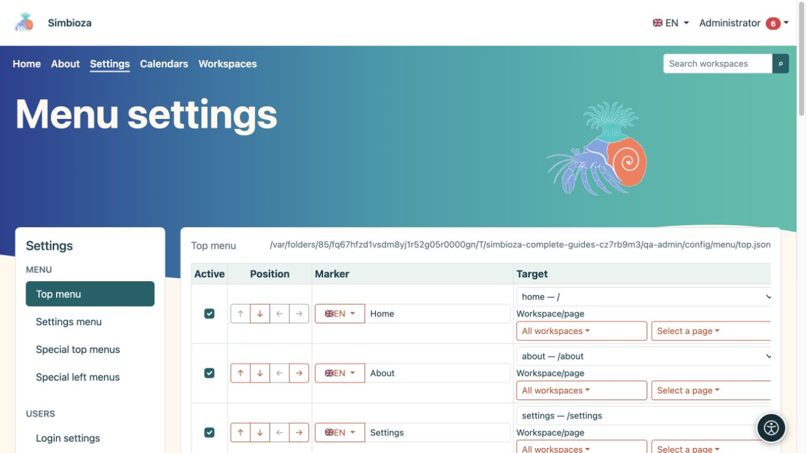

# Configurar los menús de Simbioza

> Las capturas de pantalla muestran la interfaz en inglés.

Los menús ayudan a las personas a encontrar contenido y herramientas disponibles. **Cambiar un menú no cambia el permiso para acceder a su destino.** Establezca quién puede leer o editar el contenido primero y luego agregue el enlace.

**Audiencia:** el administrador del sitio edita los menús de toda la instalación. Un administrador de espacio de trabajo puede editar los menús especiales de su propio espacio de trabajo cuando tiene su permiso de administración.

*El menú superior tiene su propio formulario, mientras que la columna de la izquierda abre otros tipos de menú.*

## Elija el menú correcto

En **Configuración → Menú**, el administrador elige:

| Entrada | que cambia |
|---|---|
| Menú superior | Navegación principal compartida, como Inicio, Acerca de, Calendarios y Espacios de trabajo. |
| Menú de configuración | Navegación entre configuraciones administrativas. No otorga a los usuarios comunes acceso a esas configuraciones. |
| Menús superiores especiales | Navegación principal en pantallas seleccionadas o dentro de espacios de trabajo seleccionados. |
| Menús especiales de la izquierda | Un bloque adicional de enlaces en la barra lateral en una parte seleccionada de la aplicación. No es el árbol de páginas del espacio de trabajo. |

**Resultado:** cambias la parte seleccionada de navegación. Guardar el menú superior no guarda también un menú izquierdo abierto en otro lugar.

## Comience con un cambio

1. Abra el menú correspondiente y lea los elementos existentes.
2. Agregue un enlace claro o reposicione un elemento existente.
3. Elija su botón **Guardar configuración de menú** o **Guardar este menú**.
4. Abra la parte de la aplicación donde debería aparecer y prueba el enlace.
5. Repita con un usuario normal y, para contenido público, sin iniciar sesión.

Comience con [un elemento y sus traducciones](izbornici-stavke_es.md). Utilice [menús especiales](izbornici-podrucja_es.md) para una navegación diferente dentro de un espacio de trabajo. [Visibilidad y permisos](izbornici-vidljivost_es.md) explica por qué los enlaces no son necesariamente visibles para todos los visitantes.

La apariencia, los colores, la ubicación de la navegación y la visualización de los íconos disponibles pertenecen al tema. La edición del texto del menú es independiente de la edición del tema; ver [temas](teme_es.md).

Si falla al guardar o el formulario ha estado abierto durante mucho tiempo, vuelva a abrirlo antes de realizar el cambio. Guardar en otra pestaña puede invalidar la confirmación de seguridad anterior. Evite repetir cada acción en varias pestañas.
