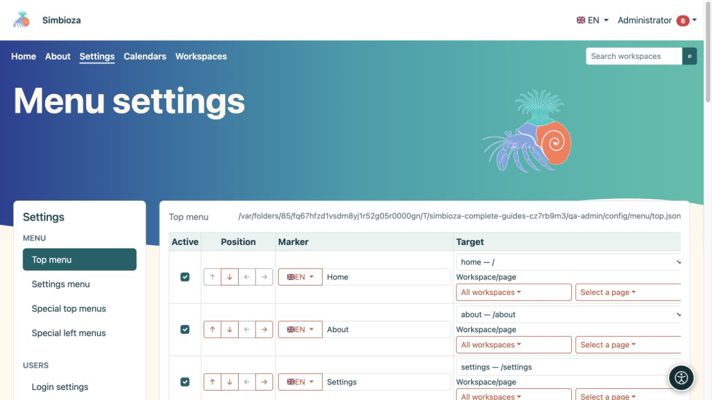

# Configurer les menus de Simbioza

> Les captures d’écran présentent l’interface en anglais.

Les menus aident les utilisateurs à trouver le contenu et les outils disponibles. **Modifier un menu ne change pas le droit d’accès à sa destination.** Définissez d’abord qui peut lire ou modifier le contenu, puis ajoutez le lien.

**Public concerné :** l’administrateur du site modifie les menus communs à toute l’installation. Le responsable d’un espace de travail peut modifier les menus spécifiques de son espace s’il dispose du droit de gestion correspondant.

*Le menu supérieur dispose de son propre formulaire ; la colonne de gauche ouvre les autres types de menus.*

## Choisir le bon menu

Dans **Paramètres → Menu**, l’administrateur choisit :

| Entrée | Ce qu’elle modifie |
|---|---|
| Menu supérieur | Navigation principale commune, par exemple Accueil, À propos, Calendriers et Espaces de travail. |
| Menu des paramètres | Navigation entre les paramètres d’administration. Il ne donne pas aux utilisateurs ordinaires le droit d’accéder à ces paramètres. |
| Menus supérieurs spécifiques | Navigation principale sur certains écrans ou dans certains espaces de travail. |
| Menus de gauche spécifiques | Bloc supplémentaire de liens dans la barre latérale d’une partie choisie de l’application. Ce bloc est distinct de l’arborescence des pages de l’espace de travail. |

**Résultat :** vous modifiez la partie sélectionnée de la navigation. Enregistrer le menu supérieur n’enregistre pas également un menu de gauche ouvert ailleurs.

## Commencer par une modification

1. Ouvrez le menu voulu et consultez les éléments existants.
2. Ajoutez un lien explicite ou déplacez un élément existant.
3. Choisissez le bouton **Enregistrer la configuration du menu** ou **Enregistrer ce menu**.
4. Ouvrez la partie de l’application où il doit apparaître et vérifiez le lien.
5. Recommencez avec un utilisateur ordinaire et, pour le contenu public, sans vous connecter.

Commencez par [un élément et ses traductions](izbornici-stavke_fr.md). Utilisez les [menus spécifiques](izbornici-podrucja_fr.md) pour adapter la navigation dans un espace de travail. [Visibilité et droits](izbornici-vidljivost_fr.md) explique pourquoi les liens ne sont pas nécessairement visibles par tous les visiteurs.

L’apparence, les couleurs, la position de la navigation et l’affichage des icônes disponibles relèvent du thème. La modification du texte d’un menu est distincte de celle du thème ; consultez les [thèmes](teme_fr.md).

Si l’enregistrement échoue ou si le formulaire est ouvert depuis longtemps, rouvrez-le avant de faire la modification. Un enregistrement dans un autre onglet peut invalider l’ancienne confirmation de sécurité. Évitez de répéter chaque action dans plusieurs onglets.
