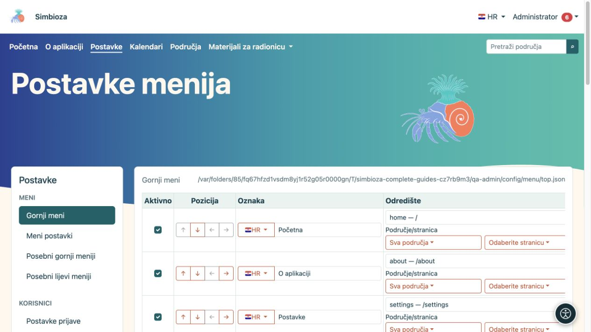

# Podesite izbornike Simbioze

Izbornici pomažu ljudima pronaći sadržaj i dostupne alate. **Promjena izbornika ne mijenja pravo pristupa sadržaju.** Najprije odredite tko smije čitati ili uređivati odredište, a zatim dodajte poveznicu.

**Za koga:** administrator uređuje izbornike cijele instalacije. Upravitelj područja uređuje samo posebne izbornike svojeg područja, ako ima pravo upravljanja tim područjem.

*Gornji meni ima zaseban obrazac, a lijevi stupac vodi na druge vrste izbornika.*

## Odaberite pravi izbornik

U **Postavke → Meni** administrator bira:

| Stavka | Što mijenja |
|---|---|
| Gornji meni | Zajedničku glavnu navigaciju, primjerice Početna, O aplikaciji, Kalendari i Područja. |
| Meni postavki | Navigaciju administratorskih postavki. Ne daje pristup postavkama običnom korisniku. |
| Posebni gornji meniji | Glavnu navigaciju samo na odabranim ekranima ili u područjima. |
| Posebni lijevi meniji | Dodatni bočni blok poveznica na odabranom dijelu aplikacije. To nije stablo stranica područja. |

**Rezultat:** mijenjate točno odabrani dio navigacije. Spremanje gornjeg menija ne sprema istodobno otvoreni lijevi meni.

## Krenite jednostavno

1. Otvorite odgovarajući izbornik i pročitajte postojeće stavke.
2. Dodajte jednu jasnu poveznicu ili presložite postojeću.
3. Odaberite pripadajući gumb **Spremi konfiguraciju menija** ili **Spremi ovaj meni**.
4. Otvorite dio aplikacije na kojem se izbornik treba prikazati i provjerite poveznicu.
5. Ponovite provjeru običnim korisnikom i, ako je sadržaj javan, bez prijave.

Za početak pripremite [jednu stavku i njezine prijevode](izbornici-stavke_hr.md). Za drukčiju navigaciju pojedinog područja koristite [posebne izbornike](izbornici-podrucja_hr.md). [Vidljivost i ovlasti](izbornici-vidljivost_hr.md) objašnjavaju zašto se neke poveznice ne vide svim korisnicima.

Izgled, boje, položaj navigacije i prikaz raspoloživih ikona ovise o temi. Uređivanje teksta izbornika nije uređivanje teme; za to koristite [teme](teme_hr.md).

Ako spremanje ne uspije ili je obrazac dugo bio otvoren, ponovno ga otvorite prije izmjene. Spremanje iz druge kartice može učiniti staru sigurnosnu potvrdu nevažećom. Nemojte odmah ponavljati sve radnje u više kartica.
