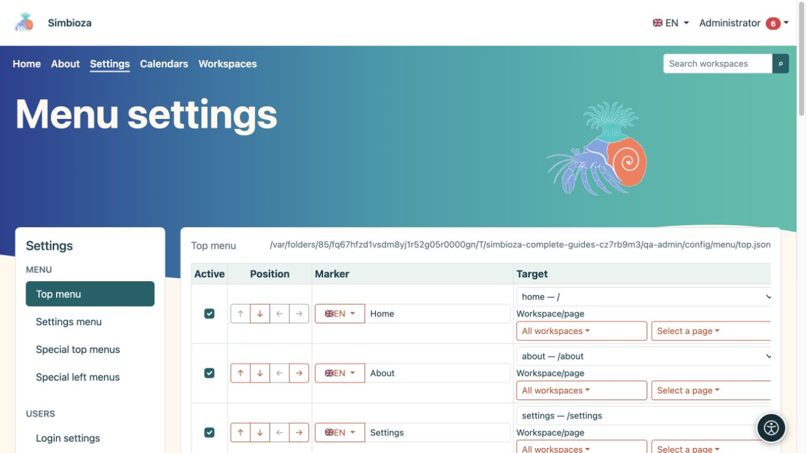

# Configura i menu di Simbioza

> Le schermate mostrano l’interfaccia in inglese.

I menu aiutano le persone a trovare i contenuti e gli strumenti disponibili. **La modifica di un menu non modifica l'autorizzazione ad accedere alla sua destinazione.** Imposta prima chi può leggere o modificare il contenuto, quindi aggiungi il collegamento.

**Destinatari:** l'amministratore del sito modifica i menu dell'intera installazione. Un responsabile di un'area di lavoro può modificare i menu speciali della propria area se dispone dell'autorizzazione di gestione.

*Il menu in alto ha un proprio modulo, mentre la colonna di sinistra apre altri tipi di menu.*

## Scegli il menù corretto

In **Impostazioni → Menu**, l'amministratore sceglie:

| Voce | Cosa cambia |
|---|---|
| Menu superiore | Navigazione principale condivisa, ad esempio Home, Informazioni, Calendari e Aree di lavoro. |
| Menu Impostazioni | Navigazione tra le impostazioni amministrative. Non garantisce agli utenti ordinari l'accesso a tali impostazioni. |
| Menu superiori speciali | Navigazione principale nelle schermate selezionate o all'interno delle aree di lavoro selezionate. |
| Menu laterali sinistri speciali | Un ulteriore blocco di collegamenti della barra laterale in una parte selezionata dell'applicazione. Non è l'albero delle pagine dell'area di lavoro. |

**Risultato:** cambi la parte selezionata della navigazione. Il salvataggio del menu in alto non salva anche il menu di sinistra aperto altrove.

## Inizia con un cambiamento

1. Apri il menu appropriato e leggi gli elementi esistenti.
2. Aggiungi un collegamento chiaro o riposiziona un elemento esistente.
3. Scegli il pulsante **Salva configurazione menu** o **Salva questo menu**.
4. Apri la parte dell'applicazione in cui dovrebbe apparire e prova il collegamento.
5. Ripetere con un utente normale e, per i contenuti pubblici, senza effettuare l'accesso.

Inizia con [un elemento e le sue traduzioni](izbornici-stavke_it.md). Utilizzare i [menu speciali](izbornici-podrucja_it.md) per una navigazione diversa all'interno di un'area di lavoro. [Visibilità e autorizzazioni](izbornici-vidljivost_it.md) spiega perché i collegamenti non sono necessariamente visibili a tutti i visitatori.

L'aspetto, i colori, il posizionamento della navigazione e la visualizzazione delle icone disponibili fanno parte del tema. La modifica del testo del menu è separata dalla modifica del tema; vedere [temi](teme_it.md).

Se il salvataggio fallisce o il modulo è rimasto aperto per molto tempo, riaprilo prima di apportare la modifica. Il salvataggio in un'altra scheda può invalidare la conferma di sicurezza precedente. Evita di ripetere ogni azione in più schede.
