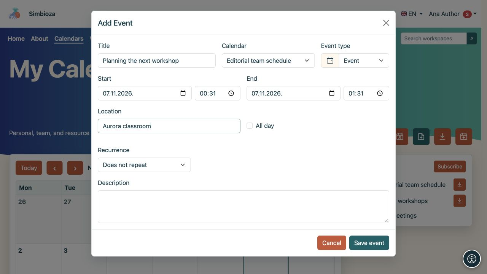

# Einen Termin hinzufügen oder ändern

> Die Bildschirmaufnahmen zeigen die englische Benutzeroberfläche.

[Kalender](kalendari_de.md)

**Für:** einen Benutzer mit Schreibzugriff auf den ausgewählten Kalender. Ein gewöhnliches Ereignis zeichnet einen Zeitpunkt in einem Zeitplan auf. Um Personen einzuladen, Antworten anzufordern oder eine Ressource über einen Genehmigungsprozess zu reservieren, verwenden Sie [Besprechungen](sastanci_de.md).

## Erstellen Sie ein einzelnes Ereignis

1. Öffnen Sie **Kalender** und wählen Sie **Ereignis hinzufügen**.
2. Wählen Sie den **Kalender**. Es werden nur Kalender angeboten, in die Sie schreiben dürfen. Dadurch wird auch die Zielgruppe ausgewählt. Überprüfen Sie daher, ob diese persönlich, intern oder öffentlich ist.
3. Geben Sie einen eindeutigen **Titel** ein.
4. Legen Sie **Start** und **Ende** fest. Das Ende darf nicht vor dem Anfang liegen. Aktivieren Sie **Ganztägig** für eine Veranstaltung ohne Uhrzeit und wählen Sie deren Daten aus.
5. Fügen Sie optional einen Ort, eine Beschreibung und einen Veranstaltungstyp hinzu.
6. Speichern. Überprüfen Sie das Ereignis im richtigen Kalenderzeitraum.

**Ergebnis:** Personen, die den Kalender lesen können, können den Termin sehen. Die Beschreibung und der Ort richten sich an dieselbe Zielgruppe. Geben Sie keine internen Details in einen öffentlichen Kalender ein. Farbe und Typ helfen bei der Identifizierung eines Ereignisses, steuern jedoch nicht den Zugriff.

<figure class="my-4">

<figcaption>Wählen Sie den Kalender, den Titel und die Zeiten. Sie können nur in einen Kalender schreiben, den Sie ändern dürfen.</figcaption>
</figure>

## Wiederholung einstellen

Aktivieren Sie die Wiederholung im Veranstaltungsformular für eine regelmäßige Zusage.

1. Wählen Sie tägliche, wöchentliche, monatliche oder jährliche Wiederholung.
2. Wählen Sie ein Ende: **Kein Ende**, **Nach mehreren Vorkommen** oder **Bis zum Datum**. Geben Sie die Nummer oder das Datum für die letzten beiden Optionen ein.
3. Merken und schauen Sie sich die nächsten Termine an.

**Ergebnis:** Ein sich wiederholendes Ereignis führt zu mehreren Vorkommen im Zeitplan. Überprüfen Sie vor dem Speichern Tag, Uhrzeit und Ende der Serie.

<figure class="my-4">

<figcaption>Jede Woche und Kein Ende sind ausgewählt. Um die Serie einzuschränken, wählen Sie eine Anzahl von Vorkommen oder ein Enddatum.</figcaption>
</figure>

## Bearbeiten oder löschen Sie ein Ereignis

Öffnen Sie ein Ereignis im Kalender. Mit Schreibzugriff können Sie die Felder ändern und speichern oder die Löschaktion auswählen. Überprüfen Sie den Titel und den Kalender, bevor Sie den Löschvorgang bestätigen.

**Bei einem sich wiederholenden Ereignis wirken sich Änderungen und Löschungen auf die gesamte Serie aus.** Das Formular unterscheidet das von Ihnen ausgewählte Vorkommnis vom ursprünglichen Serienanfang. Gehen Sie nicht davon aus, dass sich die Änderung nur auf das angezeigte Datum auswirkt.

Wenn es sich bei dem Datensatz um eine Besprechung mit Teilnehmern oder eine Reservierung handelt, befolgen Sie die einzelnen Aktionen im [Besprechungsleitfaden](sastanci_de.md). Für gewöhnliche Veranstaltungen und Meetings gilt nicht der gleiche Antwort- und Stornierungsprozess.

## Ich kann nicht speichern

- Fehlender Titel oder ungültige Daten: Korrigieren Sie das markierte Feld und speichern Sie erneut.
- Kalender fehlt in der Liste: Überprüfen Sie den Schreibzugriff oder erstellen Sie [Ihren persönlichen Kalender](kalendari-osobni_de.md).
- Keine Bearbeitungsaktion: Sie haben wahrscheinlich nur Lesezugriff. Bitten Sie den Kalendereigentümer, Ihre Berechtigungen zu überprüfen.
- Ereignis fehlt nach dem Speichern: Aktivieren Sie das Kontrollkästchen für Zeitraum und Kalender in [der Anzeigeanleitung](kalendari-pregled_de.md).
