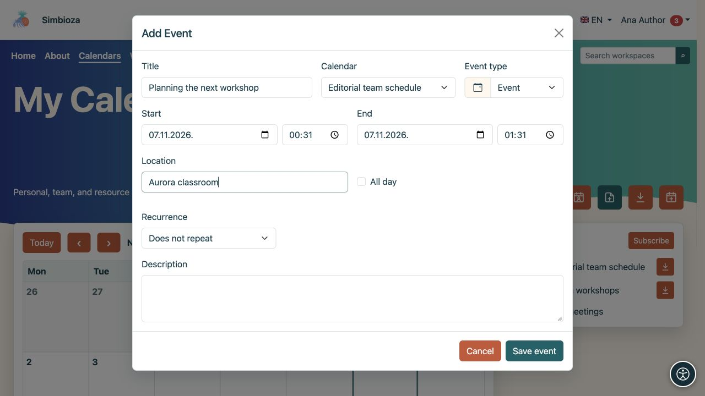

# Add or change an event

[Calendars](kalendari_en.md)

**For:** a user with write access to the selected calendar. An ordinary event records a time in a schedule. To invite people, request responses or reserve a resource through an approval process, use [Meetings](sastanci_en.md).

## Create a single event

1. Open **Calendars** and select **Add event**.
2. Choose the **Calendar**. Only calendars you may write to are offered. This also chooses the audience, so check whether it is personal, internal or public.
3. Enter a clear **Title**.
4. Set the **Start** and **End**. The end must not precede the start. Enable **All day** for an event without hours and choose its dates.
5. Optionally add a location, description and event type.
6. Save. Check the event in the correct calendar period.

**Result:** people who can read the calendar can see the appointment. The description and location have the same audience; do not enter internal details in a public calendar. Colour and type help identify an event but do not control access.

<figure class="my-4">

<figcaption>Choose the calendar, title and times. You can write only to a calendar you are allowed to change.</figcaption>
</figure>

## Set repetition

Enable repetition in the event form for a regular commitment.

1. Choose daily, weekly, monthly or yearly repetition.
2. Choose an ending: **No end**, **After a number of occurrences** or **Until date**. Enter the number or date for the last two choices.
3. Save and inspect the next few dates.

**Result:** one repeating event produces several occurrences in the schedule. Check the day, time and end of the series before saving.

<figure class="my-4">

<figcaption>Every week and No end are selected. To limit the series, choose a number of occurrences or an end date.</figcaption>
</figure>

## Edit or delete an event

Open an event in the calendar. With write access, change its fields and save or select the delete action. Check its title and calendar before confirming deletion.

**For a repeating event, changes and deletion affect the whole series.** The form distinguishes the occurrence you selected from the original series start. Do not assume the change affects only the displayed date.

If the record is a meeting with participants or a reservation, follow its separate actions in [the meeting guide](sastanci_en.md). Ordinary events and meetings do not have the same response and cancellation process.

## I cannot save

- Missing title or invalid dates: correct the highlighted field and save again.
- Calendar missing from the list: check write access or create [your own personal calendar](kalendari-osobni_en.md).
- No edit action: you probably have read access only. Ask the calendar owner to check your permissions.
- Event missing after saving: check the period and calendar checkbox in [the viewing guide](kalendari-pregled_en.md).
