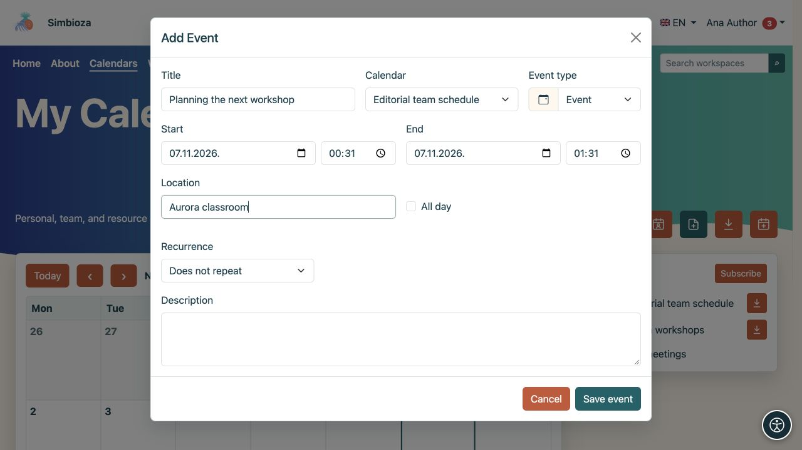

# Añadir o modificar un evento

> Las capturas de pantalla muestran la interfaz en inglés.

[Calendarios](kalendari_es.md)

**Para:** un usuario con acceso de escritura al calendario seleccionado. Un evento ordinario registra un tiempo en un cronograma. Para invitar personas, solicitar respuestas o reservar un recurso a través de un proceso de aprobación, utilice [Reuniones](sastanci_es.md).

## Crear un solo evento

1. Abra **Calendarios** y seleccione **Agregar evento**.
2. Elija el **Calendario**. Sólo se ofrecen calendarios en los que puede escribir. Esto también elige la audiencia, así que verifica si es personal, interna o pública.
3. Introduzca un **Título** claro.
4. Establezca **Inicio** y **Fin**. El final no debe preceder al comienzo. Habilite **Todo el día** para un evento sin horario y elija sus fechas.
5. Opcionalmente, agregue una ubicación, descripción y tipo de evento.
6. Guardar. Consulte el evento en el período del calendario correcto.

**Resultado:** las personas que puedan leer el calendario podrán ver la cita. La descripción y la ubicación tienen el mismo público; no introduzca detalles internos en un calendario público. El color y el tipo ayudan a identificar un evento pero no controlan el acceso.

<figure class="my-4">

<figcaption>Elija el calendario, título y horarios. Sólo puede escribir en un calendario que pueda cambiar.</figcaption>
</figure>

## Establecer repetición

Habilite la repetición en el formulario de evento para un compromiso regular.

1. Elija repetición diaria, semanal, mensual o anual.
2. Elija un final: **Sin fin**, **Después de varias apariciones** o **Hasta la fecha**. Ingrese el número o la fecha para las dos últimas opciones.
3. Guarde e inspeccione las próximas fechas.

**Resultado:** un evento repetido produce varias ocurrencias en el programa. Consulte el día, hora y final de la serie antes de guardar.

<figure class="my-4">

<figcaption>Se seleccionan Cada semana y Sin fin. Para limitar la serie, elija una cantidad de ocurrencias o una fecha de finalización.</figcaption>
</figure>

## Editar o eliminar un evento

Abrir un evento en el calendario. Con acceso de escritura, cambie sus campos y guarde o seleccione la acción de eliminación. Consulte su título y calendario antes de confirmar la eliminación.

**Para un evento que se repite, los cambios y la eliminación afectan a toda la serie.** El formulario distingue la ocurrencia que seleccionó del inicio de la serie original. No asuma que el cambio afecta sólo a la fecha mostrada.

Si el registro es una reunión con participantes o una reserva, siga sus acciones por separado en [la guía de la reunión](sastanci_es.md). Los eventos y reuniones ordinarias no tienen el mismo proceso de respuesta y cancelación.

## no puedo guardar

- Título faltante o fechas no válidas: corrija el campo resaltado y guárdelo nuevamente.
- Falta el calendario en la lista: verifique el acceso de escritura o cree [su propio calendario personal](kalendari-osobni_es.md).
- Sin acción de edición: probablemente solo tenga acceso de lectura. Pídale al propietario del calendario que verifique sus permisos.
- Falta el evento después de guardarlo: marque la casilla de período y calendario en [la guía de visualización](kalendari-pregled_es.md).
