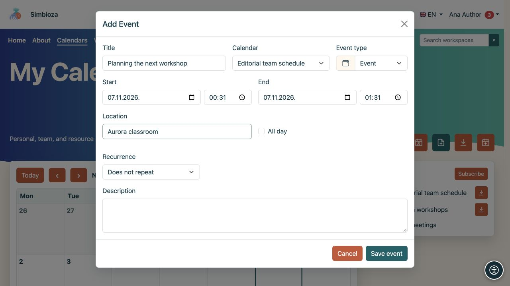

# Ajouter ou modifier un événement

> Les captures d’écran présentent l’interface en anglais.

[Calendriers](kalendari_fr.md)

**Pour :** un utilisateur disposant d'un accès en écriture au calendrier sélectionné. Un événement ordinaire enregistre une heure dans un planning. Pour inviter des personnes, demander des réponses ou réserver une ressource via un processus d'approbation, utilisez [Réunions](sastanci_fr.md).

## Créer un seul événement

1. Ouvrez **Calendriers** et sélectionnez **Ajouter un événement**.
2. Choisissez le **Calendrier**. Seuls les calendriers sur lesquels vous pouvez écrire sont proposés. Celui-ci choisit également le public, alors vérifiez s'il est personnel, interne ou public.
3. Saisissez un **Titre** clair.
4. Définissez **Début** et **Fin**. La fin ne doit pas précéder le début. Activez **Toute la journée** pour un événement sans heures et choisissez ses dates.
5. Ajoutez éventuellement un emplacement, une description et un type d'événement.
6. Sauvegarder. Vérifiez l'événement dans la période calendaire correcte.

**Résultat :** les personnes capables de lire le calendrier peuvent voir le rendez-vous. La description et le lieu ont la même audience ; ne saisissez pas de détails internes dans un calendrier public. La couleur et le type aident à identifier un événement mais ne contrôlent pas l'accès.

<figure class="my-4">

<figcaption>Choisissez le calendrier, le titre et les horaires. Vous ne pouvez écrire que sur un calendrier que vous êtes autorisé à modifier.</figcaption>
</figure>

## Définir la répétition

Activer la répétition dans le formulaire d'événement pour un engagement régulier.

1. Choisissez une répétition quotidienne, hebdomadaire, mensuelle ou annuelle.
2. Choisissez une fin : **Sans fin**, **Après un certain nombre d'occurrences** ou **Jusqu'à la date**. Entrez le numéro ou la date pour les deux derniers choix.
3. Enregistrez et inspectez les prochaines dates.

**Résultat :** un événement répétitif produit plusieurs occurrences dans le planning. Vérifiez le jour, l'heure et la fin de la série avant de sauvegarder.

<figure class="my-4">

<figcaption>Chaque semaine et sans fin sont sélectionnés. Pour limiter la série, choisissez un nombre d'occurrences ou une date de fin.</figcaption>
</figure>

## Modifier ou supprimer un événement

Ouvrez un événement dans le calendrier. Avec un accès en écriture, modifiez ses champs et enregistrez ou sélectionnez l'action de suppression. Vérifiez son titre et son calendrier avant de confirmer la suppression.

**Pour un événement répétitif, les modifications et la suppression affectent toute la série.** Le formulaire distingue l'occurrence que vous avez sélectionnée du début de la série d'origine. Ne présumez pas que le changement affecte uniquement la date affichée.

Si l'enregistrement est une réunion avec des participants ou une réservation, suivez ses actions distinctes dans [le guide de réunion](sastanci_fr.md). Les événements et réunions ordinaires n’ont pas le même processus de réponse et d’annulation.

## je ne peux pas sauvegarder

- Titre manquant ou dates invalides : corrigez le champ en surbrillance et enregistrez à nouveau.
- Calendrier manquant dans la liste : vérifiez l'accès en écriture ou créez [votre propre calendrier personnel](kalendari-osobni_fr.md).
- Aucune action de modification : vous disposez probablement d'un accès en lecture uniquement. Demandez au propriétaire du calendrier de vérifier vos autorisations.
- Événement manquant après l'enregistrement : cochez la case période et calendrier dans [le guide de visualisation](kalendari-pregled_fr.md).
