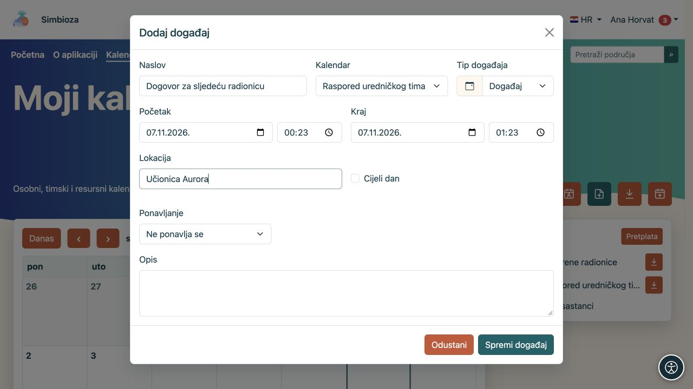
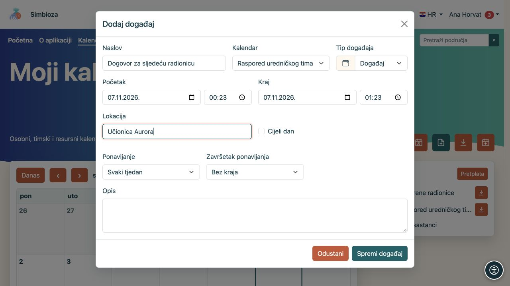
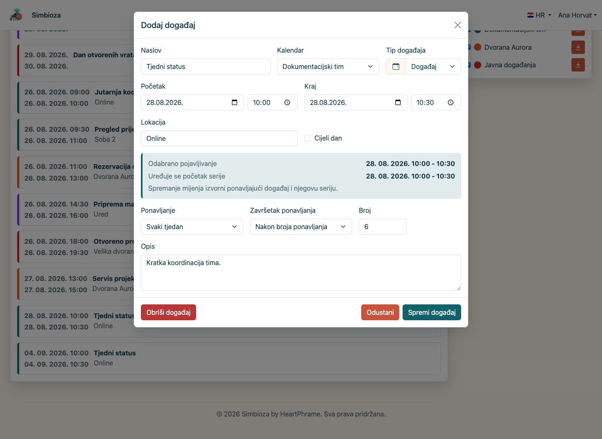

# Dodajte ili promijenite događaj

[Kalendari](kalendari_hr.md)

**Za koga:** za korisnika s pravom pisanja u odabrani kalendar. Informativni događaj upisuje termin u raspored. Ako trebate pozvati osobe, tražiti odgovore ili rezervirati resurs kroz postupak odobravanja, koristite [Sastanke](sastanci_hr.md).

## Unesite jedan događaj

1. Otvorite **Kalendari** i odaberite **Dodaj događaj**.
2. Odaberite **Kalendar**. Ponuđeni su samo kalendari u koje smijete pisati. Time birate i publiku događaja, zato provjerite jeste li odabrali osobni, interni ili javni kalendar.
3. Upišite jasan **Naslov**.
4. Odredite **Početak** i **Kraj**. Kraj ne smije biti prije početka. Za događaj bez satnice uključite **Cijeli dan** i odaberite datume.
5. Po potrebi dodajte lokaciju, opis i tip događaja.
6. Spremite. Provjerite događaj u odgovarajućem razdoblju kalendara.

**Rezultat:** termin vide osobe koje smiju čitati kalendar. Opis i lokacija dijele istu publiku; ne upisujte interni podatak u javni kalendar. Boja i vrsta pomažu prepoznati događaj, ali ne određuju prava pristupa.

<figure class="my-4">

<figcaption>Odaberite kalendar, naslov i vrijeme. Pisanje je moguće samo u kalendar koji smijete mijenjati.</figcaption>
</figure>

## Postavite ponavljanje

Za redovitu obvezu uključite ponavljanje u obrascu događaja.

1. Odaberite dnevno, tjedno, mjesečno ili godišnje ponavljanje.
2. Odaberite završetak: **Bez kraja**, **Nakon broja ponavljanja** ili **Do datuma**. Za posljednje dvije mogućnosti unesite broj odnosno datum.
3. Spremite i pregledajte nekoliko sljedećih datuma.

**Rezultat:** jedan ponavljajući događaj daje više pojavljivanja u rasporedu. Prije spremanja provjerite točan dan, sat i završetak serije.

<figure class="my-4">

<figcaption>Odabrano je ponavljanje Svaki tjedan i završetak Bez kraja. Za ograničenu seriju odaberite broj ponavljanja ili datum završetka.</figcaption>
</figure>

## Uredite ili obrišite događaj

Otvorite događaj u kalendaru. Ako imate pisanje, izmijenite podatke i spremite ih ili odaberite radnju brisanja. Prije potvrde brisanja provjerite naslov i kalendar.

**Kod ponavljanja izmjena i brisanje vrijede za cijelu seriju.** Obrazac razlikuje kliknuto pojavljivanje od početka izvorne serije. Nemojte očekivati da promjena utječe samo na jedan prikazani datum.

<figure class="my-4">

<figcaption>Jasno su odvojeni odabrano pojavljivanje, početak serije te akcije spremanja i brisanja.</figcaption>
</figure>

Ako je otvoreni zapis sastanak sa sudionicima ili rezervacijom, pratite njegove zasebne radnje iz [vodiča za sastanke](sastanci_hr.md). Običan događaj i sastanak nemaju isti postupak odgovaranja i otkazivanja.

## Ne mogu spremiti

- Nedostaje naslov ili su datumi nevaljani: ispravite označeno polje i ponovite spremanje.
- Kalendar nije ponuđen: provjerite pravo pisanja ili napravite [vlastiti osobni kalendar](kalendari-osobni_hr.md).
- Radnja izmjene nije prikazana: vjerojatno imate samo čitanje. Zamolite vlasnika kalendara da provjeri prava.
- Događaj se ne vidi nakon spremanja: provjerite razdoblje i kvačicu kalendara u [pregledu](kalendari-pregled_hr.md).
