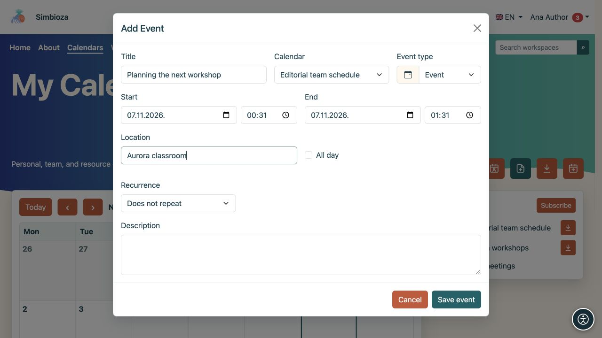

# Aggiungi o modifica un evento

> Le schermate mostrano l’interfaccia in inglese.

[Calendari](kalendari_it.md)

**Per:** un utente con accesso in scrittura al calendario selezionato. Un evento ordinario registra un orario in una pianificazione. Per invitare persone, richiedere risposte o prenotare una risorsa tramite un processo di approvazione, utilizzare [Riunioni](sastanci_it.md).

## Crea un singolo evento

1. Apri **Calendari** e seleziona **Aggiungi evento**.
2. Scegli il **Calendario**. Vengono offerti solo i calendari a cui puoi scrivere. Questo sceglie anche il pubblico, quindi controlla se è personale, interno o pubblico.
3. Inserisci un **Titolo** chiaro.
4. Imposta **Inizio** e **Fine**. La fine non deve precedere l'inizio. Abilita **Tutto il giorno** per un evento senza orari e scegli le sue date.
5. Facoltativamente, aggiungi una posizione, una descrizione e un tipo di evento.
6. Salva. Controlla l'evento nel periodo corretto del calendario.

**Risultato:** le persone che possono leggere il calendario possono vedere l'appuntamento. La descrizione e la posizione hanno lo stesso pubblico; non inserire dettagli interni in un calendario pubblico. Il colore e il tipo aiutano a identificare un evento ma non controllano l'accesso.

<figure class="my-4">

<figcaption>Scegli il calendario, il titolo e gli orari. Puoi scrivere solo su un calendario che sei autorizzato a modificare.</figcaption>
</figure>

## Imposta la ripetizione

Abilita la ripetizione nel modulo evento per un impegno regolare.

1. Scegli la ripetizione giornaliera, settimanale, mensile o annuale.
2. Scegli un finale: **Nessuna fine**, **Dopo un certo numero di occorrenze** o **Fino alla data**. Immettere il numero o la data per le ultime due scelte.
3. Salva e controlla le prossime date.

**Risultato:** un evento ripetuto produce diverse occorrenze nella pianificazione. Controllare il giorno, l'ora e la fine della serie prima di salvare.

<figure class="my-4">

<figcaption>Sono selezionati Ogni settimana e Nessuna fine. Per limitare la serie, scegli un numero di occorrenze o una data di fine.</figcaption>
</figure>

## Modifica o elimina un evento

Apri un evento nel calendario. Con accesso in scrittura, modifica i suoi campi e salva o seleziona l'azione di eliminazione. Controllane il titolo e il calendario prima di confermare l'eliminazione.

**Per un evento ricorrente, le modifiche e l'eliminazione influiscono sull'intera serie.** Il modulo distingue l'occorrenza selezionata dall'inizio della serie originale. Non dare per scontato che la modifica influisca solo sulla data visualizzata.

Se il record è una riunione con partecipanti o una prenotazione, seguire le azioni separate nella [guida alla riunione](sastanci_it.md). Gli eventi e le riunioni ordinarie non hanno lo stesso processo di risposta e cancellazione.

## Non posso salvare

- Titolo mancante o date non valide: correggi il campo evidenziato e salva nuovamente.
- Calendario mancante dall'elenco: controlla l'accesso in scrittura o crea [il tuo calendario personale](kalendari-osobni_it.md).
- Nessuna azione di modifica: probabilmente hai solo accesso in lettura. Chiedi al proprietario del calendario di verificare le tue autorizzazioni.
- Evento mancante dopo il salvataggio: seleziona la casella di controllo del periodo e del calendario nella [guida alla visualizzazione](kalendari-pregled_it.md).
