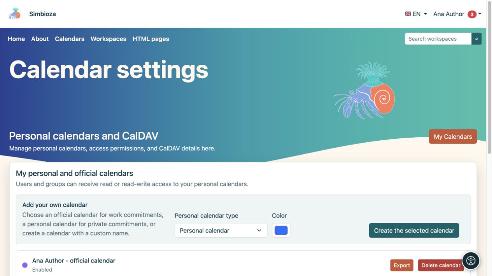
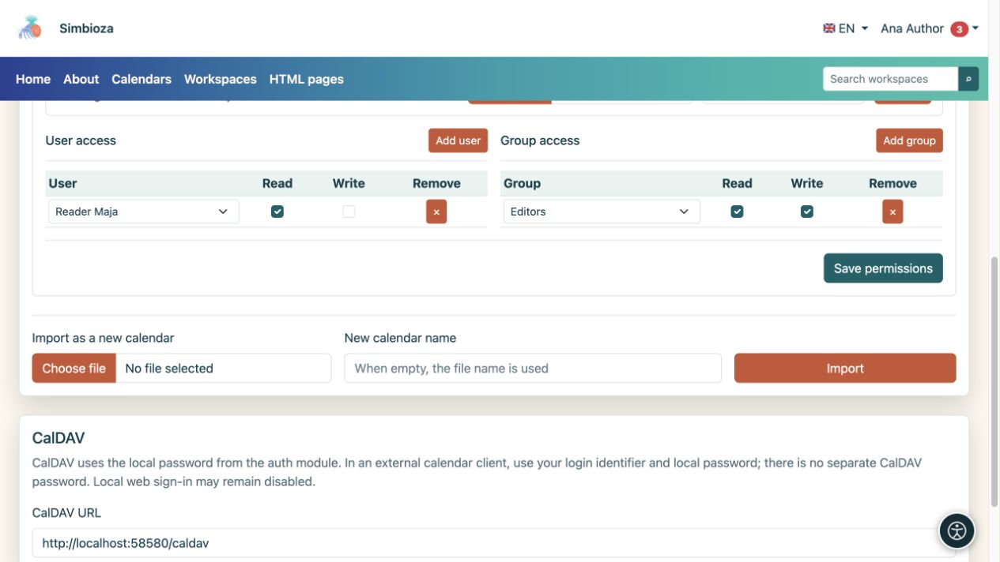

# Einen persönlichen Kalender erstellen und teilen

> Die Bildschirmaufnahmen zeigen die englische Benutzeroberfläche.

[Kalender](kalendari_de.md)

**Für:** einen angemeldeten Benutzer, der einen eigenen Zeitplan benötigt. Sie benötigen keine Mitgliedschaft in der Gruppe „Kalender“. Öffnen Sie **Kalender → Kalendereinstellungen**; der Bildschirm heißt **Persönliche Kalender und CalDAV**.

## Erstellen Sie Ihren Kalender

1. Wählen Sie unter **Eigenen Kalender hinzufügen** den Typ **Persönlicher Kalender** aus.
2. Geben Sie für einen benutzerdefinierten Typ ein **eindeutiges Namenssuffix** ein, um mehrere eigene Kalender zu unterscheiden.
3. Wählen Sie eine Farbe.
4. Wählen Sie **Den ausgewählten Kalender erstellen**.
5. Öffnen Sie die Hauptansicht, wählen Sie den Kalender und [ein Testereignis hinzufügen](kalendari-dogadaji_de.md).

**Ergebnis:** Ihr persönlicher oder geschäftlicher Kalender wird erstellt. Ein persönlicher Kalender wird nicht automatisch erstellt; Erstellen Sie bei Bedarf eine. Sein Name oder das Wort „Werk“ gewähren anderen Personen keinen Zugang.

<figure class="my-4">

<figcaption>Wählen Sie einen verfügbaren Typ und eine verfügbare Farbe. Ein bereits erstellter Typ ist möglicherweise für eine andere Erstellung nicht verfügbar.</figcaption>
</figure>

## Erteilen Sie einer Person oder Gruppe Lese- oder Schreibzugriff

Öffnen Sie **Import- und Zugriffsrechte** auf der Karte Ihres Kalenders.

1. Suchen Sie unter **Benutzerzugriff** eine Person und fügen Sie sie hinzu, oder wählen Sie unter **Gruppenzugriff** eine Gruppe aus.
2. Aktivieren Sie **Lesen**, damit sie den Zeitplan anzeigen können.
3. Aktivieren Sie **Schreiben** nur, wenn sie Ereignisse hinzufügen, ändern und löschen dürfen.
4. Wählen Sie **Berechtigungen speichern**.
5. Bitten Sie den Empfänger, den Kalender mit seinem eigenen Konto zu öffnen. Möglicherweise müssen sie es unter [Abonnements](kalendari-pregled_de.md) aktivieren.

**Ergebnis:** Sie geben den Kalender mit den ausgewählten Berechtigungen frei, nicht Ihr Konto. Geben Sie Ihr Passwort nicht an andere Personen weiter. Die direkten und Gruppenberechtigungen einer Person werden kombiniert: Durch das Entfernen einer Zeile wird der Zugriff nicht widerrufen, der noch über eine andere Gruppe gewährt wurde.

Um eine direkte Erteilung zu entfernen, wählen Sie in dieser Zeile **Entfernen** aus und speichern Sie die Berechtigungen. Fragen Sie den Manager nach einrichtungsweit freigegebenen Kalendern. Event-Schreibzugriff gewährt ihre Einstellungen nicht selbst.

<figure class="my-4">

<figcaption>Maja hat gelesen; die Gruppe „Editoren“ verfügt über Lese- und Schreibzugriff. Bestätigen Sie die Erteilung mit den Berechtigungen zum Speichern.</figcaption>
</figure>

## Importieren, exportieren und löschen Sie Ihren Kalender

- **Export** lädt Ereignisse als ICS herunter.
- **In diesen Kalender importieren** fügt Termine aus einer Datei zum ausgewählten Kalender hinzu. Lesen Sie zuerst die Hinweise zum [Umgang mit vorhandenen Terminen](kalendari-povezivanje_de.md).
- **Als neuen Kalender importieren** erstellt einen separaten Kalender, anstatt ihn zu einem vorhandenen hinzuzufügen.
- **Kalender löschen** entfernt den ausgewählten Kalender. Überprüfen Sie den Namen und exportieren Sie alle erforderlichen Ereignisse, bevor Sie bestätigen. Durch Deaktivieren des Kontrollkästchens „Anzeige“ wird der Zeitplan nur ausgeblendet und ist besser geeignet, wenn Sie ihn vorübergehend nicht sehen möchten.

Informationen zum Verbinden einer anderen Kalenderanwendung finden Sie unter [CalDAV](kalendari-povezivanje_de.md#caldav). Auf dem Profilbildschirm wird kein Passwort angezeigt.
