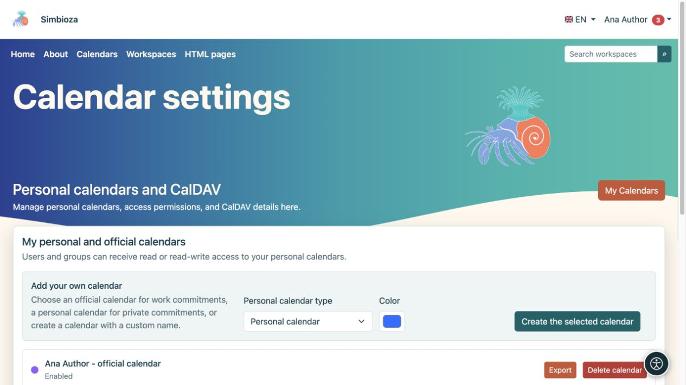
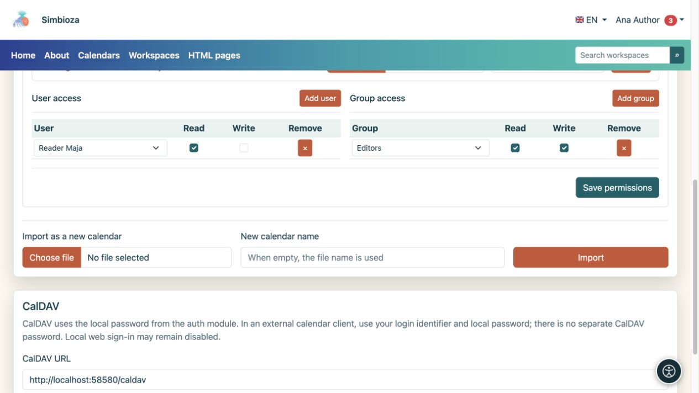

# Create and share a personal calendar

[Calendars](kalendari_en.md)

**For:** a signed-in user who needs their own schedule. You do not need membership in the Calendars group. Open **Calendars → Calendar settings**; the screen is named **Personal calendars and CalDAV**.

## Create your calendar

1. Under **Add your own calendar**, choose the **Personal calendar type**.
2. For a custom type, enter a **Unique name suffix** to distinguish several calendars of your own.
3. Choose a colour.
4. Select **Create the selected calendar**.
5. Open the main view, choose the calendar and [add a trial event](kalendari-dogadaji_en.md).

**Result:** your personal or work calendar is created. A personal calendar is not created automatically; create one when needed. Its name or the word “work” does not grant access to other people.

<figure class="my-4">

<figcaption>Choose an available type and colour. A type you have already created may be unavailable for another creation.</figcaption>
</figure>

## Give a person or group read or write access

Open **Import and access rights** on your calendar's card.

1. Under **User access**, find and add a person, or choose a group under **Group access**.
2. Enable **Read** to let them view the schedule.
3. Enable **Write** only if they may add, change and delete events.
4. Select **Save permissions**.
5. Ask the recipient to open the calendar using their own account; they may need to enable it under [subscriptions](kalendari-pregled_en.md).

**Result:** you share the calendar under the selected permissions, not your account. Do not give other people your password. A person's direct and group permissions combine: removing one row does not revoke access still granted through another group.

To remove a direct grant, select **Remove** on that row and save permissions. Ask the manager about institution-wide shared calendars; event write access does not itself grant their settings.

<figure class="my-4">

<figcaption>Maja has Read; the Editors group has Read and Write. Confirm the grants with Save permissions.</figcaption>
</figure>

## Import, export and delete your calendar

- **Export** downloads events as ICS.
- **Import into this calendar** adds events from a file to the selected calendar; first read about [handling existing events](kalendari-povezivanje_en.md).
- **Import as a new calendar** creates a separate calendar instead of adding to an existing one.
- **Delete calendar** removes the selected calendar. Check its name and export any needed events before confirming. Clearing its display checkbox only hides the schedule and is more suitable if you temporarily do not want to see it.

To connect another calendar application, see [CalDAV](kalendari-povezivanje_en.md#caldav). The profile screen does not display a password.
