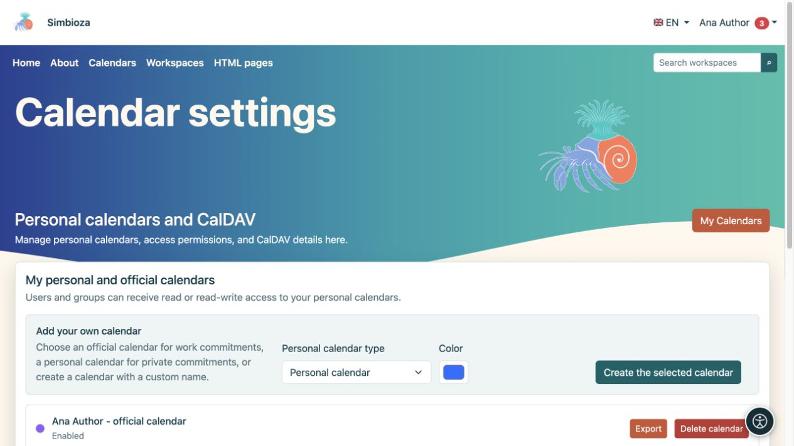
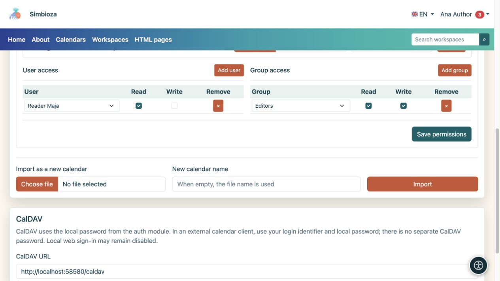

# Crear y compartir un calendario personal

> Las capturas de pantalla muestran la interfaz en inglés.

[Calendarios](kalendari_es.md)

**Para:** un usuario que ha iniciado sesión y necesita su propio horario. No necesita ser miembro del grupo Calendarios. Abra **Calendarios → Configuración del calendario**; la pantalla se llama **Calendarios personales y CalDAV**.

## Crea su calendario

1. En **Agrega su propio calendario**, elige **Tipo de calendario personal**.
2. Para un tipo personalizado, ingrese un **Sufijo de nombre único** para distinguir varios calendarios propios.
3. Elija un color.
4. Seleccione **Crear el calendario seleccionado**.
5. Abra la vista principal, elija el calendario y [agregue un evento de prueba](kalendari-dogadaji_es.md).

**Resultado:** se crea su calendario personal o laboral. Un calendario personal no se crea automáticamente; cree uno cuando sea necesario. Su nombre o la palabra “trabajo” no otorga acceso a otras personas.

<figure class="my-4">

<figcaption>Elija un tipo y color disponible. Es posible que un tipo que ya haya creado no esté disponible para otra creación.</figcaption>
</figure>

## Dar acceso de lectura o escritura a una persona o grupo

Abra **Derechos de importación y acceso** en la tarjeta de su calendario.

1. En **Acceso de usuario**, busque y agregue una persona, o elija un grupo en **Acceso de grupo**.
2. Habilite **Leer** para permitirles ver el cronograma.
3. Habilite **Escribir** solo si pueden agregar, cambiar y eliminar eventos.
4. Seleccione **Guardar permisos**.
5. Pídale al destinatario que abra el calendario usando su propia cuenta; es posible que deban habilitarlo en [suscripciones](kalendari-pregled_es.md).

**Resultado:** compartes el calendario con los permisos seleccionados, no su cuenta. No le des su contraseña a otras personas. Los permisos directos y de grupo de una persona se combinan: eliminar una fila no revoca el acceso aún otorgado a través de otro grupo.

Para eliminar una concesión directa, seleccione **Eliminar** en esa fila y guarde los permisos. Pregúntele al gestor sobre los calendarios compartidos en toda la institución; El acceso de escritura de eventos no otorga por sí solo su configuración.

<figure class="my-4">

<figcaption>Maja ha leído; el grupo Editores tiene Lectura y Escritura. Confirme las concesiones con permisos de Guardar.</figcaption>
</figure>

## Importa, exporta y elimina su calendario

- **Exportar** descarga eventos como ICS.
- **Importar a este calendario** añade eventos de un archivo al calendario seleccionado. Lea primero cómo [gestionar los eventos existentes](kalendari-povezivanje_es.md).
- **Importar como un calendario nuevo** crea un calendario separado en lugar de agregarlo a uno existente.
- **Eliminar calendario** elimina el calendario seleccionado. Verifique su nombre y exporte los eventos necesarios antes de confirmar. Al borrar la casilla de verificación de visualización solo se oculta el horario y es más adecuado si no desea verlo temporalmente.

Para conectar otra aplicación de calendario, consulte [CalDAV](kalendari-povezivanje_es.md#caldav). La pantalla de perfil no muestra una contraseña.
