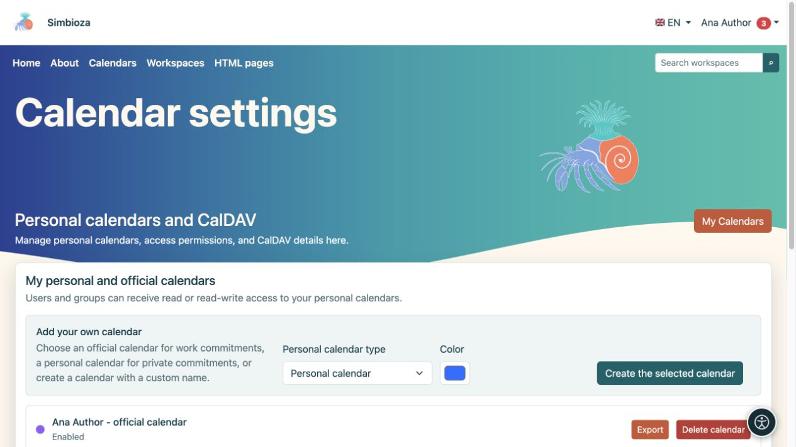
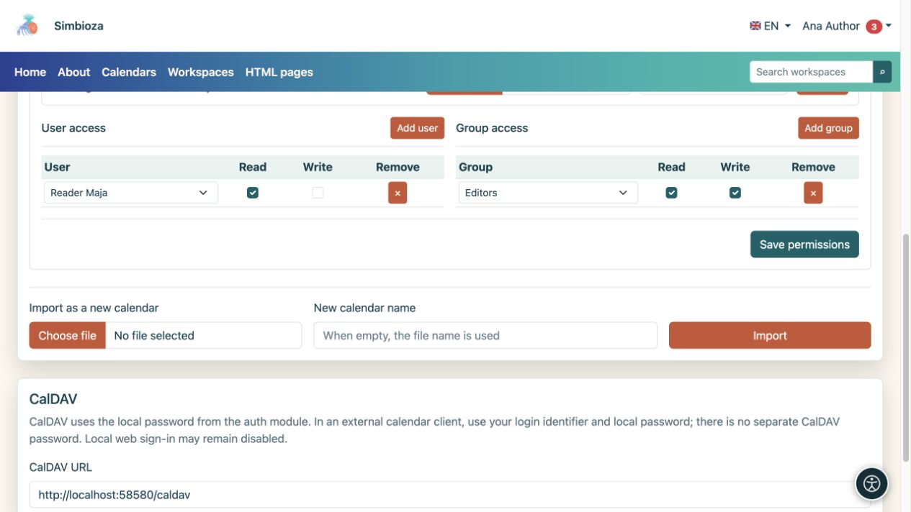

# Créer et partager un calendrier personnel

> Les captures d’écran présentent l’interface en anglais.

[Calendriers](kalendari_fr.md)

**Pour :** un utilisateur connecté qui a besoin de son propre emploi du temps. Vous n'avez pas besoin d'être membre du groupe Calendriers. Ouvrez **Calendriers → Paramètres du calendrier** ; l'écran s'appelle **Calendriers personnels et CalDAV**.

## Créez votre calendrier

1. Sous **Ajouter votre propre calendrier**, choisissez le **Type de calendrier personnel**.
2. Pour un type personnalisé, saisissez un **Suffixe de nom unique** pour distinguer plusieurs de vos propres agendas.
3. Choisissez une couleur.
4. Sélectionnez **Créer le calendrier sélectionné**.
5. Ouvrez la vue principale, choisissez le calendrier et [ajoutez un événement d'essai](kalendari-dogadaji_fr.md).

**Résultat :** votre calendrier personnel ou professionnel est créé. Un calendrier personnel n'est pas créé automatiquement ; créez-en un en cas de besoin. Son nom ou le mot « œuvre » ne donne pas accès à d'autres personnes.

<figure class="my-4">

<figcaption>Choisissez un type et une couleur disponibles. Un type que vous avez déjà créé peut être indisponible pour une autre création.</figcaption>
</figure>

## Donner à une personne ou à un groupe un accès en lecture ou en écriture

Ouvrez **Importation et droits d'accès** sur la carte de votre calendrier.

1. Sous **Accès utilisateur**, recherchez et ajoutez une personne, ou choisissez un groupe sous **Accès de groupe**.
2. Activez **Lire** pour leur permettre de consulter le planning.
3. Activez **Write** uniquement s'ils peuvent ajouter, modifier et supprimer des événements.
4. Sélectionnez **Enregistrer les autorisations**.
5. Demandez au destinataire d'ouvrir le calendrier en utilisant son propre compte ; ils devront peut-être l'activer sous [abonnements](kalendari-pregled_fr.md).

**Résultat :** vous partagez le calendrier avec les autorisations sélectionnées, et non avec votre compte. Ne donnez pas votre mot de passe à d’autres personnes. Les autorisations directes et de groupe d'une personne se combinent : la suppression d'une ligne ne révoque pas l'accès encore accordé via un autre groupe.

Pour supprimer une autorisation directe, sélectionnez **Supprimer** sur cette ligne et enregistrez les autorisations. Renseignez-vous auprès du responsable sur les calendriers partagés à l'échelle de l'établissement ; l'accès en écriture aux événements n'accorde pas lui-même leurs paramètres.

<figure class="my-4">

<figcaption>Maja a lu ; le groupe Éditeurs a Lire et Écrire. Confirmez les autorisations avec les autorisations Enregistrer.</figcaption>
</figure>

## Importez, exportez et supprimez votre calendrier

- **Export** télécharge les événements au format ICS.
- **Importer dans ce calendrier** ajoute les événements d'un fichier au calendrier sélectionné ; lisez d'abord sur [la gestion des événements existants](kalendari-povezivanje_fr.md).
- **Importer en tant que nouveau calendrier** crée un calendrier distinct au lieu de l'ajouter à un calendrier existant.
- **Supprimer le calendrier** supprime le calendrier sélectionné. Vérifiez son nom et exportez tous les événements nécessaires avant de confirmer. Décocher sa case d'affichage masque uniquement le planning et est plus adapté si vous ne souhaitez temporairement pas le voir.

Pour connecter une autre application de calendrier, voir [CalDAV](kalendari-povezivanje_fr.md#caldav). L'écran de profil n'affiche pas de mot de passe.
