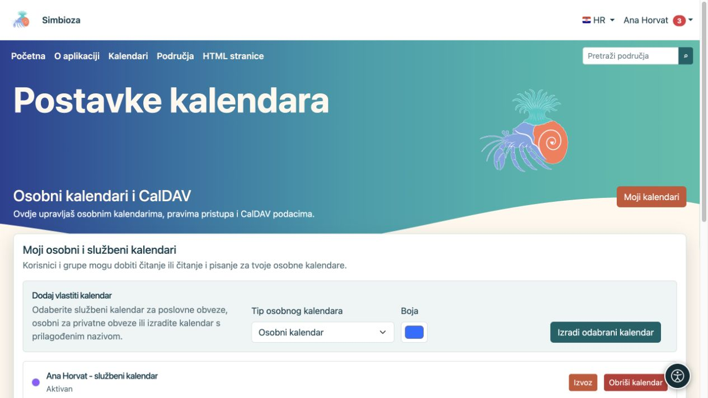
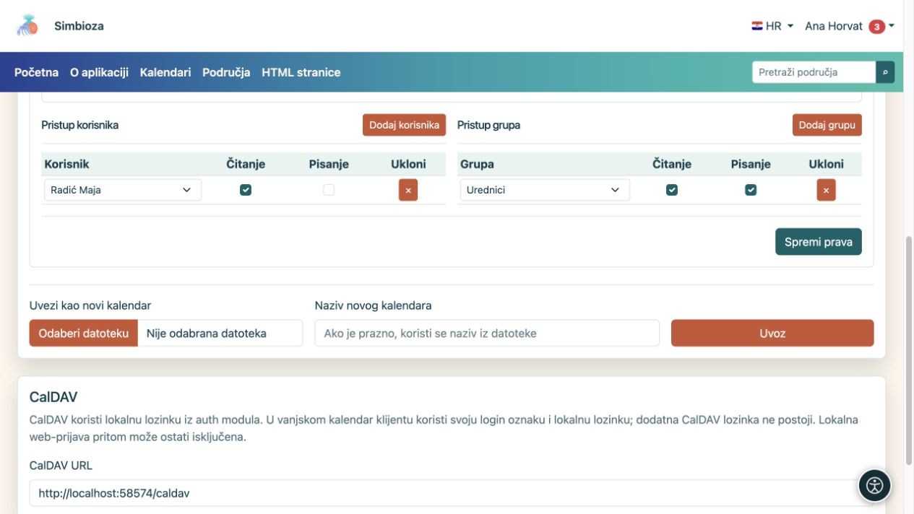

# Izradite i podijelite osobni kalendar

[Kalendari](kalendari_hr.md)

**Za koga:** za prijavljenog korisnika koji želi vlastiti raspored. Ne trebate pripadati grupi Kalendari. Otvorite **Kalendari → Postavke kalendara**; ekran se zove **Osobni kalendari i CalDAV**.

## Izradite vlastiti kalendar

1. U odjeljku **Dodaj vlastiti kalendar** odaberite **Tip osobnog kalendara**.
2. Za prilagođeni tip unesite **Jedinstveni nastavak naziva**, kako biste razlikovali više vlastitih kalendara.
3. Odaberite boju.
4. Odaberite **Izradi odabrani kalendar**.
5. Otvorite glavni pregled, odaberite kalendar i [dodajte probni događaj](kalendari-dogadaji_hr.md).

**Rezultat:** nastaje vaš osobni ili službeni kalendar. Osobni kalendar ne izrađuje se automatski; napravite ga kad vam zatreba. Njegov naziv ili riječ „službeni” ne dodjeljuju pristup drugim osobama.

<figure class="my-4">

<figcaption>Odaberite ponuđeni tip i boju. Već stvoren tip može biti označen kao nedostupan za ponovnu izradu.</figcaption>
</figure>

## Dopustite osobi ili grupi čitanje ili pisanje

Na kartici vlastitog kalendara otvorite **Uvoz i prava pristupa**.

1. Pod **Pristup korisnika** pronađite i dodajte osobu, ili pod **Pristup grupa** odaberite grupu.
2. Označite **Čitanje** za uvid u raspored.
3. Označite **Pisanje** samo ako osoba smije dodavati, mijenjati i brisati događaje.
4. Odaberite **Spremi prava**.
5. Zamolite primatelja da otvori kalendar svojim računom; po potrebi neka ga uključi kroz [pretplate](kalendari-pregled_hr.md).

**Rezultat:** dijelite kalendar prema označenim pravima, a ne svoj račun. Ne šaljite drugima vlastitu lozinku. Prava osobe i njezinih grupa zbrajaju se: uklanjanje jednog retka ne ukida pravo koje i dalje dolazi preko druge grupe.

Za uklanjanje izravne dodjele koristite **Ukloni** uz odgovarajući redak i spremite prava. Za zajednički kalendar ustanove obratite se upravitelju; pravo pisanja samo po sebi ne daje pristup njegovim postavkama.

<figure class="my-4">

<figcaption>Maja može čitati, a grupa Urednici čitati i pisati. Prava se spremaju zasebnom radnjom Spremi prava.</figcaption>
</figure>

## Uvoz, izvoz i brisanje vlastitog kalendara

- **Izvoz** preuzima ICS događaja.
- **Uvezi u ovaj kalendar** dodaje događaje iz datoteke u odabrani kalendar; najprije pročitajte [postupanje s postojećim događajima](kalendari-povezivanje_hr.md).
- **Uvezi kao novi kalendar** stvara odvojeni kalendar, umjesto dodavanja u postojeći.
- **Obriši kalendar** uklanja odabrani kalendar. Prije potvrde provjerite naziv i izvezite potrebne događaje. Skrivanjem kvačice u pregledu samo skrivate raspored; to je prikladnije ako ga privremeno ne želite gledati.

Za povezivanje s drugom kalendarskom aplikacijom pogledajte [CalDAV](kalendari-povezivanje_hr.md#caldav). Lozinka ne prikazuje se na ekranu profila.
