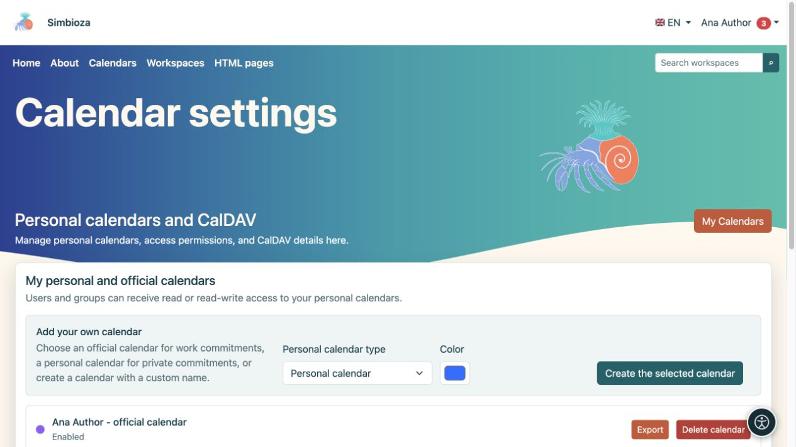
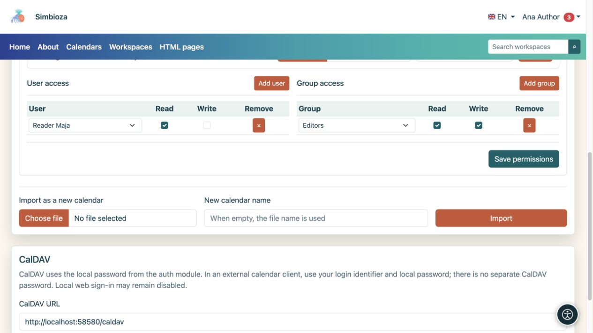

# Crea e condividi un calendario personale

> Le schermate mostrano l’interfaccia in inglese.

[Calendari](kalendari_it.md)

**Per:** un utente registrato che necessita della propria pianificazione. Non è necessaria l'appartenenza al gruppo Calendari. Apri **Calendari → Impostazioni calendario**; la schermata è denominata **Calendari personali e CalDAV**.

## Crea il tuo calendario

1. In **Aggiungi il tuo calendario**, scegli il **Tipo di calendario personale**.
2. Per un tipo personalizzato, inserisci un **suffisso del nome univoco** per distinguere diversi calendari di tua scelta.
3. Scegli un colore.
4. Seleziona **Crea il calendario selezionato**.
5. Apri la vista principale, scegli il calendario e [aggiungi un evento di prova](kalendari-dogadaji_it.md).

**Risultato:** viene creato il tuo calendario personale o lavorativo. Un calendario personale non viene creato automaticamente; crearne uno quando necessario. Il suo nome o la parola “lavoro” non consentono l'accesso ad altre persone.

<figure class="my-4">

<figcaption>Scegli un tipo e un colore disponibili. Un tipo che hai già creato potrebbe non essere disponibile per un'altra creazione.</figcaption>
</figure>

## Concedere a una persona o a un gruppo l'accesso in lettura o scrittura

Apri **Diritti di importazione e accesso** sulla scheda del tuo calendario.

1. In **Accesso utente**, trova e aggiungi una persona oppure scegli un gruppo in **Accesso gruppo**.
2. Abilita **Leggi** per consentire loro di visualizzare la pianificazione.
3. Abilita **Scrivi** solo se possono aggiungere, modificare ed eliminare eventi.
4. Seleziona **Salva autorizzazioni**.
5. Chiedi al destinatario di aprire il calendario utilizzando il proprio account; potrebbe essere necessario abilitarlo in [abbonamenti](kalendari-pregled_it.md).

**Risultato:** condividi il calendario con le autorizzazioni selezionate, non con il tuo account. Non fornire ad altre persone la tua password. Le autorizzazioni dirette e di gruppo di una persona si combinano: la rimozione di una riga non revoca l'accesso ancora concesso tramite un altro gruppo.

Per rimuovere una concessione diretta, seleziona **Rimuovi** su quella riga e salva le autorizzazioni. Chiedere al manager informazioni sui calendari condivisi a livello di istituto; l'accesso in scrittura agli eventi non garantisce di per sé le relative impostazioni.

<figure class="my-4">

<figcaption>Maja dispone di Lettura; il gruppo dei redattori dispone di Lettura e Scrittura. Conferma le autorizzazioni con Salva autorizzazioni.</figcaption>
</figure>

## Importa, esporta ed elimina il tuo calendario

- **Esporta** scarica gli eventi come ICS.
- **Importa in questo calendario** aggiunge eventi da un file al calendario selezionato; leggi prima sulla [gestione degli eventi esistenti](kalendari-povezivanje_it.md).
- **Importa come nuovo calendario** crea un calendario separato invece di aggiungerlo a uno esistente.
- **Elimina calendario** rimuove il calendario selezionato. Controlla il suo nome ed esporta tutti gli eventi necessari prima di confermare. Deselezionando la casella di controllo della visualizzazione si nasconde solo la pianificazione ed è più adatta se non si desidera visualizzarla temporaneamente.

Per connettere un'altra applicazione di calendario, vedere [CalDAV](kalendari-povezivanje_it.md#caldav). La schermata del profilo non visualizza una password.
