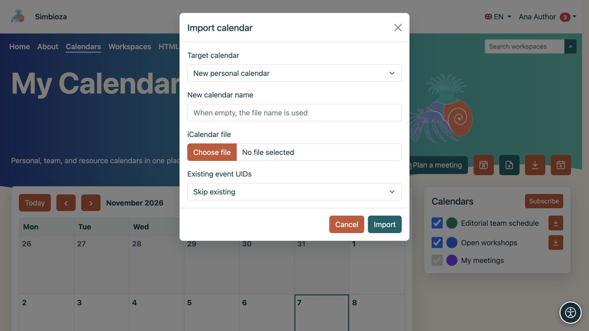
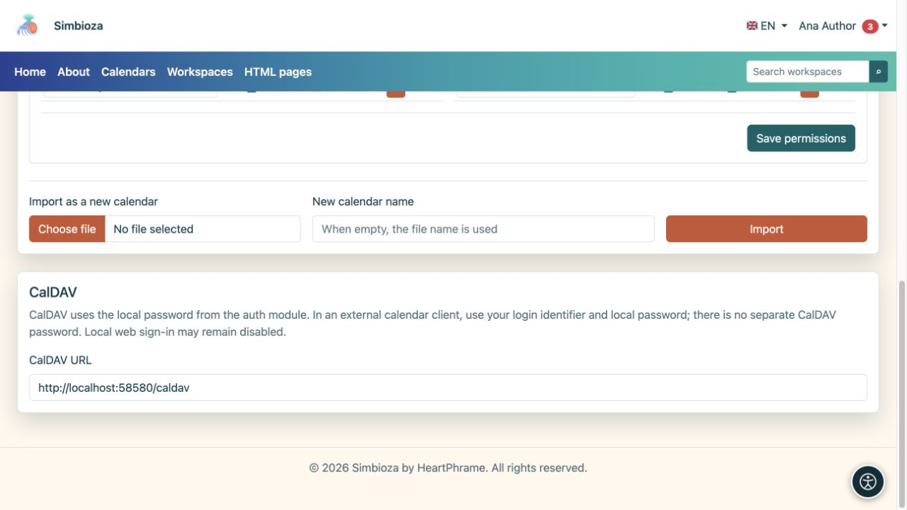

# Termine übertragen oder eine Kalenderanwendung verbinden

> Die Bildschirmaufnahmen zeigen die englische Benutzeroberfläche.

[Kalender](kalendari_de.md)

Wählen Sie die Methode für Ihr Ziel. **ICS** ist eine Datei, die Ereignisse zu einem bestimmten Zeitpunkt enthält. **CalDAV** verbindet eine Kalenderanwendung zur Synchronisierung mit dem Server.

## Exportieren Sie eine ICS-Datei

1. Finden Sie einen Kalender, den Sie lesen können.
2. Wählen Sie das Symbol **Exportieren** oder öffnen Sie Ihren eigenen Kalender unter **Kalendereinstellungen** und wählen Sie **Exportieren**.
3. Laden Sie die Datei `.ics` herunter und öffnen Sie sie in der Kalenderanwendung Ihrer Wahl.

**Ergebnis:** Sie erhalten eine Kopie der Ereignisse. Spätere Änderungen in Simbioza aktualisieren eine bereits heruntergeladene Datei nicht automatisch. Teilen Sie es nur mit der beabsichtigten Zielgruppe.

## Importieren Sie Ereignisse in einen vorhandenen Kalender

Sie benötigen Schreibzugriff auf den Zielkalender.

1. Wählen Sie das Importsymbol in der Hauptansicht oder öffnen Sie **Import- und Zugriffsrechte → In diesen Kalender importieren** in Ihrem eigenen Kalender.
2. Wählen Sie eine ICS-Datei aus und überprüfen Sie den Zielkalender.
3. Wählen Sie aus, wie mit vorhandenen Ereignissen mit derselben UID (der eindeutigen Kennung des Ereignisses) umgegangen werden soll:
   - **Vorhandene überspringen** behält den vorhandenen Datensatz bei.
   - **Vorhandene aktualisieren** aktualisiert das passende vorhandene Ereignis mithilfe der Datei.
4. Starten Sie **Import** und lesen Sie das Ergebnis, einschließlich übersprungener oder ungültiger Datensätze.
5. Öffnen Sie das Datum mindestens eines importierten Ereignisses und überprüfen Sie dessen Titel, Uhrzeit und Wiederholung.

**Ergebnis:** Akzeptierte Ereignisse werden im ausgewählten Kalender angezeigt und sind für das Publikum sichtbar. Verwenden Sie für einen Testimport einen separaten Kalender, um zu vermeiden, dass reale Ereignisse unbeabsichtigt aktualisiert werden.

Für einen separaten Zeitplan verwenden Sie **Als neuen Kalender importieren**. Ein normaler Benutzer erstellt seinen eigenen persönlichen Kalender. Autorisierte Manager pflegen Team- und Ressourcenkalender über [Kalenderverwaltung](admin-kalendari_de.md).

<figure class="my-4">

<figcaption>Das Ziel in diesem Beispiel ist „Neuer persönlicher Kalender“, wobei „Überspringen“ für übereinstimmende Ereigniskennungen vorhanden ist. Um etwas zu einem bestehenden Kalender hinzuzufügen, wählen Sie diesen Kalender vor dem Import aus.</figcaption>
</figure>

## Verbinden Sie einen Client über CalDAV

Verwenden Sie CalDAV, um mit denselben Kalendern in einer anderen Anwendung zu arbeiten, die das Protokoll unterstützt.

1. Öffnen Sie **Kalender → Kalendereinstellungen → CalDAV**.
2. Kopieren Sie die angezeigte URL **CalDAV**, gegebenenfalls einschließlich des Installationsunterverzeichnisses.
3. Fügen Sie ein CalDAV-Konto in einem vertrauenswürdigen Kalender-Client hinzu.
4. Geben Sie diese Adresse und Ihre **lokale Anmeldekennung Simbioza und Ihr lokales Passwort** ein.
5. Schauen Sie sich die angebotenen Kalender an. Um die Synchronisierung zu überprüfen, fügen Sie einem beschreibbaren Kalender ein harmloses Testereignis hinzu und überprüfen Sie es in beiden Anwendungen.

<figure class="my-4">

<figcaption>Kopieren Sie die CalDAV-URL. Ihr lokales Passwort wird auf diesem Bildschirm nicht angezeigt.</figcaption>
</figure>

**Ergebnis:** Der Client erkennt zugängliche Kalender und tauscht Ereignisse unter Ihren Berechtigungen aus. Durch die Verbindung über CalDAV wird ein schreibgeschützter Kalender nicht in einen beschreibbaren Kalender umgewandelt.

Es gibt kein separates CalDAV-Passwort. Wenn Sie sich nur über einen externen Anbieter bei Simbioza anmelden und kein lokales Passwort haben, wenden Sie sich an den Administrator. Die Berechtigung zur lokalen Web-Anmeldung ist unabhängig von CalDAV: Eine deaktivierte lokale Web-Anmeldung verhindert nicht unbedingt, dass CalDAV mit gültigen lokalen Anmeldeinformationen verwendet werden kann.

Verwenden Sie die angezeigte Adresse HTTPS und ein gültiges Zertifikat. Wenn im Profil angegeben ist, dass CalDAV deaktiviert ist, bitten Sie den Administrator, die Installationskonfiguration zu überprüfen. Erweiterte Eigenschaften und Präsentation hängen auch vom Client ab; überprüfen Sie den erforderlichen Arbeitsablauf vor einer breiteren Verwendung.

## Eine Ereignisdatei ist kein vollständiges Backup

ICS behält nicht alle Berechtigungen, Teilnehmer, Antworten, Genehmigungen und Besprechungssystemeinstellungen bei. Um das gesamte System zu übertragen oder wiederherzustellen, verwenden Sie [Administrator-Backups](admin-sigurnosne-kopije_de.md) oder [Arbeitsbereichs-Backups](podrucja-izvoz-backup_de.md) für Inhalte, die einem Arbeitsbereich zugeordnet sind. Die Sicherung des Arbeitsbereichs schließt private CalDAV-Anmeldeinformationen aus.
