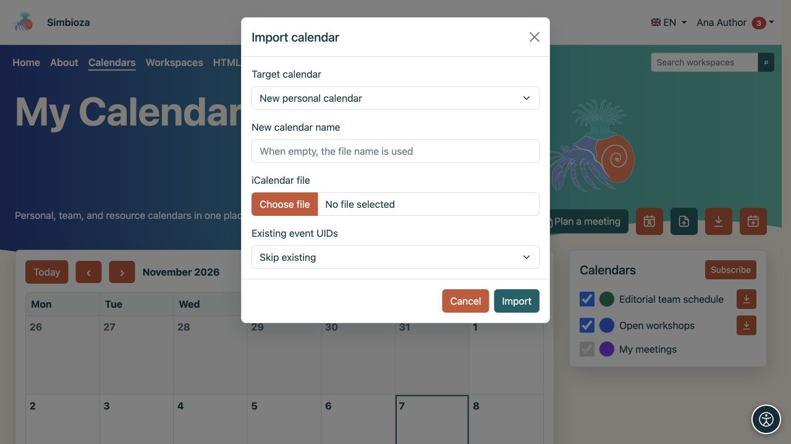
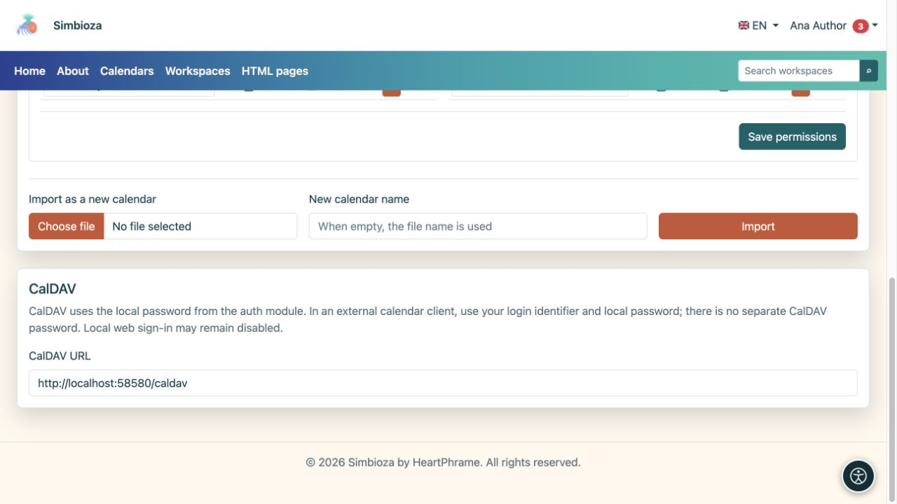

# Transfer events or connect a calendar application

[Calendars](kalendari_en.md)

Choose the method for your goal. **ICS** is a file containing events at one point in time. **CalDAV** connects a calendar application to the server for synchronisation.

## Export an ICS file

1. Find a calendar you may read.
2. Select its **Export** icon, or open your own calendar under **Calendar settings** and select **Export**.
3. Download the `.ics` file and open it in your chosen calendar application.

**Result:** you receive a copy of the events. Later changes in Simbioza do not automatically update an already downloaded file. Share it only with the intended audience.

## Import events into an existing calendar

You need write access to the target calendar.

1. Select the import icon in the main view, or open **Import and access rights → Import into this calendar** on your own calendar.
2. Select an ICS file and check the target calendar.
3. Choose how to handle existing events with the same UID (the event's unique identifier):
   - **Skip existing** keeps the existing record.
   - **Update existing** updates the matching existing event using the file.
4. Start **Import** and read the result, including skipped or invalid records.
5. Open the date of at least one imported event and check its title, time and repetition.

**Result:** accepted events appear in the selected calendar and are visible to its audience. Use a separate calendar for a trial import to avoid unintentionally updating real events.

For a separate schedule, use **Import as a new calendar**. An ordinary user creates their own personal calendar; authorised managers maintain team and resource calendars through [calendar administration](admin-kalendari_en.md).

<figure class="my-4">

<figcaption>The target in this example is New personal calendar, with Skip existing for matching event identifiers. To add to an existing calendar, select that calendar before import.</figcaption>
</figure>

## Connect a client through CalDAV

Use CalDAV to work with the same calendars in another application that supports the protocol.

1. Open **Calendars → Calendar settings → CalDAV**.
2. Copy the displayed **CalDAV URL**, including the installation subdirectory where applicable.
3. Add a CalDAV account in a trusted calendar client.
4. Enter that address and your **local Simbioza login identifier and local password**.
5. Check the calendars offered. To verify synchronisation, add a harmless trial event to a writable calendar and inspect it in both applications.

<figure class="my-4">

<figcaption>Copy the CalDAV URL. Your local password is not displayed on this screen.</figcaption>
</figure>

**Result:** the client discovers accessible calendars and exchanges events under your permissions. Connecting through CalDAV does not turn a read-only calendar into a writable one.

There is no separate CalDAV password. If you sign in to Simbioza only through an external provider and have no local password, contact the administrator. Local web sign-in permission is separate from CalDAV: disabled local web sign-in does not necessarily prevent CalDAV with valid local credentials.

Use the displayed HTTPS address and a valid certificate. If the profile says CalDAV is disabled, ask the administrator to review the installation configuration. Advanced properties and presentation also depend on the client; verify the required workflow before wider use.

## An event file is not a complete backup

ICS does not preserve every permission, participant, response, approval and meeting-system setting. To transfer or restore the full system, use [administrator backups](admin-sigurnosne-kopije_en.md), or [workspace backup](podrucja-izvoz-backup_en.md) for content associated with a workspace. Workspace backup excludes private CalDAV credentials.
