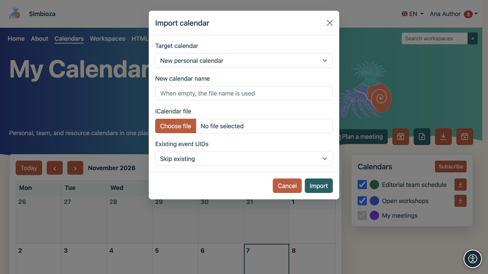
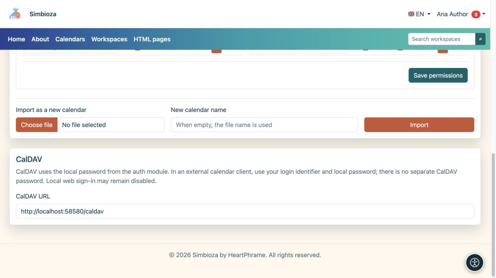

# Transferir eventos o conectar una aplicación de calendario

> Las capturas de pantalla muestran la interfaz en inglés.

[Calendarios](kalendari_es.md)

Elija el método para su objetivo. **ICS** es un archivo que contiene eventos en un momento dado. **CalDAV** conecta una aplicación de calendario al servidor para su sincronización.

## Exportar un archivo ICS

1. Encuentra un calendario que pueda leer.
2. Seleccione su icono **Exportar** o abra su propio calendario en **Configuración del calendario** y seleccione **Exportar**.
3. Descargue el archivo `.ics` y ábralo en la aplicación de calendario elegida.

**Resultado:** recibes una copia de los eventos. Los cambios posteriores en Simbioza no actualizan automáticamente un archivo ya descargado. Compártelo sólo con el público objetivo.

## Importar eventos a un calendario existente

Necesita acceso de escritura al calendario de destino.

1. Seleccione el icono de importación en la vista principal o abra **Importar y derechos de acceso → Importar a este calendario** en su propio calendario.
2. Seleccione un archivo ICS y verifique el calendario de destino.
3. Elija cómo manejar eventos existentes con el mismo UID (el identificador único del evento):
   - **Omitir existente** mantiene el registro existente.
   - **Actualizar existente** actualiza el evento existente coincidente utilizando el archivo.
4. Inicie **Importar** y lea el resultado, incluidos los registros omitidos o no válidos.
5. Abra la fecha de al menos un evento importado y verifique su título, hora y repetición.

**Resultado:** los eventos aceptados aparecen en el calendario seleccionado y son visibles para su audiencia. Utilice un calendario separado para una importación de prueba para evitar actualizar involuntariamente eventos reales.

Para un cronograma separado, use **Importar como un calendario nuevo**. Un usuario normal crea su propio calendario personal; Los gestores autorizados mantienen calendarios de equipos y recursos a través de [administración de calendario](admin-kalendari_es.md).

<figure class="my-4">

<figcaption>El objetivo en este ejemplo es Nuevo calendario personal, con Omitir existente para identificadores de eventos coincidentes. Para agregar a un calendario existente, seleccione ese calendario antes de importarlo.</figcaption>
</figure>

## Conecte un cliente a través de CalDAV

Utilice CalDAV para trabajar con los mismos calendarios en otra aplicación que admita el protocolo.

1. Abra **Calendarios → Configuración del calendario → CalDAV**.
2. Copie la **CalDAV URL** que se muestra, incluido el subdirectorio de instalación cuando corresponda.
3. Agregue una cuenta CalDAV en un cliente de calendario confiable.
4. Ingrese esa dirección y su **identificador de inicio de sesión local Simbioza y contraseña local**.
5. Consulte los calendarios ofrecidos. Para verificar la sincronización, agregue un evento de prueba inofensivo a un calendario con permiso de escritura e inspecciónelo en ambas aplicaciones.

<figure class="my-4">

<figcaption>Copie la URL CalDAV. Su contraseña local no se muestra en esta pantalla.</figcaption>
</figure>

**Resultado:** el cliente descubre calendarios accesibles e intercambia eventos bajo sus permisos. La conexión a través de CalDAV no convierte un calendario de solo lectura en uno en el que se puede escribir.

No existe una contraseña CalDAV separada. Si inicia sesión en Simbioza solo a través de un proveedor externo y no tiene una contraseña local, comuníquese con el administrador. El permiso de inicio de sesión web local es independiente de CalDAV: el inicio de sesión web local deshabilitado no necesariamente impide que CalDAV tenga credenciales locales válidas.

Utilice la dirección HTTPS que se muestra y un certificado válido. Si el perfil dice CalDAV está deshabilitado, solicite al administrador que revise la configuración de instalación. Las propiedades avanzadas y la presentación también dependen del cliente; Verifique el flujo de trabajo requerido antes de un uso más amplio.

## Un archivo de evento no es una copia de seguridad completa

ICS no conserva todos los permisos, participantes, respuestas, aprobaciones y configuraciones del sistema de reuniones. Para transferir o restaurar el sistema completo, utilice [copias de seguridad del administrador](admin-sigurnosne-kopije_es.md) o [copia de seguridad del espacio de trabajo](podrucja-izvoz-backup_es.md) para el contenido asociado con un espacio de trabajo. La copia de seguridad del espacio de trabajo excluye las credenciales privadas CalDAV.
