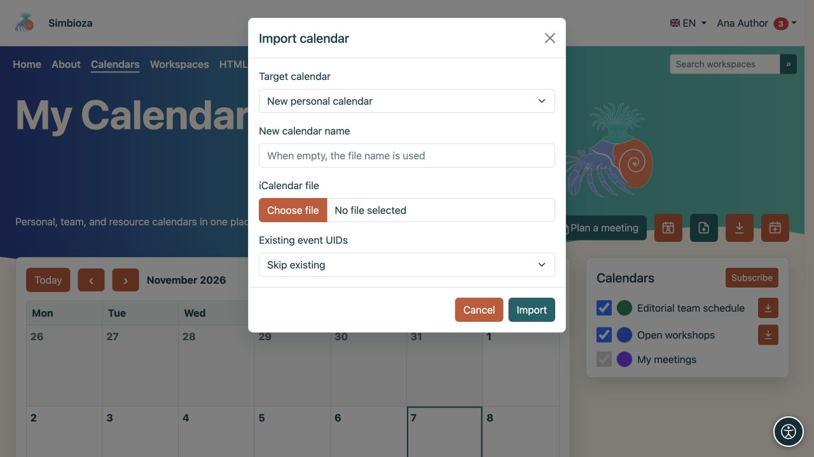
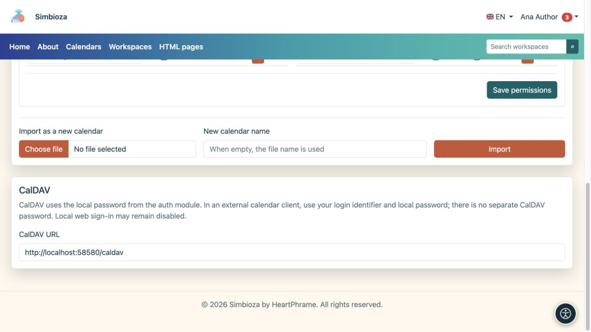

# Transférer des événements ou connecter une application de calendrier

> Les captures d’écran présentent l’interface en anglais.

[Calendriers](kalendari_fr.md)

Choisissez la méthode adaptée à votre objectif. **ICS** est un fichier contenant des événements à un moment donné. **CalDAV** connecte une application de calendrier au serveur pour la synchronisation.

## Exporter un fichier ICS

1. Trouvez un calendrier que vous pouvez lire.
2. Sélectionnez son icône **Exporter** ou ouvrez votre propre calendrier sous **Paramètres du calendrier** et sélectionnez **Exporter**.
3. Téléchargez le fichier `.ics` et ouvrez-le dans l'application de calendrier de votre choix.

**Résultat :** vous recevez une copie des événements. Les modifications ultérieures dans Simbioza ne mettent pas automatiquement à jour un fichier déjà téléchargé. Partagez-le uniquement avec le public visé.

## Importer des événements dans un calendrier existant

Vous avez besoin d'un accès en écriture au calendrier cible.

1. Sélectionnez l'icône d'importation dans la vue principale ou ouvrez **Importation et droits d'accès → Importer dans ce calendrier** sur votre propre calendrier.
2. Sélectionnez un fichier ICS et vérifiez le calendrier cible.
3. Choisissez comment gérer les événements existants avec le même UID (l'identifiant unique de l'événement) :
   - **Ignorer l'existant** conserve l'enregistrement existant.
   - **Mettre à jour existant** met à jour l'événement existant correspondant à l'aide du fichier.
4. Démarrez **Import** et lisez le résultat, y compris les enregistrements ignorés ou non valides.
5. Ouvrez la date d'au moins un événement importé et vérifiez son titre, son heure et sa répétition.

**Résultat :** les événements acceptés apparaissent dans le calendrier sélectionné et sont visibles par son audience. Utilisez un calendrier distinct pour une importation d'essai afin d'éviter de mettre à jour involontairement des événements réels.

Pour un planning distinct, utilisez **Importer en tant que nouveau calendrier**. Un utilisateur ordinaire crée son propre calendrier personnel ; les responsables autorisés gèrent les calendriers des équipes et des ressources via [l'administration du calendrier](admin-kalendari_fr.md).

<figure class="my-4">

<figcaption>La cible dans cet exemple est Nouveau calendrier personnel, avec Skip existant pour les identifiants d'événement correspondants. Pour ajouter à un calendrier existant, sélectionnez ce calendrier avant l'importation.</figcaption>
</figure>

## Connectez un client via CalDAV

Utilisez CalDAV pour travailler avec les mêmes calendriers dans une autre application prenant en charge le protocole.

1. Ouvrez **Calendriers → Paramètres du calendrier → CalDAV**.
2. Copiez l'URL **CalDAV** affichée, y compris le sous-répertoire d'installation, le cas échéant.
3. Ajoutez un compte CalDAV dans un client de calendrier approuvé.
4. Entrez cette adresse ainsi que votre **identifiant de connexion local Simbioza et votre mot de passe local**.
5. Consultez les calendriers proposés. Pour vérifier la synchronisation, ajoutez un événement d'essai inoffensif à un calendrier inscriptible et inspectez-le dans les deux applications.

<figure class="my-4">

<figcaption>Copiez l'URL CalDAV. Votre mot de passe local n'est pas affiché sur cet écran.</figcaption>
</figure>

**Résultat :** le client découvre les calendriers accessibles et échange des événements sous vos autorisations. La connexion via CalDAV ne transforme pas un calendrier en lecture seule en un calendrier inscriptible.

Il n’existe pas de mot de passe CalDAV distinct. Si vous vous connectez à Simbioza uniquement via un fournisseur externe et que vous n'avez pas de mot de passe local, contactez l'administrateur. L'autorisation de connexion Web locale est distincte de CalDAV : la désactivation de la connexion Web locale n'empêche pas nécessairement CalDAV d'avoir des informations d'identification locales valides.

Utilisez l’adresse HTTPS affichée et un certificat valide. Si le profil indique que CalDAV est désactivé, demandez à l'administrateur de revoir la configuration de l'installation. Les propriétés avancées et la présentation dépendent également du client ; vérifiez le flux de travail requis avant une utilisation plus large.

## Un fichier d'événements n'est pas une sauvegarde complète

ICS ne conserve pas tous les paramètres d’autorisation, de participant, de réponse, d’approbation et du système de réunion. Pour transférer ou restaurer l'intégralité du système, utilisez [sauvegardes de l'administrateur](admin-sigurnosne-kopije_fr.md) ou [sauvegarde de l'espace de travail](podrucja-izvoz-backup_fr.md) pour le contenu associé à un espace de travail. La sauvegarde de l'espace de travail exclut les informations d'identification privées CalDAV.
