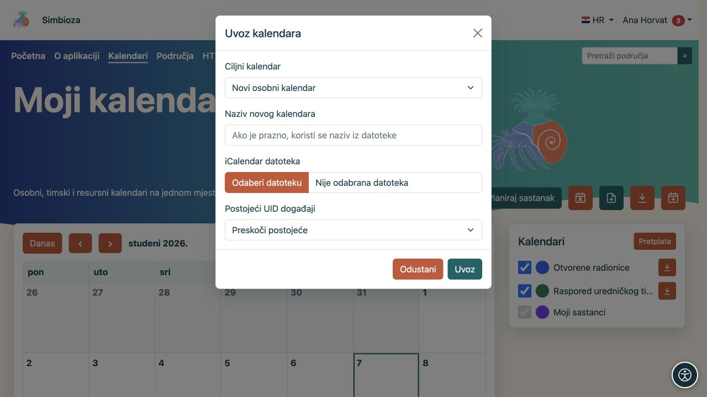
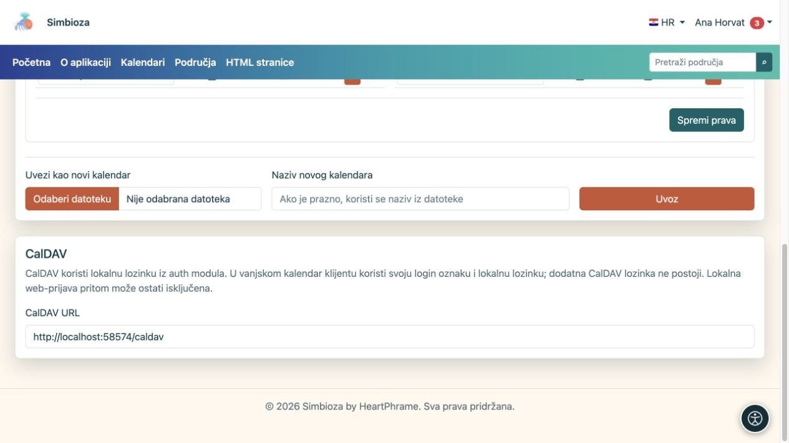

# Prenesite događaje ili povežite kalendarsku aplikaciju

[Kalendari](kalendari_hr.md)

Odaberite postupak prema cilju. **ICS** je datoteka za prijenos događaja u jednom trenutku. **CalDAV** povezuje kalendarsku aplikaciju s poslužiteljem radi sinkronizacije.

## Izvezite ICS datoteku

1. Pronađite kalendar koji smijete čitati.
2. Odaberite njegovu ikonu **Izvoz**, ili otvorite vlastiti kalendar u **Postavkama kalendara** i odaberite **Izvoz**.
3. Preuzmite `.ics` datoteku i otvorite je u željenoj kalendarskoj aplikaciji.

**Rezultat:** dobivate kopiju događaja. Kasnije promjene u Simbiozi same se ne prenose u već preuzetu datoteku. Dijelite je samo s publikom kojoj su događaji namijenjeni.

## Uvezite događaje u postojeći kalendar

Trebate pravo pisanja u ciljni kalendar.

1. Na glavnom prikazu odaberite ikonu uvoza, ili na vlastitom kalendaru otvorite **Uvoz i prava pristupa → Uvezi u ovaj kalendar**.
2. Odaberite ICS datoteku i provjerite ciljni kalendar.
3. Odaberite postupak za postojeće događaje s istim UID-om (jedinstvenom oznakom događaja):
   - **Preskoči postojeće** ostavlja postojeći zapis.
   - **Ažuriraj postojeće** zamjenjuje podatke odgovarajućeg postojećeg događaja iz datoteke.
4. Pokrenite **Uvoz** i pročitajte rezultat, uključujući preskočene ili nevaljane zapise.
5. Otvorite datum barem jednog uvezenog događaja i provjerite naslov, sat i ponavljanje.

**Rezultat:** prihvaćeni događaji nalaze se u odabranom kalendaru i dostupni su njegovoj publici. Pri probnom prijenosu prvo koristite zaseban kalendar kako ne biste nenamjerno ažurirali stvarne događaje.

Za odvojeni raspored koristite **Uvezi kao novi kalendar**. Obični korisnik stvara vlastiti osobni kalendar; zajedničke timske i resursne kalendare održava ovlašteni upravitelj kroz [administraciju kalendara](admin-kalendari_hr.md).

<figure class="my-4">

<figcaption>U ovom primjeru cilj je Novi osobni kalendar, uz Preskoči postojeće za podudarne oznake događaja. Za dodavanje u postojeći odaberite taj kalendar prije uvoza.</figcaption>
</figure>

## Povežite klijent kroz CalDAV

CalDAV koristite za rad s istim kalendarima iz druge aplikacije koja podržava taj protokol.

1. Otvorite **Kalendari → Postavke kalendara → CalDAV**.
2. Kopirajte prikazani **CalDAV URL**, uključujući poddirektorij ako ga instalacija koristi.
3. U pouzdanom kalendarskom klijentu dodajte CalDAV račun.
4. Unesite tu adresu, svoju **lokalnu login oznaku i lokalnu lozinku Simbioze**.
5. Provjerite prikazane kalendare. Za provjeru sinkronizacije dodajte bezazlen probni događaj u kalendar u koji smijete pisati i pogledajte ga u oba prikaza.

<figure class="my-4">

<figcaption>Kopirajte CalDAV URL; lokalna lozinka nije prikazana na ekranu.</figcaption>
</figure>

**Rezultat:** klijent otkriva dostupne kalendare i razmjenjuje događaje prema vašim pravima. Kalendar sa samo čitanjem ne postaje promjenjiv povezivanjem preko CalDAV-a.

Ne postoji zasebna CalDAV lozinka. Ako se u Simbiozu prijavljujete isključivo vanjskom prijavom i nemate lokalnu lozinku, obratite se administratoru. Dopuštenje lokalne web-prijave zasebno je od CalDAV-a: isključena lokalna web-prijava ne mora spriječiti CalDAV s valjanim lokalnim vjerodajnicama.

Koristite prikazanu HTTPS adresu i valjan certifikat. Ako profil javlja da CalDAV nije omogućen, administrator treba provjeriti instalacijsku konfiguraciju. Napredna svojstva i prikaz ovise i o odabranom klijentu; provjerite potreban način rada prije šire uporabe.

## Datoteka događaja nije potpuni backup

ICS ne čuva sve ovlasti, sudionike, odgovore, odobrenja i druge postavke sustava sastanaka. Za prijenos ili povrat cijelog sustava koristite [administratorski backup](admin-sigurnosne-kopije_hr.md), a za sadržaj povezan s područjem njegov [backup područja](podrucja-izvoz-backup_hr.md). Backup područja ne prenosi privatne CalDAV vjerodajnice.
