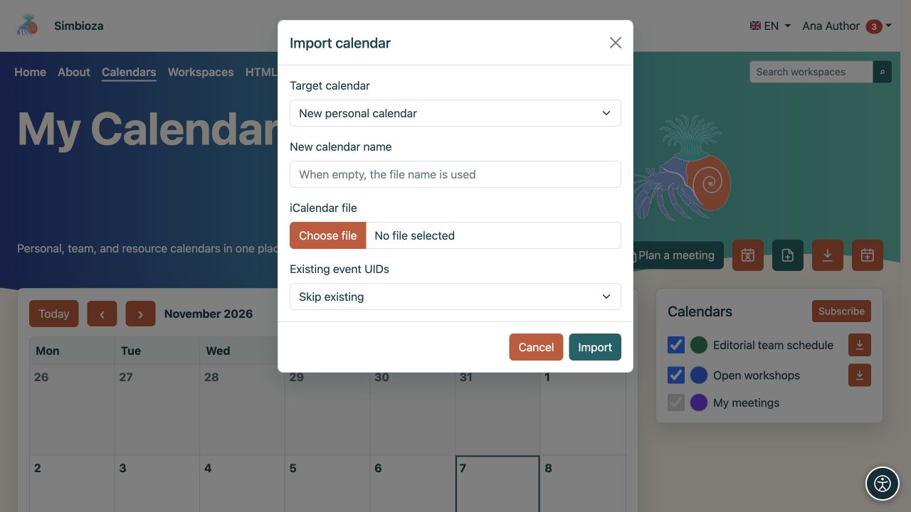
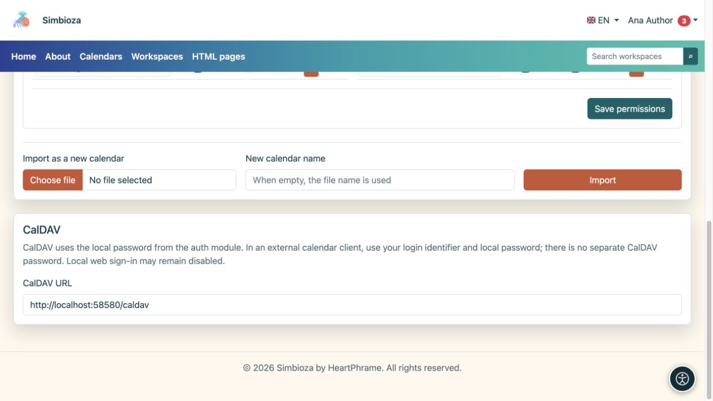

# Trasferisci eventi o collega un'applicazione di calendario

> Le schermate mostrano l’interfaccia in inglese.

[Calendari](kalendari_it.md)

Scegli il metodo per il tuo obiettivo. **ICS** è un file contenente eventi in un determinato momento. **CalDAV** collega un'applicazione di calendario al server per la sincronizzazione.

## Esporta un file ICS

1. Trova un calendario che potresti leggere.
2. Seleziona l'icona **Esporta** o apri il tuo calendario in **Impostazioni calendario** e seleziona **Esporta**.
3. Scarica il file `.ics` e aprilo nell'applicazione di calendario prescelta.

**Risultato:** ricevi una copia degli eventi. Le modifiche successive in Simbioza non aggiornano automaticamente un file già scaricato. Condividilo solo con il pubblico previsto.

## Importa eventi in un calendario esistente

È necessario l'accesso in scrittura al calendario di destinazione.

1. Seleziona l'icona di importazione nella vista principale oppure apri **Diritti di importazione e accesso → Importa in questo calendario** sul tuo calendario.
2. Seleziona un file ICS e controlla il calendario di destinazione.
3. Scegli come gestire gli eventi esistenti con lo stesso UID (l'identificatore univoco dell'evento):
   - **Salta esistente** mantiene il record esistente.
   - **Aggiorna esistente** aggiorna l'evento esistente corrispondente utilizzando il file.
4. Avvia **Importa** e leggi il risultato, inclusi i record saltati o non validi.
5. Apri la data di almeno un evento importato e controllane il titolo, l'ora e la ripetizione.

**Risultato:** gli eventi accettati vengono visualizzati nel calendario selezionato e sono visibili al suo pubblico. Utilizza un calendario separato per un'importazione di prova per evitare l'aggiornamento involontario di eventi reali.

Per una pianificazione separata, utilizza **Importa come nuovo calendario**. Un utente normale crea il proprio calendario personale; i manager autorizzati gestiscono i calendari dei team e delle risorse tramite [amministrazione del calendario](admin-kalendari_it.md).

<figure class="my-4">

<figcaption>La destinazione in questo esempio è Nuovo calendario personale, con Salta esistente per gli identificatori di evento corrispondenti. Per aggiungere a un calendario esistente, seleziona il calendario prima dell'importazione.</figcaption>
</figure>

## Connetti un client tramite CalDAV

Utilizza CalDAV per lavorare con gli stessi calendari in un'altra applicazione che supporta il protocollo.

1. Apri **Calendari → Impostazioni calendario → CalDAV**.
2. Copia l'**URL CalDAV** visualizzato, includendo l'eventuale sottocartella di installazione.
3. Aggiungi un account CalDAV in un client di calendario attendibile.
4. Inserisci l'indirizzo, l'**identificatore di accesso Simbioza locale e la password locale**.
5. Controlla i calendari offerti. Per verificare la sincronizzazione, aggiungi un evento di prova innocuo a un calendario scrivibile e controllalo in entrambe le applicazioni.

<figure class="my-4">

<figcaption>Copia l'URL CalDAV. La tua password locale non viene visualizzata in questa schermata.</figcaption>
</figure>

**Risultato:** il client scopre calendari accessibili e scambia eventi sotto le tue autorizzazioni. La connessione tramite CalDAV non trasforma un calendario di sola lettura in uno scrivibile.

Non esiste una password CalDAV separata. Se accedi a Simbioza soltanto tramite un servizio esterno e non disponi di una password locale, contatta l'amministratore. L'autorizzazione all'accesso web locale è distinta da CalDAV: disabilitare l'accesso web locale non impedisce necessariamente a CalDAV di funzionare con credenziali locali valide.

Utilizza l'indirizzo HTTPS visualizzato e un certificato valido. Se il profilo dice che CalDAV è disabilitato, chiedi all'amministratore di rivedere la configurazione di installazione. Anche le proprietà avanzate e la presentazione dipendono dal client; verificare il flusso di lavoro richiesto prima di un utilizzo più ampio.

## Un file di eventi non è un backup completo

ICS non conserva tutte le impostazioni di autorizzazione, partecipante, risposta, approvazione e sistema di riunione. Per trasferire o ripristinare l'intero sistema, utilizzare [backup dell'amministratore](admin-sigurnosne-kopije_it.md) o [backup dell'area di lavoro](podrucja-izvoz-backup_it.md) per il contenuto associato a un'area di lavoro. Il backup dell'area di lavoro esclude le credenziali private CalDAV.
