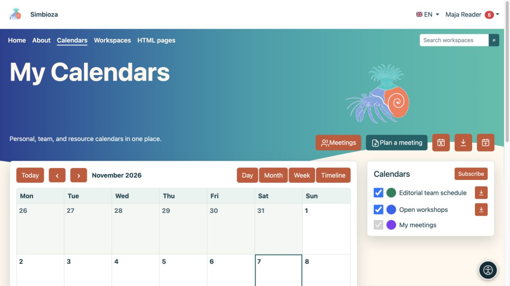
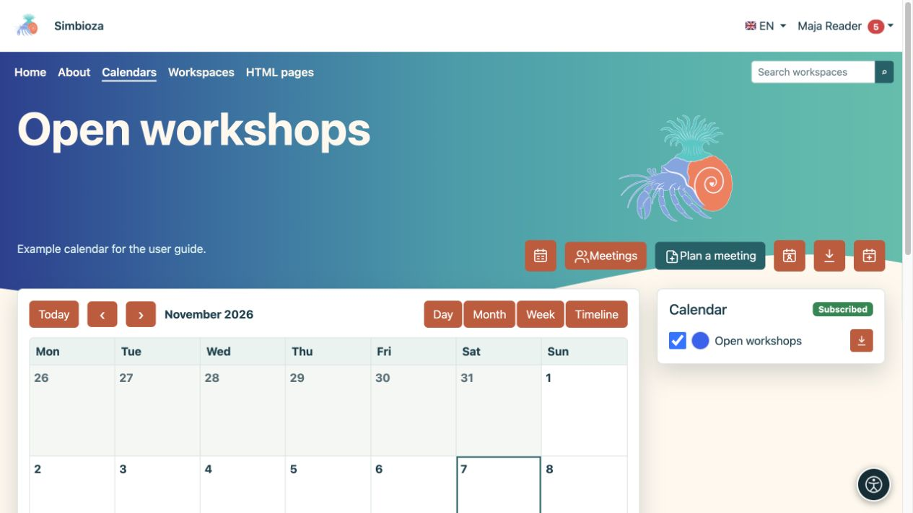
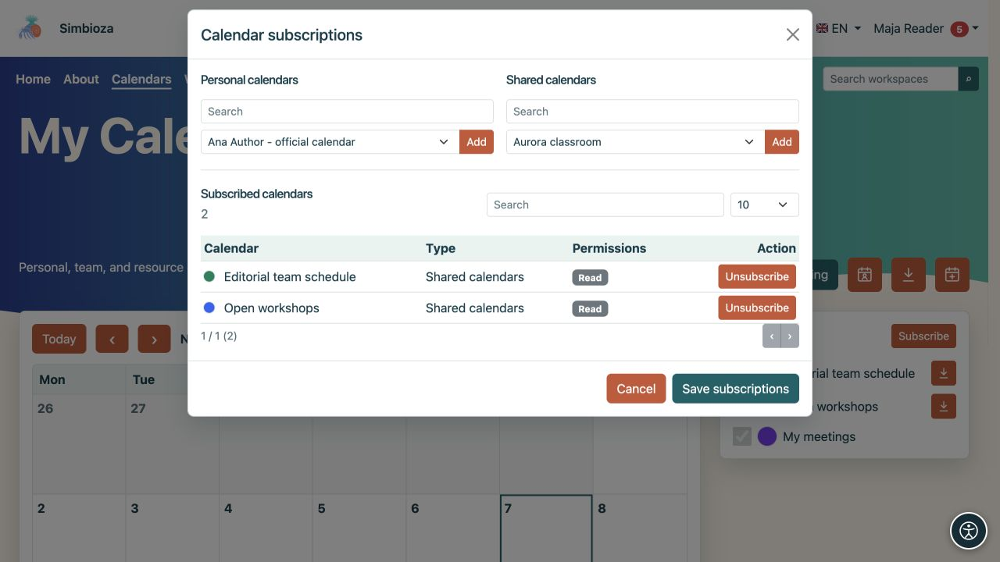
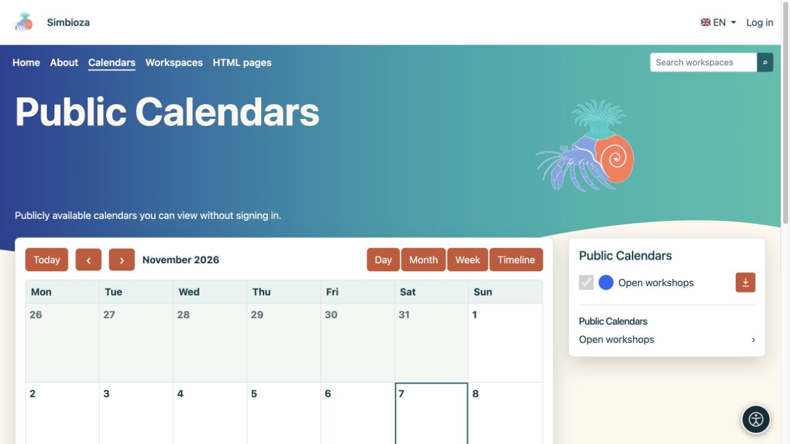

# Termine finden und die Ansicht anpassen

> Die Bildschirmaufnahmen zeigen die englische Benutzeroberfläche.

[Kalender](kalendari_de.md)

**Für:** alle, die einen Zeitplan lesen. Öffnen Sie **Kalender** im Hauptmenü.

## Wählen Sie den Datumsbereich und die Ansicht

1. Überprüfen Sie den angezeigten Monat oder Datumsbereich.
2. Verwenden Sie die Pfeile für die vorherige oder nächste Periode. **Heute** kehrt zum heutigen Datum zurück.
3. Wählen Sie die Ansicht, die zu Ihrer Aufgabe passt:

| Sicht | Nützlich für |
| --- | --- |
| Monat | Ein ganzer Monat, ganztägige Veranstaltungen und sich wiederholende Zeitpläne. |
| Woche | Sieben Tage nach Stunden und das Erkennen von Überschneidungen. |
| Tag | Eine detailliertere Ansicht eines Tages. |
| Zeitleiste | Eine chronologische Ereignisliste. |

**Ergebnis:** Nur die Anzeige ändert sich, nicht die Ereignisse. Wählen Sie ein Ereignis aus, um dessen Titel, Zeit, Ort und Beschreibung zu lesen. Bearbeitungsaktionen werden nur mit der entsprechenden Berechtigung angezeigt.

<figure class="my-4">

<figcaption>Ändern Sie den Datumsbereich und die Ansicht mit den Steuerelementen. Mit den Kontrollkästchen „Kalender“ werden die ausgewählten Zeitpläne angezeigt oder ausgeblendet.</figcaption>
</figure>

<figure class="my-4">

<figcaption>Die Wochenansicht ordnet Ereignisse nach Tag und Uhrzeit.</figcaption>
</figure>

<figure class="my-4">

<figcaption>Die Tagesansicht hebt überlappende Ereignisse aus mehreren Kalendern hervor.</figcaption>
</figure>

<figure class="my-4">

<figcaption>Die chronologische Ansicht ist nützlich, um anstehende Verpflichtungen zu scannen.</figcaption>
</figure>

## Zeigen Sie die Kalender an, die Sie benötigen

In der Seitenliste werden Ihre Kalender angezeigt. Verwenden Sie jedes Kontrollkästchen, um seine Ereignisse anzuzeigen oder auszublenden. Durch das Ausblenden eines Kalenders wird dieser nicht gelöscht.

Angemeldete Benutzer können die farbige Markierung auswählen, um ihre eigene Anzeigefarbe festzulegen. Dies hilft bei der Unterscheidung von Zeitplänen. Die Standardfarbe für andere Benutzer wird dadurch nicht geändert. Ihre Sichtbarkeit und Farbauswahl bleiben für Ihren nächsten Besuch erhalten.

Wählen Sie einen Kalendernamen aus, um nur diesen Zeitplan anzuzeigen. **Alle Kalender** kehrt zur kombinierten Ansicht zurück.

<figure class="my-4">

<figcaption>Offene Workshops werden getrennt von den anderen ausgewählten Kalendern angezeigt.</figcaption>
</figure>

## Abonnieren Sie einen verfügbaren Kalender

1. Melden Sie sich an und wählen Sie **Abonnieren**.
2. Suchen Sie den Kalender und prüfen Sie, ob Sie Lesezugriff oder Lese- und Schreibzugriff haben.
3. Aktivieren Sie das Abonnement und speichern Sie die Änderung.
4. Kehren Sie zur Hauptansicht zurück und aktivieren Sie bei Bedarf das entsprechende Kontrollkästchen.

**Ergebnis:** Der Kalender befindet sich in Ihrer persönlichen Liste. Ein Abonnement gewährt keine neuen Berechtigungen. Durch die Abmeldung wird weder der Kalender gelöscht noch Ihr Zugriff geändert; sie können es erneut auswählen, solange es für Sie verfügbar bleibt.

<figure class="my-4">

<figcaption>Neben dem Kalender wird der Lese- oder Lese-/Schreibzugriff angezeigt. Durch das Abonnieren oder Abbestellen werden diese Berechtigungen nicht geändert.</figcaption>
</figure>

## Lesen Sie, ohne sich anzumelden

Gäste sehen nur öffentlich lesbare Kalender und die in der öffentlichen Ansicht enthaltenen Ereignisse. Sie können den Datumsbereich ändern, einen öffentlichen Kalender öffnen und öffentlich verfügbare Ereignisse exportieren. Sie können keine Ereignisse hinzufügen, persönliche Abonnements verwalten oder persönliche Farben festlegen. Die öffentliche Ansicht bietet keinen Zugriff auf private Kalender.

<figure class="my-4">

<figcaption>Ein Gast kann den öffentlichen Open-Workshop-Zeitplan öffnen. Private Kalender sind nicht in dieser Liste.</figcaption>
</figure>

## Auf einem Telefon

Tippen Sie in der Monatsansicht auf ein Datum. Die Veranstaltungsliste und die Kalenderlegende erscheinen unterhalb des kompakten Zeitplans. Verwenden Sie **Tag** oder **Zeitleiste**, um einzelne Termine bequemer abzulesen.

<figure class="my-4">

<figcaption>Eine kompakte Monatsansicht mit den Ereignissen des ausgewählten Tages und der Kalenderlegende.</figcaption>
</figure>

## Ein erwartetes Ereignis fehlt

Überprüfen Sie das Datum, das Kalender-Kontrollkästchen und Ihr Abonnement. Wenn der gesamte Kalender fehlt, bitten Sie seinen Besitzer, seinen aktiven Status und Ihre Leseberechtigung zu überprüfen. Wenn Sie es sehen, aber nicht für ein neues Ereignis auswählen können, benötigen Sie Schreibzugriff – siehe [Ereignisse](kalendari-dogadaji_de.md).
