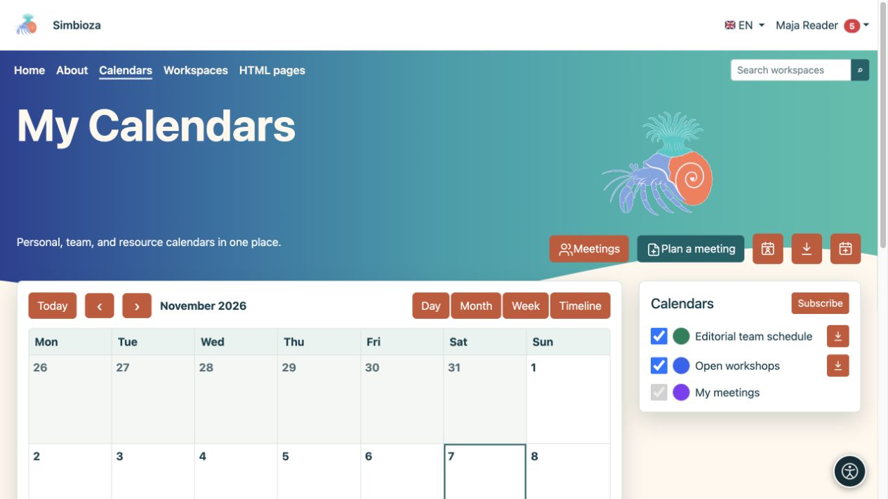
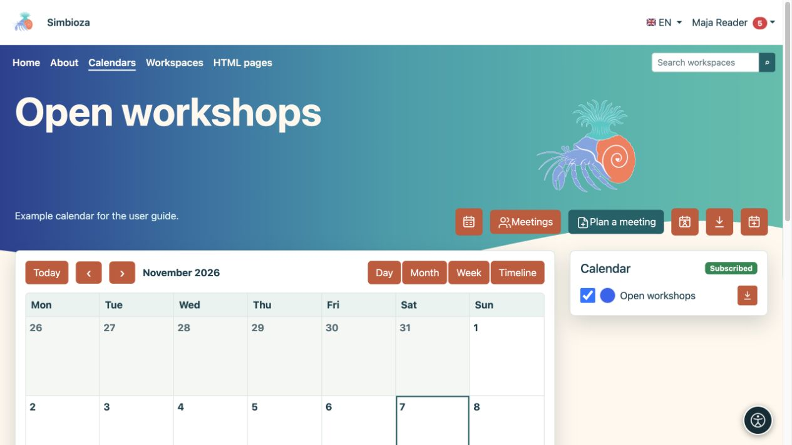
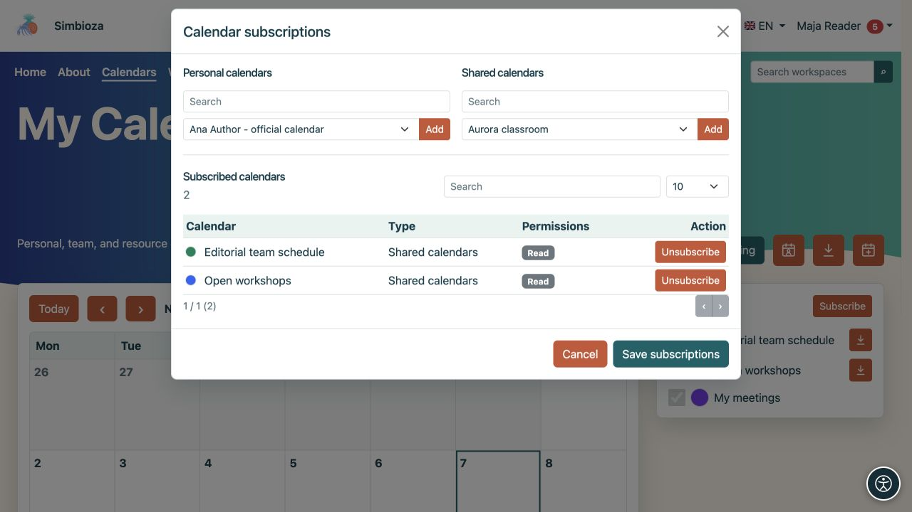
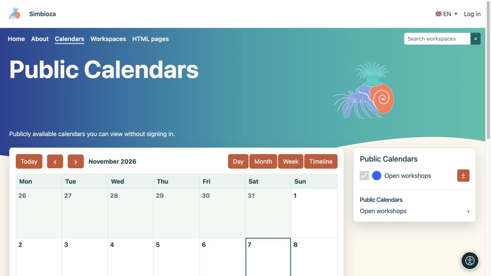

# Find events and adjust your view

[Calendars](kalendari_en.md)

**For:** anyone reading a schedule. Open **Calendars** in the main menu.

## Choose the date range and view

1. Check the displayed month or date range.
2. Use the arrows for the previous or next period. **Today** returns to today's date.
3. Choose the view that fits your task:

| View | Useful for |
| --- | --- |
| Month | A full month, all-day events and repeating schedules. |
| Week | Seven days by hour and spotting overlaps. |
| Day | A more detailed view of one day. |
| Timeline | A chronological event list. |

**Result:** only the display changes, not the events. Select an event to read its title, time, location and description. Editing actions appear only with the appropriate permission.

<figure class="my-4">

<figcaption>Change the date range and view with the controls. Calendar checkboxes show or hide the selected schedules.</figcaption>
</figure>

<figure class="my-4">

<figcaption>The week view arranges events by day and time.</figcaption>
</figure>

<figure class="my-4">

<figcaption>The day view emphasizes overlapping events from several calendars.</figcaption>
</figure>

<figure class="my-4">

<figcaption>The chronological view is useful for scanning upcoming obligations.</figcaption>
</figure>

## Show the calendars you need

The side list shows your calendars. Use each checkbox to show or hide its events. Hiding a calendar does not delete it.

Signed-in users can choose the coloured marker to set their own display colour. This helps distinguish schedules; it does not change the default colour for other users. Your visibility and colour choices are retained for your next visit.

Select a calendar name to view just that schedule. **All calendars** returns to the combined view.

<figure class="my-4">

<figcaption>Open workshops is displayed separately from the other selected calendars.</figcaption>
</figure>

## Subscribe to an available calendar

1. Sign in and select **Subscribe**.
2. Find the calendar and check whether you have read access or read and write access.
3. Enable the subscription and save the change.
4. Return to the main view and enable its checkbox if necessary.

**Result:** the calendar is in your personal list. A subscription does not grant new permissions. Unsubscribing does not delete the calendar or change your access; you may select it again while it remains available to you.

<figure class="my-4">

<figcaption>Read or read-and-write access is shown beside the calendar. Subscribing or unsubscribing does not change these permissions.</figcaption>
</figure>

## Read without signing in

Guests see only publicly readable calendars and the events included in the public view. They can change the date range, open a public calendar and export publicly available events. They cannot add events, manage personal subscriptions or set personal colours. The public view does not provide access to private calendars.

<figure class="my-4">

<figcaption>A guest can open the public Open workshops schedule. Private calendars are not in this list.</figcaption>
</figure>

## On a phone

In Month view, tap a date. Its event list and the calendar legend appear below the compact schedule. Use **Day** or **Timeline** to read individual appointments more comfortably.

<figure class="my-4">

<figcaption>A compact month view with the selected day's events and the calendar legend.</figcaption>
</figure>

## An expected event is missing

Check the date, the calendar checkbox and your subscription. If the entire calendar is absent, ask its owner to check its active status and your read permission. If you can see it but cannot choose it for a new event, you need write access — see [Events](kalendari-dogadaji_en.md).
