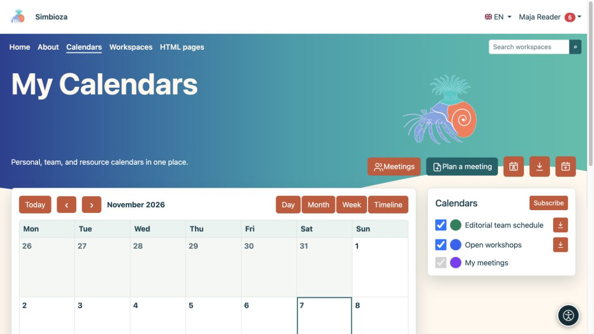
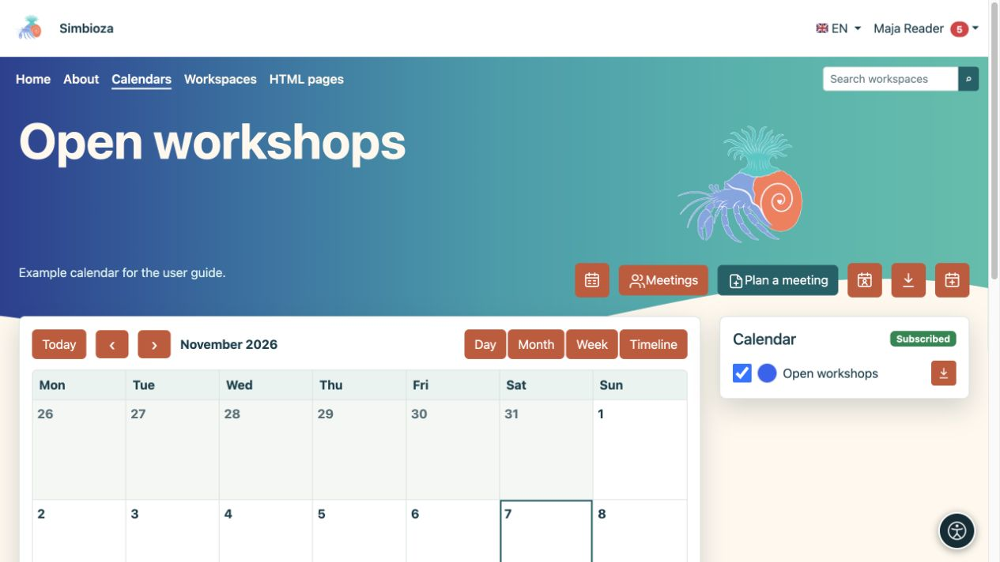
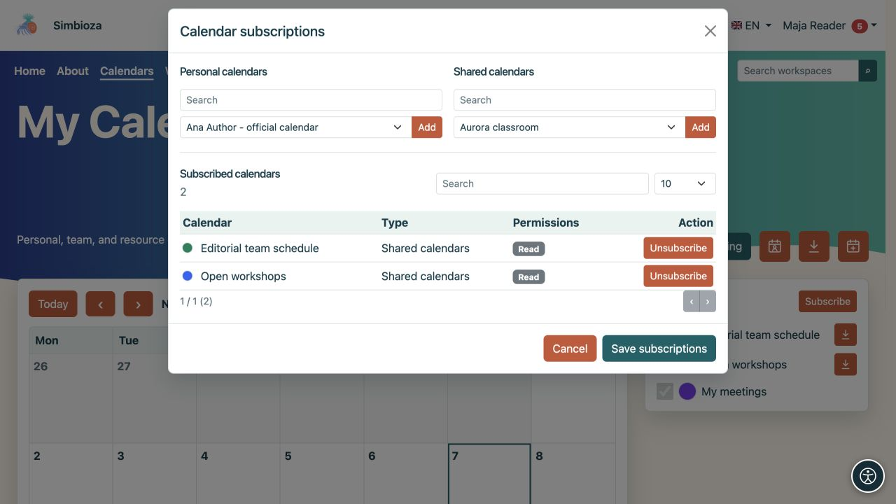
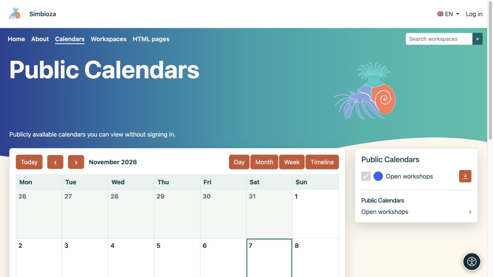

# Buscar eventos y ajustar la vista

> Las capturas de pantalla muestran la interfaz en inglés.

[Calendarios](kalendari_es.md)

**Para:** cualquiera que lea un horario. Abra **Calendarios** en el menú principal.

## Elija el rango de fechas y vea

1. Verifique el mes o rango de fechas mostrado.
2. Utilice las flechas para el período anterior o siguiente. **Hoy** vuelve a la fecha de hoy.
3. Elija la vista que se ajuste a su tarea:

| Vista | Útil para |
| --- | --- |
| Mes | Un mes completo, eventos durante todo el día y horarios repetidos. |
| Semana | Siete días por hora y las manchas se superponen. |
| Día | Una vista más detallada de un día. |
| Línea de tiempo | Una lista cronológica de eventos. |

**Resultado:** solo cambia la visualización, no los eventos. Seleccione un evento para leer su título, hora, ubicación y descripción. Las acciones de edición aparecen solo con el permiso adecuado.

<figure class="my-4">

<figcaption>Cambie el rango de fechas y visualice con los controles. Las casillas de verificación del calendario muestran u ocultan los horarios seleccionados.</figcaption>
</figure>

<figure class="my-4">

<figcaption>La vista semanal organiza eventos por día y hora.</figcaption>
</figure>

<figure class="my-4">

<figcaption>La vista del día enfatiza los eventos superpuestos de varios calendarios.</figcaption>
</figure>

<figure class="my-4">

<figcaption>La vista cronológica es útil para analizar las próximas obligaciones.</figcaption>
</figure>

## Muestra los calendarios que necesita

La lista lateral muestra sus calendarios. Utilice cada casilla de verificación para mostrar u ocultar sus eventos. Ocultar un calendario no lo elimina.

Los usuarios que hayan iniciado sesión pueden elegir el marcador de color para establecer su propio color de visualización. Esto ayuda a distinguir horarios; no cambia el color predeterminado para otros usuarios. Sus opciones de visibilidad y color se conservan para su próxima visita.

Seleccione un nombre de calendario para ver solo ese horario. **Todos los calendarios** vuelve a la vista combinada.

<figure class="my-4">

<figcaption>Los talleres abiertos se muestran por separado de los otros calendarios seleccionados.</figcaption>
</figure>

## Suscríbete a un calendario disponible

1. Inicie sesión y seleccione **Suscribirse**.
2. Busque el calendario y compruebe si tiene acceso de lectura o de lectura y escritura.
3. Habilite la suscripción y guarde el cambio.
4. Regrese a la vista principal y habilite su casilla de verificación si es necesario.

**Resultado:** el calendario está en su lista personal. Una suscripción no otorga nuevos permisos. Darse de baja no elimina el calendario ni cambia su acceso; puede seleccionarlo nuevamente mientras permanezca disponible para usted.

<figure class="my-4">

<figcaption>El acceso de lectura o lectura y escritura se muestra al lado del calendario. Suscribirse o darse de baja no cambia estos permisos.</figcaption>
</figure>

## Leer sin iniciar sesión

Los invitados solo ven los calendarios legibles públicamente y los eventos incluidos en la vista pública. Pueden cambiar el rango de fechas, abrir un calendario público y exportar eventos disponibles públicamente. No pueden agregar eventos, administrar suscripciones personales ni establecer colores personales. La vista pública no proporciona acceso a calendarios privados.

<figure class="my-4">

<figcaption>Un invitado puede abrir el calendario público de talleres abiertos. Los calendarios privados no están en esta lista.</figcaption>
</figure>

## en un teléfono

En la vista mensual, toque una fecha. Su lista de eventos y la leyenda del calendario aparecen debajo del programa compacto. Utilice **Día** o **Cronología** para leer citas individuales más cómodamente.

<figure class="my-4">

<figcaption>Una vista mensual compacta con los eventos del día seleccionado y la leyenda del calendario.</figcaption>
</figure>

## Falta un evento esperado

Consulte la fecha, la casilla del calendario y su suscripción. Si falta todo el calendario, pídale a su propietario que verifique su estado activo y su permiso de lectura. Si puede verlo pero no puede elegirlo para un nuevo evento, necesita acceso de escritura; consulte [Eventos](kalendari-dogadaji_es.md).
