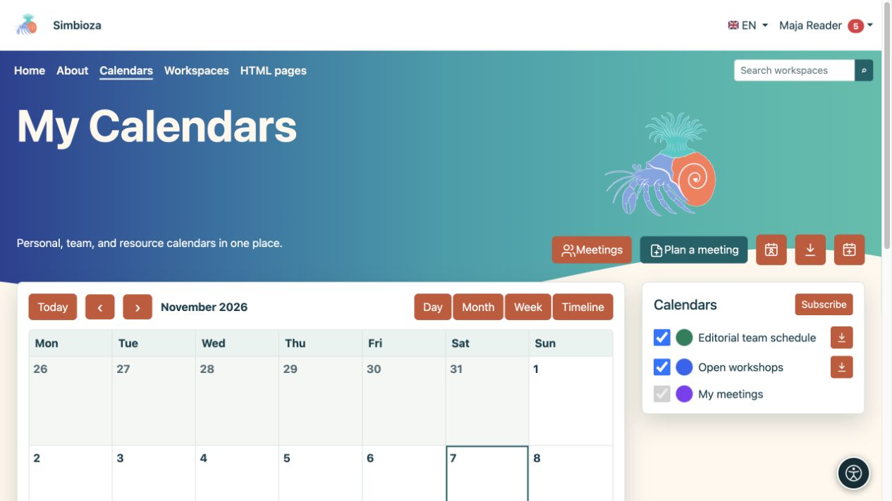
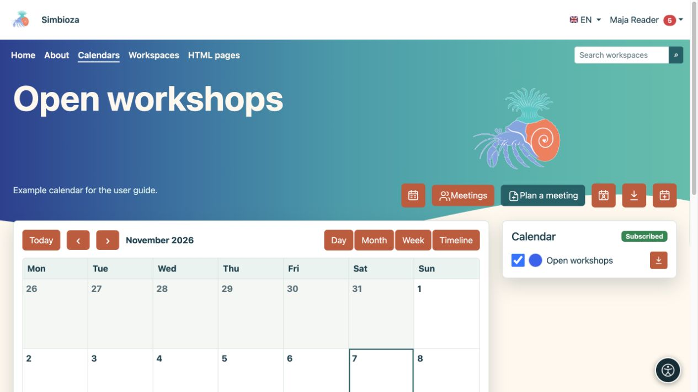
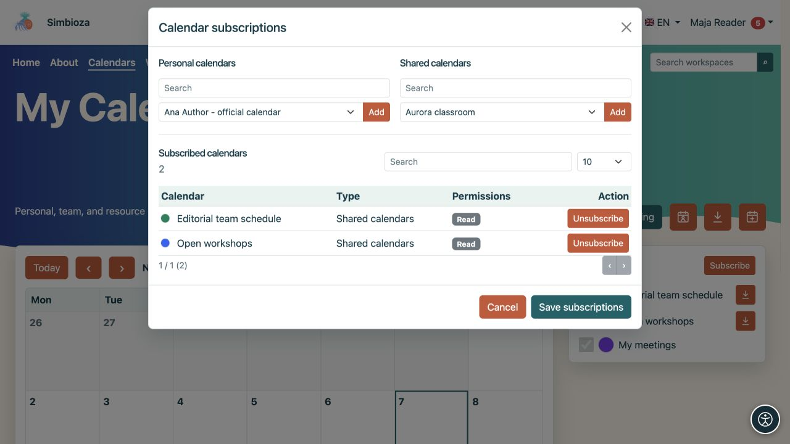
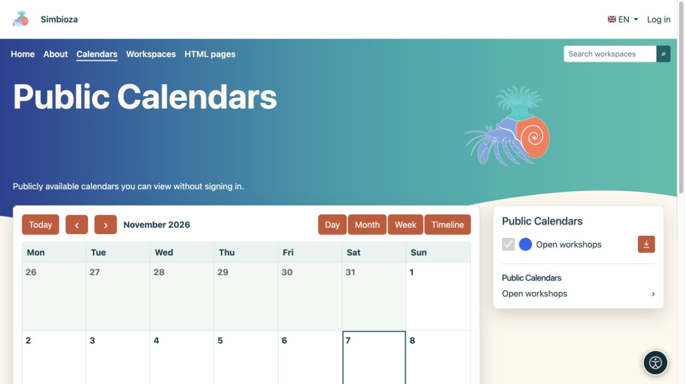

# Trouver des événements et adapter l’affichage

> Les captures d’écran présentent l’interface en anglais.

[Calendriers](kalendari_fr.md)

**Pour :** toute personne lisant un emploi du temps. Ouvrez **Calendriers** dans le menu principal.

## Choisissez la plage de dates et affichez

1. Vérifiez le mois ou la plage de dates affichée.
2. Utilisez les flèches pour la période précédente ou suivante. **Aujourd'hui** revient à la date d'aujourd'hui.
3. Choisissez la vue qui correspond à votre tâche :

| Voir | Utile pour |
| --- | --- |
| Mois | Un mois complet, des événements toute la journée et des horaires répétitifs. |
| Semaine | Sept jours par heure et repérage des chevauchements. |
| Jour | Une vue plus détaillée d'une journée. |
| Chronologie | Une liste chronologique des événements. |

**Résultat :** seul l'affichage change, pas les événements. Sélectionnez un événement pour lire son titre, son heure, son lieu et sa description. Les actions de modification n'apparaissent qu'avec l'autorisation appropriée.

<figure class="my-4">

<figcaption>Modifiez la plage de dates et affichez-la avec les commandes. Les cases à cocher du calendrier affichent ou masquent les horaires sélectionnés.</figcaption>
</figure>

<figure class="my-4">

<figcaption>La vue hebdomadaire organise les événements par jour et par heure.</figcaption>
</figure>

<figure class="my-4">

<figcaption>La vue quotidienne met l'accent sur les événements qui se chevauchent sur plusieurs calendriers.</figcaption>
</figure>

<figure class="my-4">

<figcaption>La vue chronologique est utile pour analyser les obligations à venir.</figcaption>
</figure>

## Affichez les calendriers dont vous avez besoin

La liste latérale affiche vos calendriers. Utilisez chaque case à cocher pour afficher ou masquer ses événements. Masquer un calendrier ne le supprime pas.

Les utilisateurs connectés peuvent choisir le marqueur de couleur pour définir leur propre couleur d'affichage. Cela permet de distinguer les horaires ; cela ne change pas la couleur par défaut pour les autres utilisateurs. Vos choix de visibilité et de couleurs sont conservés pour votre prochaine visite.

Sélectionnez un nom de calendrier pour afficher uniquement ce calendrier. **Tous les calendriers** revient à la vue combinée.

<figure class="my-4">

<figcaption>Les ateliers ouverts sont affichés séparément des autres calendriers sélectionnés.</figcaption>
</figure>

## Abonnez-vous à un calendrier disponible

1. Connectez-vous et sélectionnez **S'abonner**.
2. Recherchez le calendrier et vérifiez si vous disposez d'un accès en lecture ou d'un accès en lecture et en écriture.
3. Activez l'abonnement et enregistrez la modification.
4. Revenez à la vue principale et cochez sa case si nécessaire.

**Résultat :** le calendrier est dans votre liste personnelle. Un abonnement n'accorde pas de nouvelles autorisations. La désinscription ne supprime pas le calendrier et ne modifie pas vos accès ; vous pouvez le sélectionner à nouveau tant qu'il reste disponible.

<figure class="my-4">

<figcaption>L'accès en lecture ou en lecture et écriture est affiché à côté du calendrier. L'abonnement ou le désabonnement ne modifie pas ces autorisations.</figcaption>
</figure>

## Lire sans vous connecter

Les invités voient uniquement les calendriers lisibles publiquement et les événements inclus dans la vue publique. Ils peuvent modifier la plage de dates, ouvrir un calendrier public et exporter des événements accessibles au public. Ils ne peuvent pas ajouter d'événements, gérer des abonnements personnels ou définir des couleurs personnelles. La vue publique ne donne pas accès aux calendriers privés.

<figure class="my-4">

<figcaption>Un invité peut ouvrir le calendrier public des ateliers ouverts. Les agendas privés ne figurent pas dans cette liste.</figcaption>
</figure>

## Sur un téléphone

Dans la vue Mois, appuyez sur une date. Sa liste d'événements et la légende du calendrier apparaissent sous le planning compact. Utilisez **Day** ou **Timeline** pour lire les rendez-vous individuels plus confortablement.

<figure class="my-4">

<figcaption>Une vue mensuelle compacte avec les événements du jour sélectionné et la légende du calendrier.</figcaption>
</figure>

## Il manque un événement attendu

Vérifiez la date, la case à cocher du calendrier et votre abonnement. Si l'intégralité du calendrier est absent, demandez à son propriétaire de vérifier son statut actif et votre autorisation de lecture. Si vous pouvez le voir mais ne pouvez pas le choisir pour un nouvel événement, vous avez besoin d'un accès en écriture — voir [Événements](kalendari-dogadaji_fr.md).
