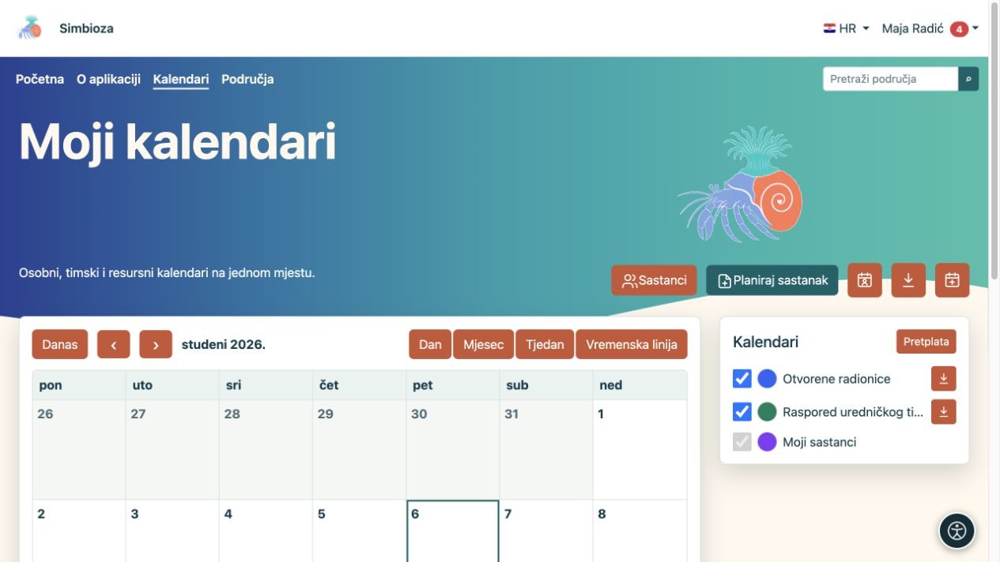
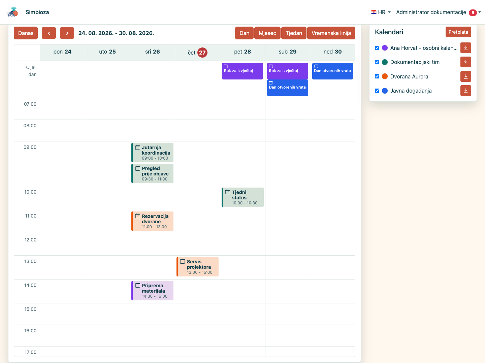
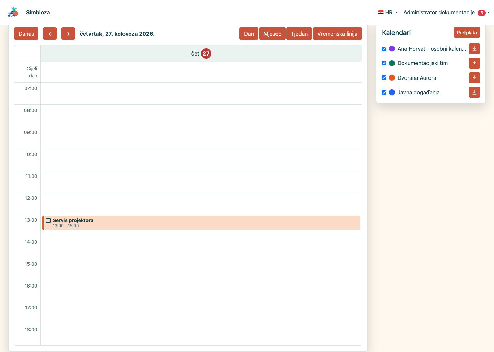
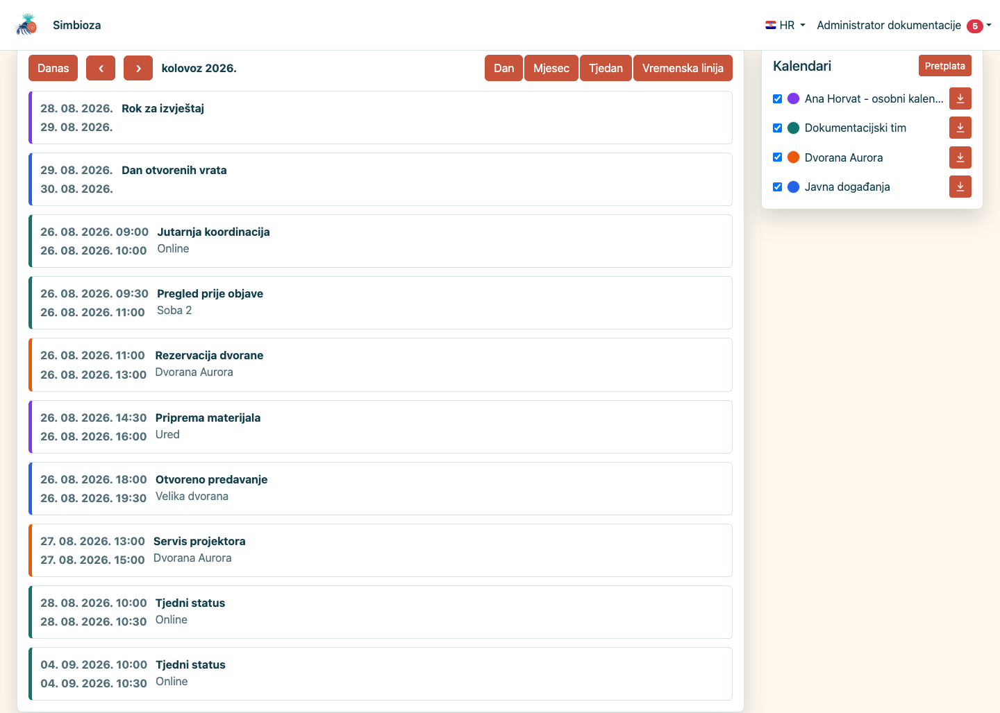
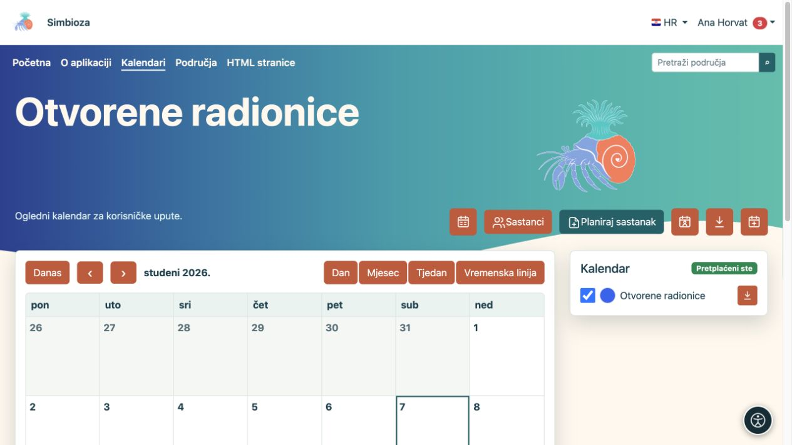
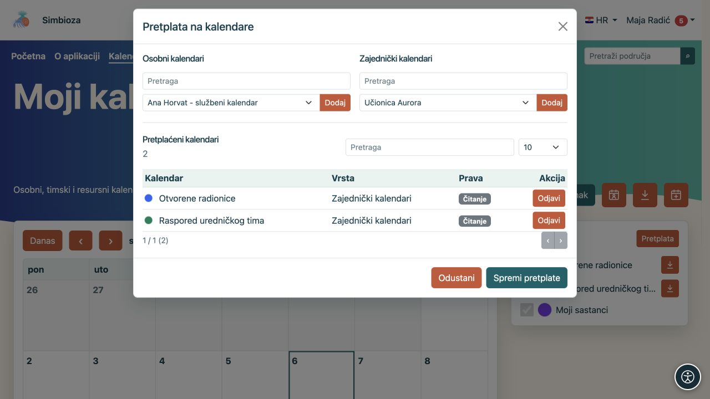
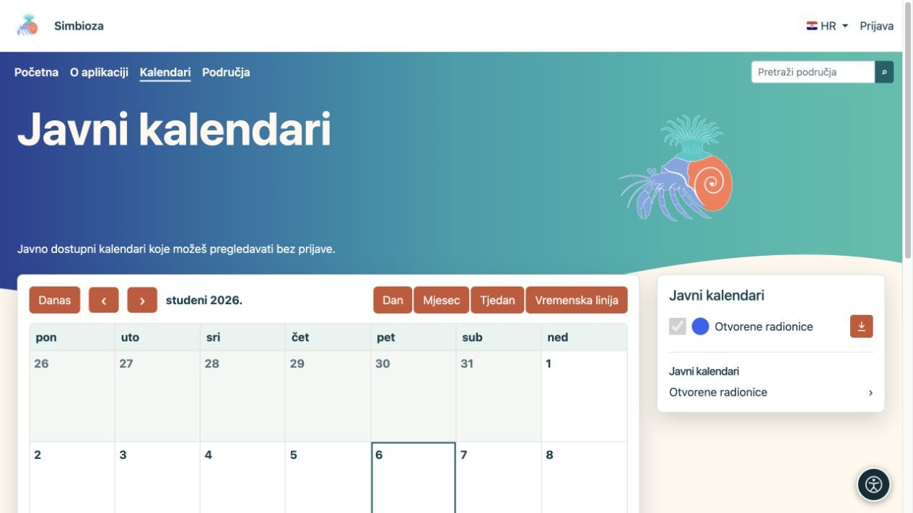
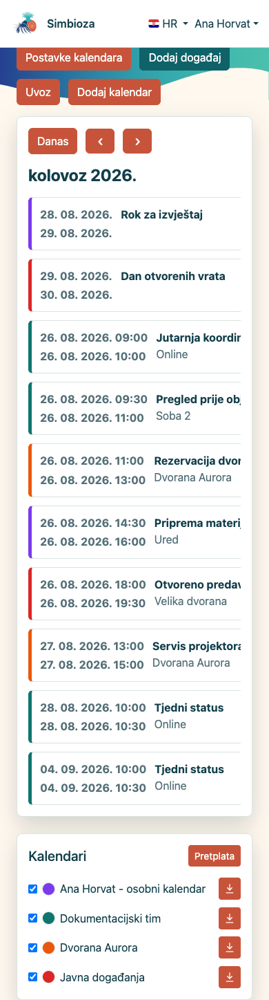

# Pronađite događaj i podesite pregled

[Kalendari](kalendari_hr.md)

**Za koga:** za svakoga tko želi čitati raspored. Krenite od **Kalendari** u glavnom izborniku.

## Odaberite razdoblje i prikaz

1. Pogledajte naziv prikazanog mjeseca ili razdoblja.
2. Strelicama prijeđite na prethodno ili sljedeće razdoblje. **Danas** vraća današnji datum.
3. Odaberite prikaz koji vam odgovara:

| Prikaz | Kada pomaže |
| --- | --- |
| Mjesec | Pregled cijelog mjeseca, cjelodnevnih događaja i ponavljanja. |
| Tjedan | Raspored sedam dana po satima i uočavanje preklapanja. |
| Dan | Detaljniji pregled jednoga dana. |
| Vremenska linija | Kronološki popis događaja. |

**Rezultat:** mijenja se prikaz, a ne događaji. Odaberite događaj da pročitate njegov naslov, vrijeme, lokaciju i opis. Akcije izmjene pojavljuju se samo kada imate odgovarajuće pravo.

<figure class="my-4">

<figcaption>Kontrole mijenjaju razdoblje i prikaz; kvačice desno uključuju ili skrivaju odabrane kalendare.</figcaption>
</figure>

<figure class="my-4">

<figcaption>Tjedni prikaz pokazuje raspored po danima i satima.</figcaption>
</figure>

<figure class="my-4">

<figcaption>Dnevni prikaz naglašava preklopljene termine iz više kalendara.</figcaption>
</figure>

<figure class="my-4">

<figcaption>Kronološki prikaz događaja prikladan je za brzi pregled nadolazećih obveza.</figcaption>
</figure>

## Uključite potrebne kalendare

Bočni popis prikazuje vaše kalendare. Kvačicom uključite ili sakrijte događaje pojedinog kalendara. Skriven kalendar time nije obrisan.

Prijavljeni korisnik može odabrati obojenu oznaku i svoju boju kalendara. Time lakše razlikuje više rasporeda; osnovna boja za druge korisnike ostaje nepromijenjena. Osobni izbor vidljivosti i boje pamti se za sljedeći dolazak.

Za jedan raspored odaberite naziv kalendara. **Svi kalendari** vraća zajednički prikaz.

<figure class="my-4">

<figcaption>Otvorene radionice prikazane su zasebno, bez ostalih odabranih kalendara.</figcaption>
</figure>

## Pretplatite se na dostupan kalendar

1. Prijavite se i odaberite **Pretplata**.
2. Pronađite kalendar i pročitajte imate li čitanje ili i pisanje.
3. Uključite pretplatu i spremite promjenu.
4. Vratite se na glavni pregled i po potrebi uključite njegovu kvačicu.

**Rezultat:** kalendar je u vašem osobnom popisu. Pretplata ne dodjeljuje nova prava. Odjava iz pretplate ne briše kalendar i ne mijenja pravo koje imate; kalendar možete ponovno odabrati dok vam je dostupan.

<figure class="my-4">

<figcaption>Uz svaki već odabrani kalendar piše razina prava. Dodavanje ili odjava pretplate ne mijenja dopuštenja.</figcaption>
</figure>

## Pregled bez prijave

Gost vidi samo javno čitljive kalendare i događaje koji su uključeni u javni prikaz. Može mijenjati razdoblje, otvoriti javni kalendar i izvesti javno dostupne događaje. Nema unosa događaja, osobnih pretplata ni postavki boje. Javni prikaz nije način pristupa privatnom kalendaru.

<figure class="my-4">

<figcaption>Gost vidi javni raspored Otvorene radionice i poveznicu na taj kalendar; privatni rasporedi nisu na popisu.</figcaption>
</figure>

## Na mobitelu

U mjesečnom prikazu dodirnite datum. Ispod kompaktnog rasporeda prikazuje se popis njegovih događaja i legenda kalendara. Za lakše čitanje jednog termina otvorite prikaz **Dan** ili **Vremenska linija**.

<figure class="my-4">

<figcaption>Mobilni prikaz mjeseca s popisom događaja odabranog dana i legendom kalendara.</figcaption>
</figure>

## Ne vidim očekivani događaj

Provjerite datum, uključenu kvačicu kalendara i pretplatu. Ako nedostaje cijeli kalendar, zamolite vlasnika da provjeri aktivnost i pravo čitanja. Ako ga vidite, ali ga ne možete ponuditi za novi događaj, nedostaje pravo pisanja — pogledajte [Događaji](kalendari-dogadaji_hr.md).
