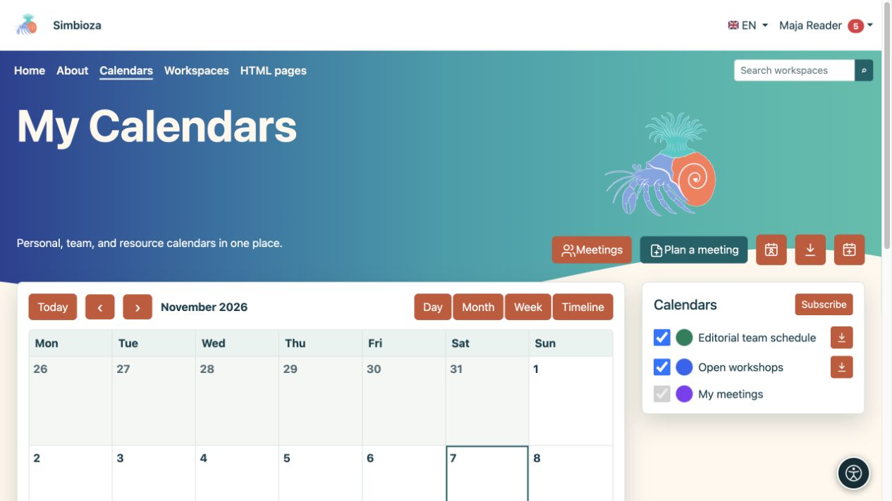
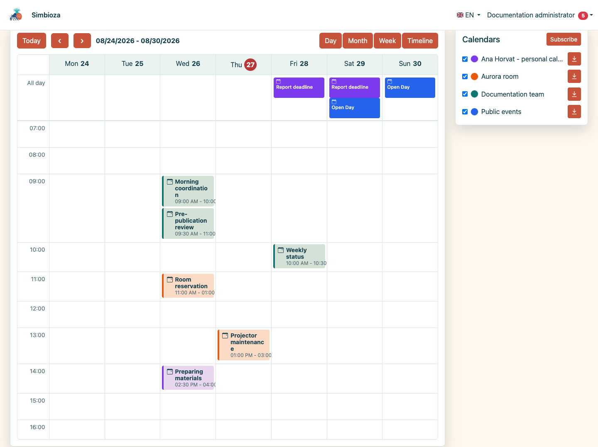
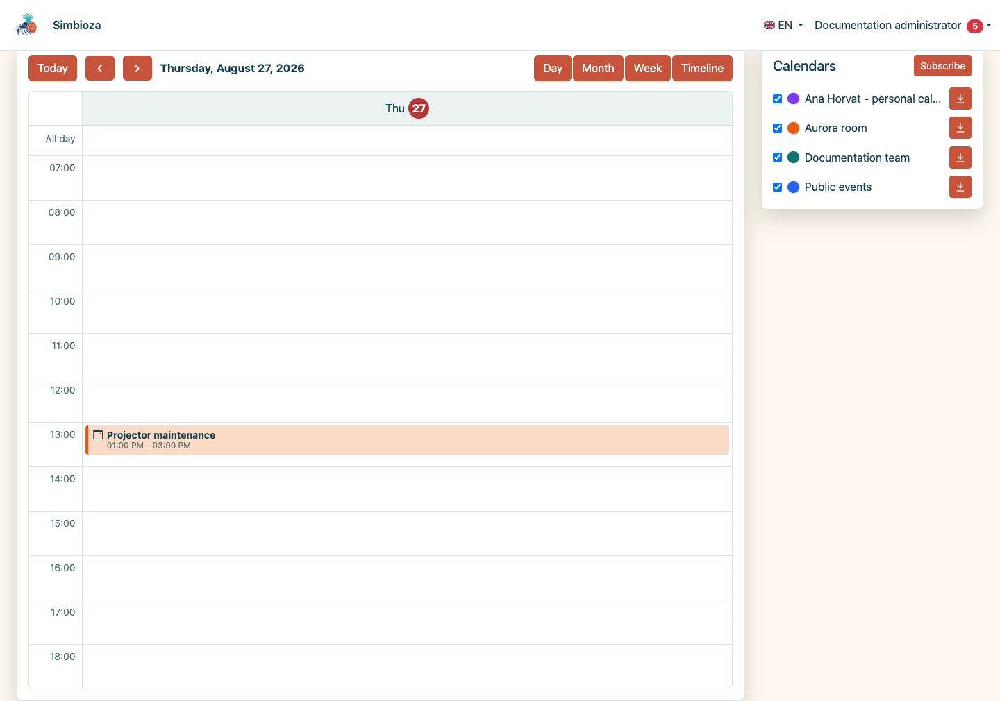
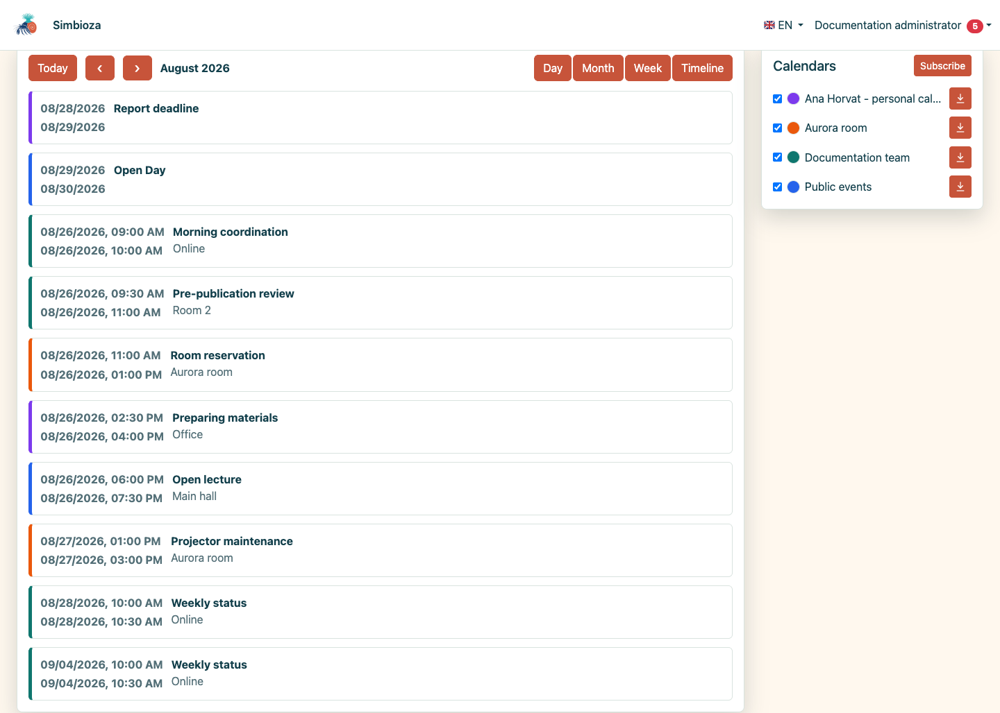
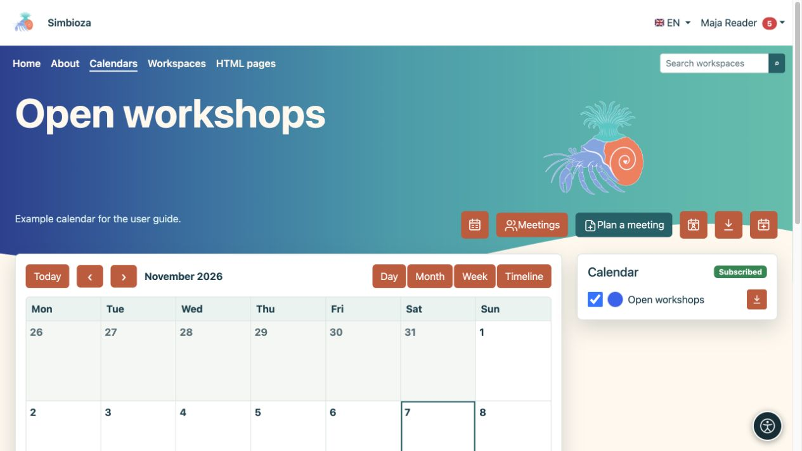
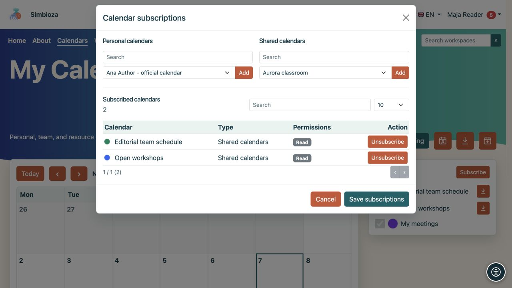
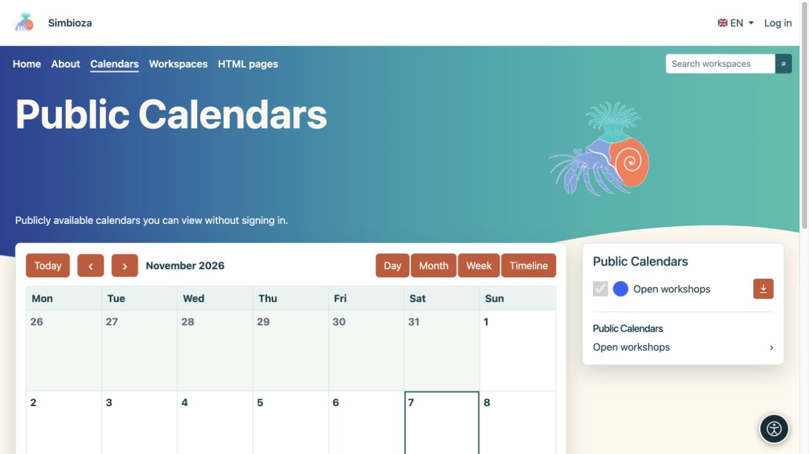
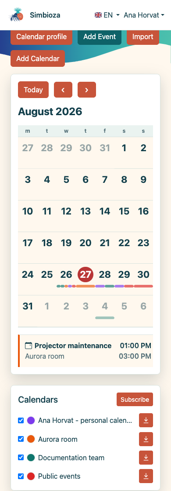

# Trova eventi e modifica la tua visualizzazione

> Le schermate mostrano l’interfaccia in inglese.

[Calendari](kalendari_it.md)

**Per:** chiunque legga un programma. Apri **Calendari** nel menu principale.

## Scegli l'intervallo di date e visualizza

1. Controlla il mese o l'intervallo di date visualizzato.
2. Utilizzare le frecce per il periodo precedente o successivo. **Oggi** ritorna alla data odierna.
3. Scegli la vista più adatta al tuo compito:

| Visualizzazione | Utile per |
| --- | --- |
| Mese | Un mese intero, eventi che durano tutto il giorno e programmi ricorrenti. |
| Settimana | Sette giorni per ora e individuazione delle sovrapposizioni. |
| Giorno | Una visione più dettagliata di un giorno. |
| Cronologia | Un elenco cronologico degli eventi. |

**Risultato:** cambia solo la visualizzazione, non gli eventi. Seleziona un evento per leggerne il titolo, l'ora, il luogo e la descrizione. Le azioni di modifica vengono visualizzate solo con l'autorizzazione appropriata.

<figure class="my-4">

<figcaption>Modifica l'intervallo di date e visualizzalo con i controlli. Le caselle di controllo del calendario mostrano o nascondono le pianificazioni selezionate.</figcaption>
</figure>

<figure class="my-4">

<figcaption>La visualizzazione settimanale organizza gli eventi per giorno e ora.</figcaption>
</figure>

<figure class="my-4">

<figcaption>La vista giornaliera enfatizza gli eventi sovrapposti di diversi calendari.</figcaption>
</figure>

<figure class="my-4">

<figcaption>La vista cronologica è utile per scansionare gli impegni imminenti.</figcaption>
</figure>

## Mostra i calendari che ti servono

L'elenco laterale mostra i tuoi calendari. Utilizza ciascuna casella di controllo per mostrare o nascondere i relativi eventi. Nascondere un calendario non lo elimina.

Gli utenti che hanno effettuato l'accesso possono scegliere l'indicatore colorato per impostare il proprio colore di visualizzazione. Questo aiuta a distinguere gli orari; non cambia il colore predefinito per gli altri utenti. La tua visibilità e le scelte di colore verranno conservate per la tua prossima visita.

Seleziona un nome di calendario per visualizzare solo quella pianificazione. **Tutti i calendari** ritorna alla visualizzazione combinata.

<figure class="my-4">

<figcaption>I workshop aperti vengono visualizzati separatamente dagli altri calendari selezionati.</figcaption>
</figure>

## Iscriviti a un calendario disponibile

1. Accedi e seleziona **Iscriviti**.
2. Trova il calendario e controlla se disponi di accesso in lettura o di accesso in lettura e scrittura.
3. Abilita l'abbonamento e salva la modifica.
4. Ritorna alla vista principale e abilita la relativa casella di controllo, se necessario.

**Risultato:** il calendario è nella tua lista personale. Un abbonamento non concede nuove autorizzazioni. L'annullamento dell'iscrizione non elimina il calendario né modifica il tuo accesso; puoi selezionarlo di nuovo mentre rimane a tua disposizione.

<figure class="my-4">

<figcaption>L'accesso in lettura o in lettura e scrittura viene visualizzato accanto al calendario. L'iscrizione o l'annullamento dell'iscrizione non modifica queste autorizzazioni.</figcaption>
</figure>

## Leggi senza effettuare l'accesso

Gli ospiti vedono solo i calendari leggibili pubblicamente e gli eventi inclusi nella visualizzazione pubblica. Possono modificare l'intervallo di date, aprire un calendario pubblico ed esportare eventi disponibili pubblicamente. Non possono aggiungere eventi, gestire abbonamenti personali o impostare colori personali. La visualizzazione pubblica non fornisce l'accesso ai calendari privati.

<figure class="my-4">

<figcaption>Un ospite può aprire il programma pubblico dei workshop aperti. I calendari privati non sono in questo elenco.</figcaption>
</figure>

## Al telefono

Nella vista Mese, tocca una data. L'elenco degli eventi e la legenda del calendario vengono visualizzati sotto il programma compatto. Utilizza **Giorno** o **Timeline** per leggere più comodamente i singoli appuntamenti.

<figure class="my-4">

<figcaption>Una visualizzazione mensile compatta con gli eventi del giorno selezionato e la legenda del calendario.</figcaption>
</figure>

## Manca un evento previsto

Controlla la data, la casella di controllo del calendario e il tuo abbonamento. Se l'intero calendario è assente, chiedi al proprietario di verificarne lo stato attivo e il tuo permesso di lettura. Se puoi vederlo ma non puoi sceglierlo per un nuovo evento, devi avere accesso in scrittura: vedi [Eventi](kalendari-dogadaji_it.md).
