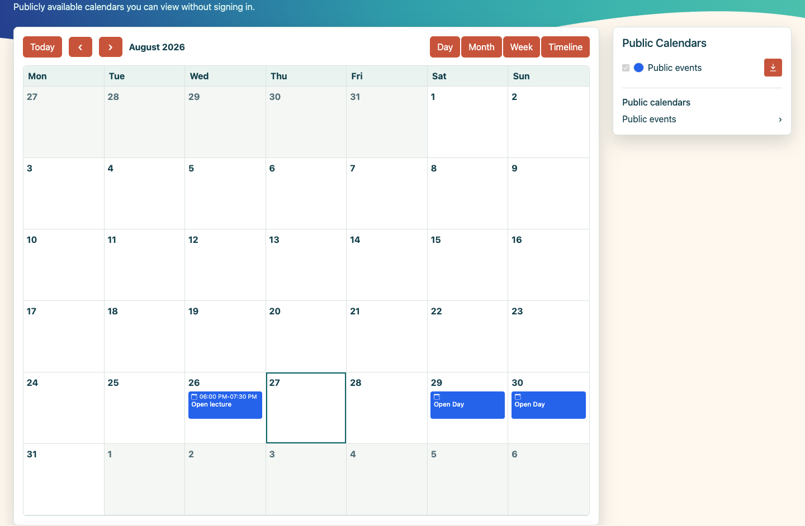
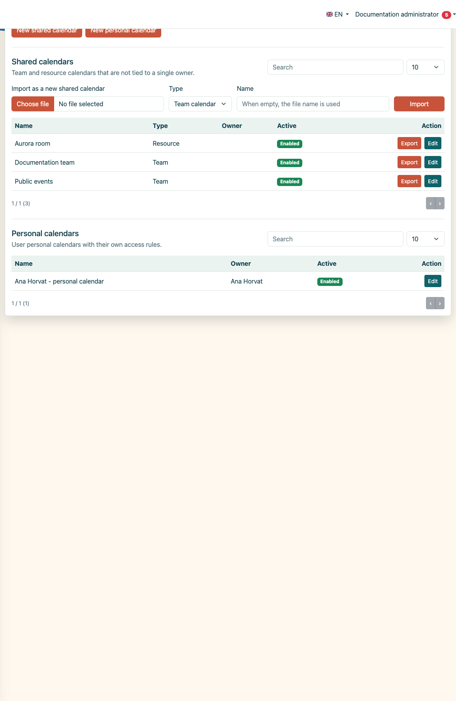
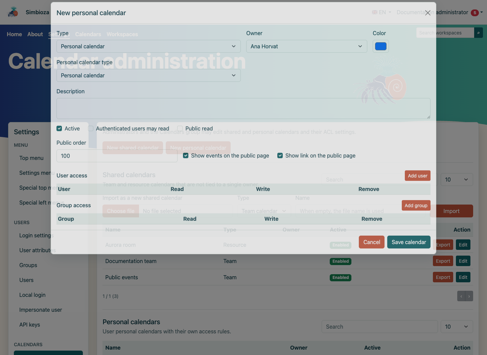
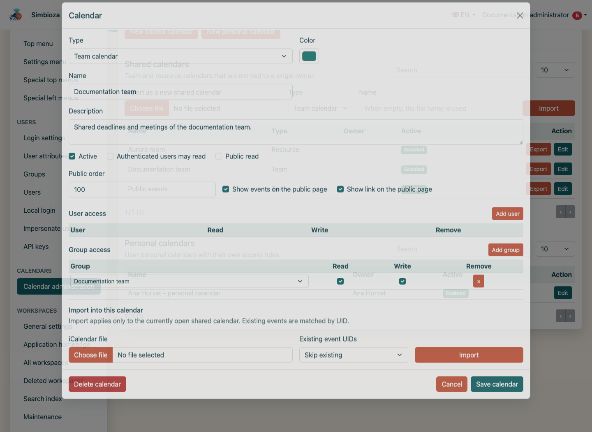
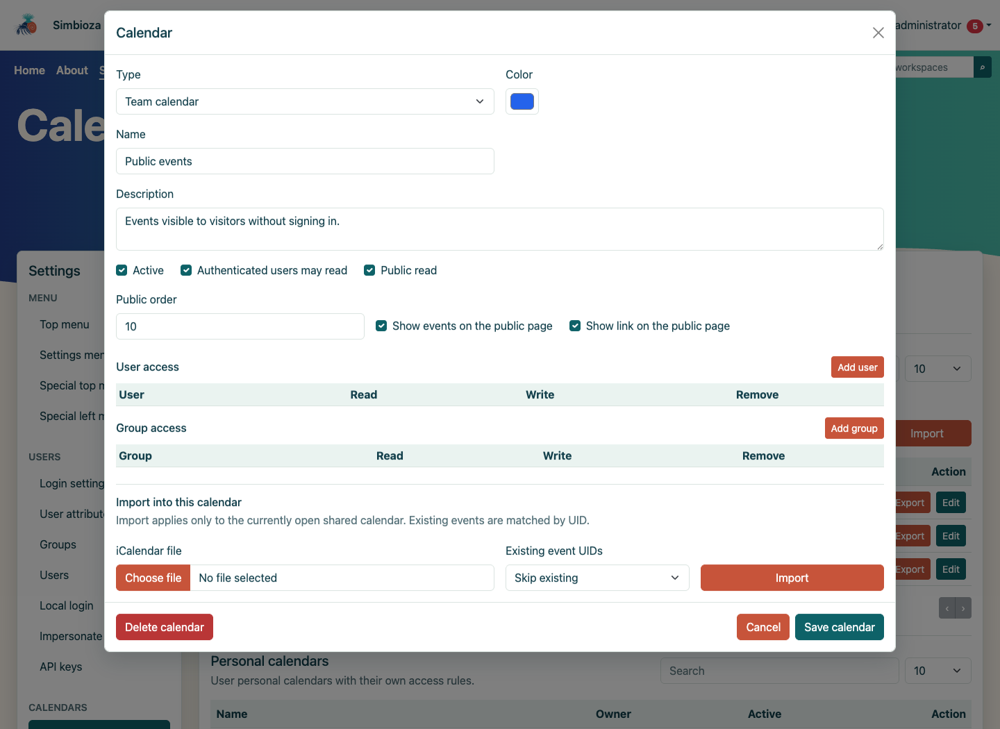
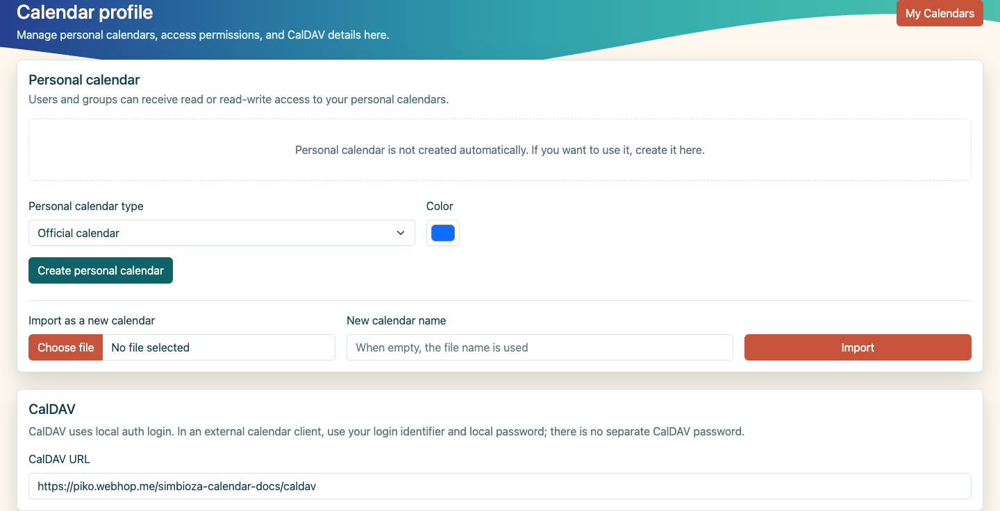
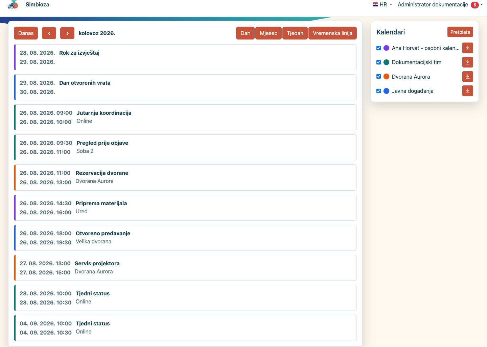
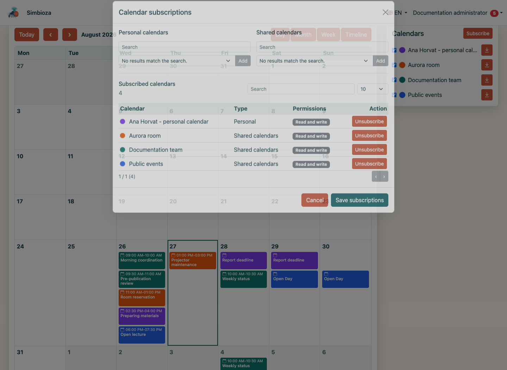
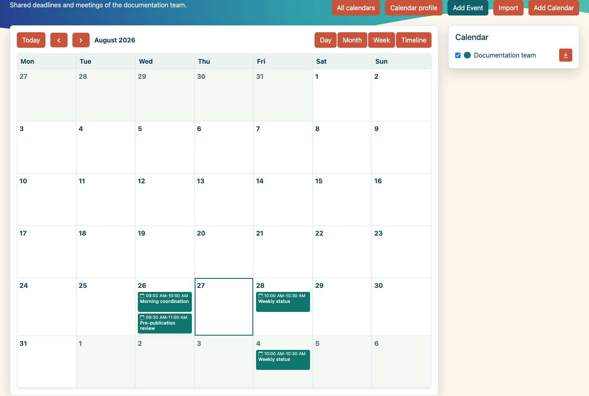
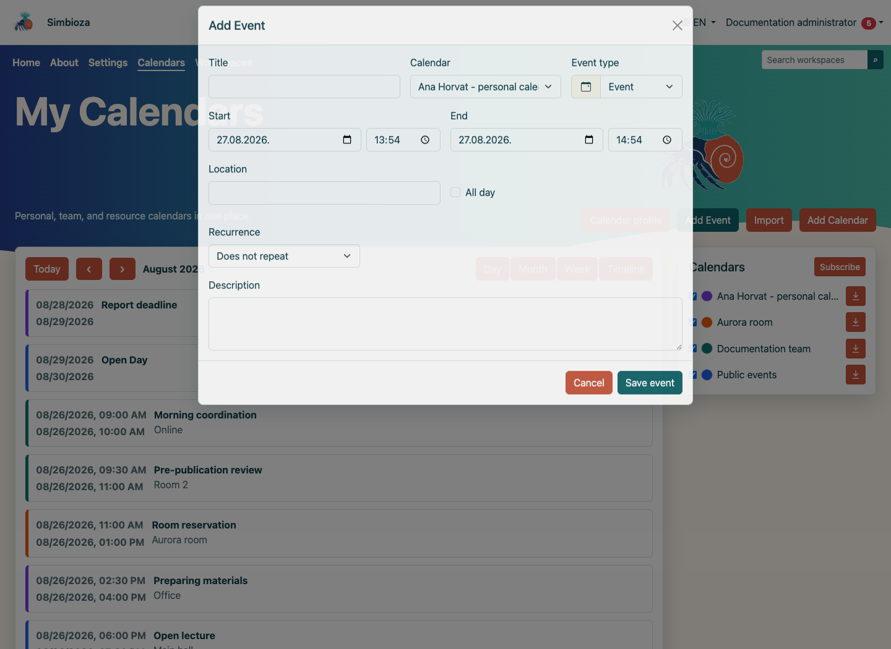

# Calendars

This guide explains public, team, resource, and personal calendars in Simbioza: administration, access rights, subscriptions, colors, views, events, recurrence, iCalendar exchange, CalDAV, and mobile use.

**The examples were created in a separate clean SQLite installation.** All local accounts, groups, calendars, and events are fictional. No passwords, tokens, or other secret values appear in the screenshots.

## Contents

1.  [Calendar types and roles](#types-and-roles)
2.  [Public calendars without signing in](#public-view)
3.  [Calendar administration](#administration)
4.  [Access rights and public visibility](#permissions)
5.  [Personal calendars](#personal)
6.  [Multiple calendars, subscriptions, and colors](#main-view)
7.  [Month, week, day, and timeline views](#views)
8.  [Creating and editing events](#events)
9.  [iCalendar import and export](#ics)
10. [CalDAV](#caldav)
11. [Mobile view](#mobile)
12. [Administrator and regular user](#differences)
13. [Final verification and troubleshooting](#verification)

## 1. Calendar types and roles

Simbioza displays every calendar that the current user may read in one place. Read access controls visibility; write access controls whether the user may create, edit, and delete events.

| Type | Purpose | Who creates and manages it |
|----|----|----|
| **Public** | Announcements and events visible even to visitors who have not signed in. Technically, this is a team calendar with public read enabled. | An administrator or a member of the system **Calendars** group. |
| **Team** | Shared deadlines and meetings for a department, project, or working group. | An administrator or the **Calendars** group; access is granted to users and groups. |
| **Resource** | A schedule for a room, device, vehicle, or another shared resource. | An administrator or the **Calendars** group; ACL entries determine read and write access. |
| **Personal** | A private or official calendar owned by one user, with optional sharing. | The owner through Calendar profile; an administrator may also create and maintain it. |

**The Calendars group.** Administrators and members of the system *Calendars* group can open **Settings → Calendars → Calendar administration**. A regular user cannot see or access that screen.

## 2. Public calendars without signing in

When at least one calendar is publicly readable, an unauthenticated visitor receives the public view at `/calendars`. Personal, team, and resource calendars without public access are not exposed.

<figure class="my-4">

<figcaption>A visitor sees only the public Events calendar and the events explicitly published through it.</figcaption>
</figure>

The public page supports month, week, day, and timeline views and export of the public calendar. It does not offer event creation, subscriptions, or personal color settings. A public calendar name links to its standalone view.

## 3. Calendar administration

Open **Settings → Calendars → Calendar administration**. The upper table contains shared team and resource calendars; the lower table contains personal calendars. Both support search, sorting, page size, and pagination.

<figure class="my-4">

<figcaption>Separate shared and personal calendar lists with import, export, and edit actions.</figcaption>
</figure>

### 3.1. New team or resource calendar

1.  Select **New shared calendar**.
2.  Choose **Team calendar** or **Resource calendar**.
3.  Enter a clear name and description and select the base color.
4.  Keep **Active** enabled. A disabled calendar and its events are unavailable to users.
5.  Add users or groups and enable **Read** and **Write** independently.
6.  Save the calendar and open it from the main calendar page for verification.

### 3.2. New personal calendar from administration

An administrator may select a user and create an official, personal, or custom personal calendar. The name is generated from the user's display name; a custom calendar uses a unique suffix so the same user may own multiple personal calendars.

<figure class="my-4">

<figcaption>The administrator selects the owner, personal calendar type, color, and initial access rules.</figcaption>
</figure>

## 4. Access rights and public visibility

The calendar dialog combines the basic properties, public visibility, and ACL entries. User and group rights are additive: any valid source may grant read or write. Write access permits event operations; changing the calendar itself and its ACL remains an administrator or Calendars-group task.

<figure class="my-4">

<figcaption>The Documentation team group has read and write access; ICS import is available in the same dialog.</figcaption>
</figure>

### 4.1. Public settings

- **Authenticated users may read** grants read access to every signed-in user without an individual ACL row.
- **Public read** permits reading without signing in.
- **Public order** controls ordering among public calendars; lower numbers appear first.
- **Show events on the public page** includes events in the aggregate public view.
- **Show link on the public page** exposes the calendar name as a link to its standalone public view.

<figure class="my-4">

<figcaption>Public read, ordering, aggregate events, and the standalone link are configured independently.</figcaption>
</figure>

Use public read only for information intended for everyone. Event titles, descriptions, and locations also become public. Use authenticated access or a targeted ACL for internal information.

## 5. Personal calendars

Each user opens **Calendars → Calendar profile**. A personal calendar does not have to be created automatically; the user can create one when needed. The owner can export it, import ICS data, share read or write access with a user or group, and create additional official or custom calendars.

<figure class="my-4">

<figcaption>The owner shares a personal calendar, manages ICS content, and sees the CalDAV URL.</figcaption>
</figure>

In the example, Petar Novak has read-only access. He can see Ana's personal calendar and events, but it is not offered when he creates a new event.

## 6. Multiple calendars, subscriptions, and colors

**My Calendars** overlays events from every selected calendar. The color next to each calendar distinguishes its events and can be changed for the current user without changing the base color for anyone else.

<figure class="my-4">

<figcaption>Four calendars are shown together, each with a separate user color.</figcaption>
</figure>

### 6.1. Visibility and color

- Clear the checkbox next to a calendar to hide it temporarily.
- Select its color square to choose a personal display color.
- Visibility and color choices persist for later visits.
- The export icon next to a calendar downloads its `.ics` file.

### 6.2. Subscriptions

Select **Subscribe** to review every readable calendar. The table states whether the current access level is read-only or read-write. Unsubscribing removes the calendar from the personal list; it does not delete the calendar or change the ACL.

<figure class="my-4">

<figcaption>Subscriptions remain separate from ACL rights and display the effective access level for every calendar.</figcaption>
</figure>

### 6.3. One-calendar view

Every calendar name in the sidebar is a link. Select it to display only that calendar; **All calendars** returns to the combined overlay.

<figure class="my-4">

<figcaption>The Documentation team calendar is shown without events from other calendars.</figcaption>
</figure>

## 7. Month, week, day, and timeline views

- **Month** provides the broadest overview and shows multiple calendars, all-day events, and recurrences clearly.
- **Week** arranges seven days by hour and makes overlaps easy to spot.
- **Day** enlarges a single day for a detailed schedule.
- **Timeline** presents events as a chronological list.
- **Today** returns to the current date; the arrow buttons move to the previous or next period.

<figure class="my-4">

<figcaption>The week view arranges events by day and time.</figcaption>
</figure>

<figure class="my-4">

<figcaption>The day view emphasizes overlapping events from several calendars.</figcaption>
</figure>

<figure class="my-4">

<figcaption>The chronological view is useful for scanning upcoming obligations.</figcaption>
</figure>

## 8. Creating and editing events

Select **Add Event**. The calendar selector lists only calendars to which the current user may write. In the example, the regular user may write to her personal and team calendars while the resource and public calendars remain read-only.

### 8.1. Event fields

- **Title** is required.
- **Calendar** determines the event's rights, audience, and color.
- **Event type** adds a semantic label and icon. Built-in types are available, and an authorized user can add a new type.
- **Start and end** include the date and time. The end cannot precede the start.
- **All day** hides time fields and spans the selected date or date range.
- **Location and description** are optional but visible to everyone who can read the calendar.

### 8.2. Recurrence

An event can repeat every day, week, month, or year. The series may have no end, stop after a selected number of occurrences, or end on a date.

<figure class="my-4">

<figcaption>A weekly editorial meeting that stops after six occurrences.</figcaption>
</figure>

### 8.3. Editing and deleting

Select an existing event to edit it. For a recurring event, the dialog identifies the selected occurrence and the start of the series. Saving updates the source event and its series; deletion follows the same series-level behavior.

## 9. iCalendar import and export

Simbioza uses the standard iCalendar `.ics` format for exchanging events with other systems.

- **Export** is available next to each readable calendar and in Calendar profile.
- **Import into an existing calendar** requires write access.
- **Import as a new calendar** creates a new team/resource calendar for an administrator or a new personal calendar for a user.
- Events are matched by stable `UID`. **Skip existing** preserves current records; **Update existing** replaces them with values from the imported file.

Export the destination calendar before a large import. Verify time zones, all-day events, and recurrence rules in a test calendar first.

## 10. CalDAV

CalDAV connects Simbioza calendars to an external calendar client. The address is displayed under **Calendars → Calendar profile → CalDAV**.

### 10.1. Prerequisite: local credentials

CalDAV uses the user's **local login identifier and local Simbioza password**. There is no separate CalDAV password. An administrator must prepare a local credential for an SSO-only user before connecting. Permission to sign in locally through the website is separate: CalDAV works even when local web sign-in is disabled globally or for that user. Enter the password only into a trusted client over HTTPS and never expose it in documentation or screenshots.

### 10.2. Client setup

1.  Copy the displayed CalDAV URL, for example `https://your-host/application/caldav`.
2.  Add a new CalDAV account in the external client.
3.  Use the local login identifier as the username and the local password as the password.
4.  Accept only a valid HTTPS certificate and review the discovered calendars.
5.  Create a test event in a writable calendar and verify two-way synchronization.

The CalDAV endpoint implements the basic discovery, read, and write operations required by common clients. Advanced properties may behave differently between clients, so test the intended client before an organization-wide rollout.

## 11. Mobile view

On a narrow screen, the month grid becomes compact. Selecting a date reveals a chronological list of its events; the calendar legend and personal colors remain available below the schedule.

<figure class="my-4">

<figcaption>A compact month view with the selected day's events and the calendar legend.</figcaption>
</figure>

## 12. Administrator and regular user

| Capability | Administrator / Calendars group | Regular user |
|----|----|----|
| Administer shared calendars | Yes | No |
| Create team and resource calendars | Yes | No |
| Create a personal calendar | For any user | For self |
| Manage a shared calendar ACL | Yes | No |
| Manage own personal calendar ACL | Yes | Yes |
| Create events | In administratively writable calendars | Only in calendars with write access |
| Read, subscribe, color, and export | For readable calendars | For readable calendars |
| CalDAV | Yes, with local credentials | Yes, with local credentials |

### 12.1. Administrator — meeting backup

A new Workspace backup includes the participants, replies, organizers, resource reservations and approvers for its calendars, together with the resource calendars needed by those meetings. A copied Workspace may still use an existing shared resource calendar; it does not replace that calendar's other meetings.

For complete Calendar recovery, including CalDAV account records, create a **Calendars** component or full-site backup under **Settings → Backup and restore**. A Workspace backup leaves out private CalDAV credentials. ICS exchanges events; it does not preserve the complete meeting system. An older Workspace archive containing meetings is rejected at preflight if their required records are missing; use a complete Calendar component/site backup or create a new Workspace backup with the updated module. Older archives of ordinary events remain supported. Before replacing data, back up the target and run preflight; after recovery, check permissions, a meeting and its resource.

## 13. Final verification and troubleshooting

1.  Check the public page in a private browser window without an active login.
2.  Test at least one read-only user and one user with write access.
3.  Enable all colors in the combined view and inspect overlaps.
4.  Open a calendar name, then return with **All calendars**.
5.  Create a normal, all-day, and recurring test event.
6.  Export ICS, import it into a test calendar, and verify existing-UID behavior.
7.  For CalDAV, verify local authentication, HTTPS, and two-way synchronization.
8.  Check the layout on a mobile screen.

### If a calendar or event is missing

- Check that the calendar is active.
- Check the user's direct and group read access.
- Check that the user is subscribed and that the visibility checkbox is enabled.
- Check the displayed date range and view.
- For event entry, check write access; read access is not sufficient.
- For public display, check public read and the separate public-index/link settings.

A calendar setup is ready when public and authenticated views, ACL rights, event creation/editing, ICS export, and—when used—CalDAV with a local test account have all been verified.

