# Kalendari

Ove upute objašnjavaju javne, timske, resursne i osobne kalendare u Simbiozi: administraciju, prava pristupa, pretplate, boje, prikaze, događaje, ponavljanje, iCalendar razmjenu, CalDAV i rad na mobilnom uređaju.

**Primjeri su izrađeni na zasebnoj čistoj SQLite instalaciji.** Korišteni su izmišljeni lokalni računi, grupe, kalendari i događaji. Na snimkama nema lozinki, tokena ni drugih tajnih vrijednosti.

## Sadržaj

1.  [Vrste kalendara i uloge](#vrste-i-uloge)
2.  [Javni kalendari bez prijave](#javni-prikaz)
3.  [Administracija kalendara](#administracija)
4.  [Prava pristupa i javna vidljivost](#prava)
5.  [Osobni kalendari](#osobni)
6.  [Više kalendara, pretplate i boje](#glavni-prikaz)
7.  [Mjesečni, tjedni, dnevni i vremenski prikaz](#prikazi)
8.  [Dodavanje i uređivanje događaja](#dogadaji)
9.  [iCalendar uvoz i izvoz](#ics)
10. [CalDAV](#caldav)
11. [Mobilni prikaz](#mobilni)
12. [Administrator i obični korisnik](#razlike)
13. [Završna provjera i česte poteškoće](#provjera)

## 1. Vrste kalendara i uloge

Simbioza prikazuje sve kalendare koje korisnik smije čitati na jednom mjestu. Pravo čitanja određuje vidljivost, a pravo pisanja određuje smije li korisnik dodavati, mijenjati i brisati događaje.

| Vrsta | Namjena | Tko je stvara i uređuje |
|----|----|----|
| **Javni** | Najave i događaji dostupni i posjetiteljima bez prijave. Tehnički je timski kalendar s uključenim javnim čitanjem. | Administrator ili član sistemske grupe **Kalendari**. |
| **Timski** | Zajednički rokovi i sastanci odjela, projekta ili radne skupine. | Administrator ili grupa **Kalendari**; pristup se dodjeljuje korisnicima i grupama. |
| **Resursni** | Raspored prostora, opreme, vozila ili drugog zajedničkog resursa. | Administrator ili grupa **Kalendari**; čitanje i pisanje određuje ACL. |
| **Osobni** | Privatni ili službeni kalendar jednog korisnika, uz mogućnost dijeljenja. | Vlasnik kroz profil kalendara; administrator ga također može kreirati i održavati. |

**Uloga grupe Kalendari.** Administrator i član sistemske grupe *Kalendari* mogu otvoriti **Postavke → Kalendari → Administracija kalendara**. Obični korisnik nema tu stavku ni pristup toj ruti.

## 2. Javni kalendari bez prijave

Kada je barem jedan kalendar javno čitljiv, neprijavljeni posjetitelj na adresi `/calendars` dobiva javni kalendar. Ne vidi osobne, timske ni resursne kalendare za koje nema javno pravo.

<figure class="my-4">
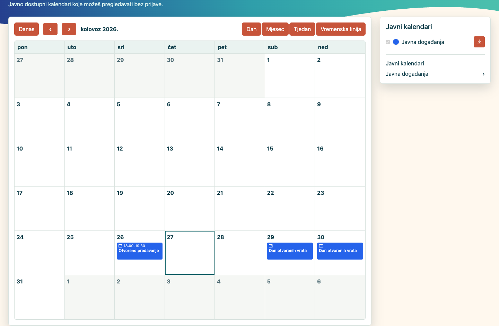
<figcaption>Posjetitelj bez računa vidi samo kalendar Javna događanja i njegove javno objavljene događaje.</figcaption>
</figure>

Na javnom prikazu dostupni su mjesec, tjedan, dan i vremenska linija te izvoz javnog kalendara. Nema dodavanja događaja, pretplata ni korisničkih postavki boje. Naziv javnog kalendara vodi na zasebni prikaz samo tog kalendara.

## 3. Administracija kalendara

Otvorite **Postavke → Kalendari → Administracija kalendara**. Gornja tablica sadrži zajedničke timske i resursne kalendare, a donja osobne kalendare. Popisi podržavaju pretraživanje, sortiranje, broj redaka i straničenje.

<figure class="my-4">
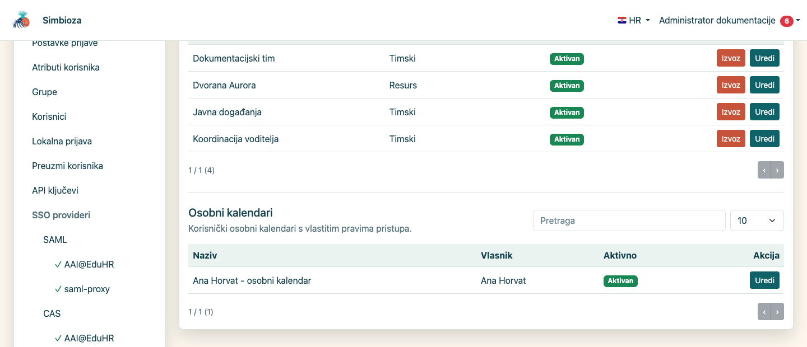
<figcaption>Odvojeni popisi zajedničkih i osobnih kalendara s uvozom, izvozom i uređivanjem.</figcaption>
</figure>

### 3.1. Novi timski ili resursni kalendar

1.  Odaberite **Novi zajednički kalendar**.
2.  Izaberite **Timski** ili **Resursni kalendar**.
3.  Upišite naziv i opis te odaberite osnovnu boju.
4.  Ostavite **Aktivno** uključeno. Isključeni kalendar i njegovi događaji nisu dostupni korisnicima.
5.  Dodajte korisnike ili grupe te zasebno označite **Čitanje** i **Pisanje**.
6.  Spremite kalendar pa ga otvorite s glavnog prikaza radi provjere.

<figure class="my-4">
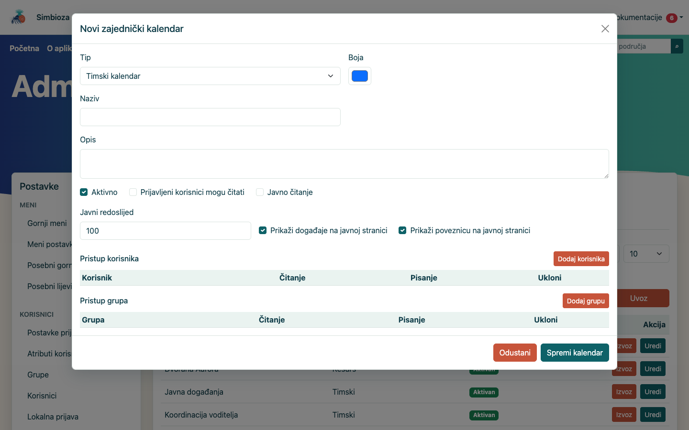
<figcaption>Jedan obrazac pokriva timski i resursni kalendar, javnu vidljivost i ACL prava.</figcaption>
</figure>

### 3.2. Novi osobni kalendar iz administracije

Administrator može odabrati korisnika te mu kreirati službeni, osobni ili prilagođeni osobni kalendar. Naziv se generira iz prikaznog imena korisnika; prilagođeni tip dodaje jedinstveni nastavak kako bi isti korisnik mogao imati više osobnih kalendara.

<figure class="my-4">
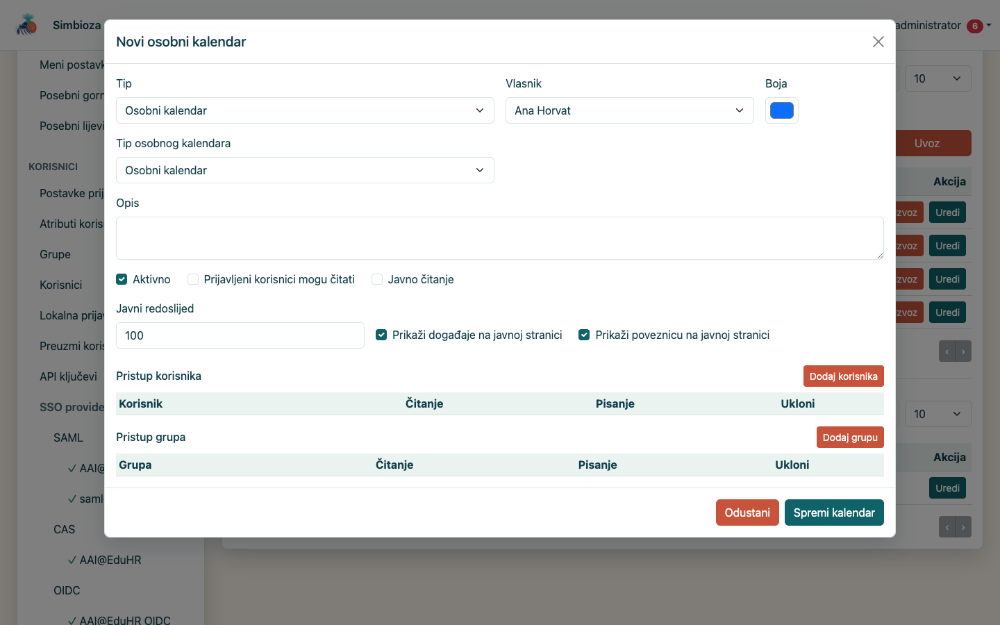
<figcaption>Administrator bira vlasnika, vrstu osobnog kalendara, boju i početna prava.</figcaption>
</figure>

## 4. Prava pristupa i javna vidljivost

U uređivanju kalendara postavljaju se osnovni podaci, javna vidljivost i ACL. Korisnička i grupna prava se zbrajaju: dovoljno je da jedan važeći izvor daje čitanje ili pisanje. Pisanje podrazumijeva mogućnost rada s događajima; upravljanje samim kalendarom i njegovim ACL-om ostaje administratoru ili grupi *Kalendari*.

<figure class="my-4">
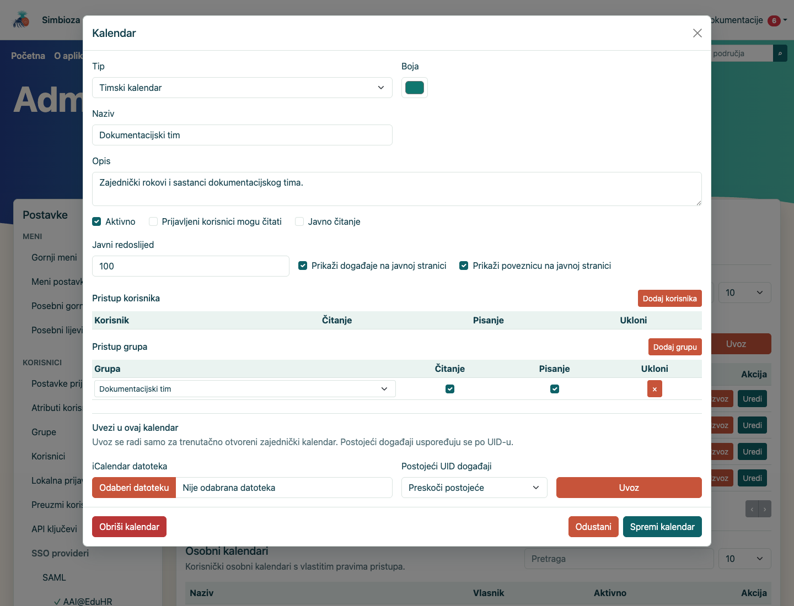
<figcaption>Grupa Dokumentacijski tim ima čitanje i pisanje; u istom modalu dostupni su ICS uvoz i uređivanje kalendara.</figcaption>
</figure>

### 4.1. Javne postavke

- **Prijavljeni korisnici mogu čitati** daje pravo čitanja svim prijavljenim korisnicima, bez pojedinačnog ACL retka.
- **Javno čitanje** dopušta čitanje bez prijave.
- **Javni redoslijed** određuje položaj među javnim kalendarima; manji broj se prikazuje ranije.
- **Prikaži događaje na javnoj stranici** uključuje događaje u zajednički javni prikaz.
- **Prikaži poveznicu na javnoj stranici** prikazuje naziv kalendara kao poveznicu na njegov samostalni javni prikaz.

<figure class="my-4">
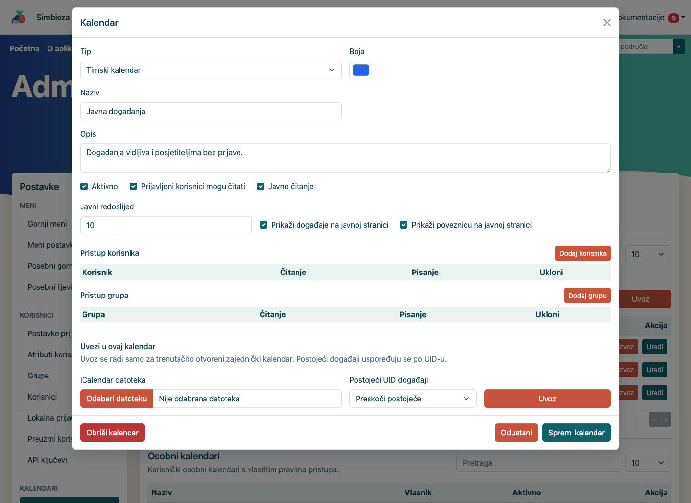
<figcaption>Javno čitanje, javni redoslijed, uključivanje događaja i zasebne poveznice postavljaju se neovisno.</figcaption>
</figure>

Javno čitanje koristite samo za sadržaj namijenjen svima. Opis događaja, lokacija i naziv također postaju javni. Za interne događaje koristite pravo prijavljenih korisnika ili ciljani ACL.

## 5. Osobni kalendari

Svaki korisnik otvara **Kalendari → Postavke kalendara**. Osobni kalendar se ne mora stvarati automatski; korisnik ga može kreirati kada mu zatreba. Vlasnik može izvesti kalendar, uvesti ICS, podijeliti čitanje ili pisanje s korisnikom ili grupom i stvoriti dodatni službeni ili prilagođeni kalendar.

<figure class="my-4">
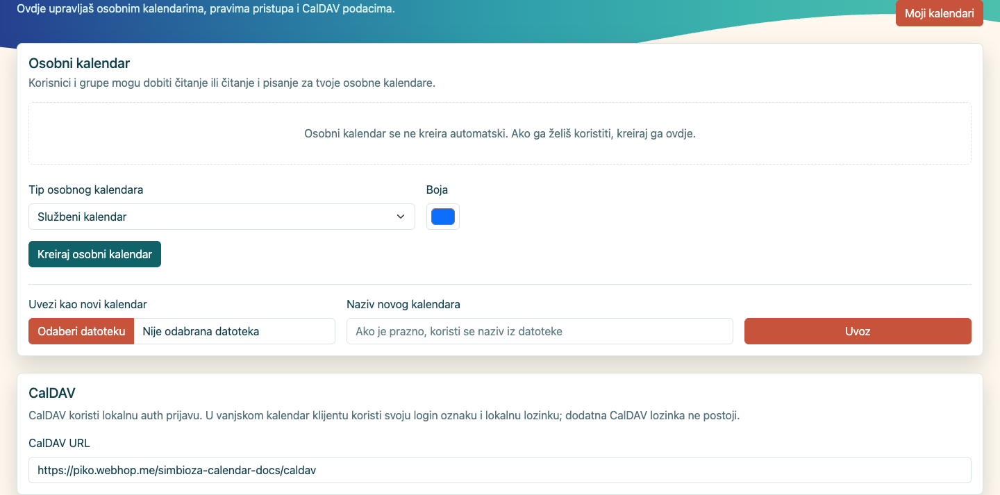
<figcaption>Vlasnik dijeli osobni kalendar, upravlja ICS sadržajem i vidi CalDAV adresu.</figcaption>
</figure>

U primjeru Petar Novak ima samo čitanje. Zbog toga vidi Anin osobni kalendar i njegove događaje, ali ga ne dobiva u popisu kalendara ponuđenih pri dodavanju događaja.

## 6. Više kalendara, pretplate i boje

Glavni ekran **Moji kalendari** preklapa događaje iz svih označenih kalendara. Boja uz svaki kalendar razlikuje događaje i može se promijeniti samo za trenutačnog korisnika, bez promjene osnovne boje drugim korisnicima.

<figure class="my-4">
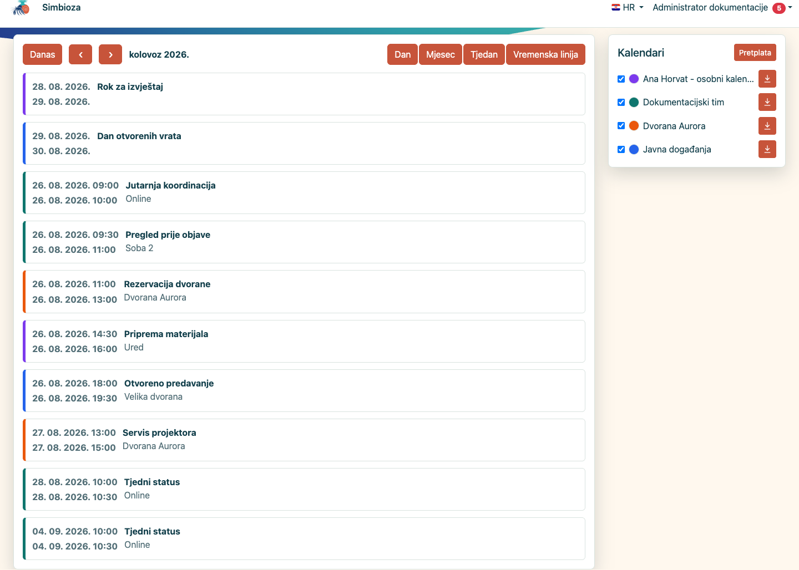
<figcaption>Četiri kalendara prikazana su istodobno, svaki svojom korisničkom bojom.</figcaption>
</figure>

### 6.1. Vidljivost i boja

- Isključite kvačicu uz kalendar kako biste ga privremeno sakrili iz prikaza.
- Odaberite obojeni kvadratić i novu boju. Promjena je osobna postavka.
- Odabir vidljivosti i boje čuva se za sljedeći dolazak.
- Izvozna ikona uz svaki kalendar preuzima njegovu `.ics` datoteku.

### 6.2. Pretplate

Odaberite **Pretplata** za pregled čitljivih kalendara. Tablica jasno pokazuje imate li samo čitanje ili čitanje i pisanje. Odjava uklanja kalendar iz osobnog popisa, ali ne briše kalendar niti mijenja prava pristupa. Ako vam ga administrator ponovno dodijeli ili se ponovno pretplatite, ponovo će biti dostupan.

<figure class="my-4">
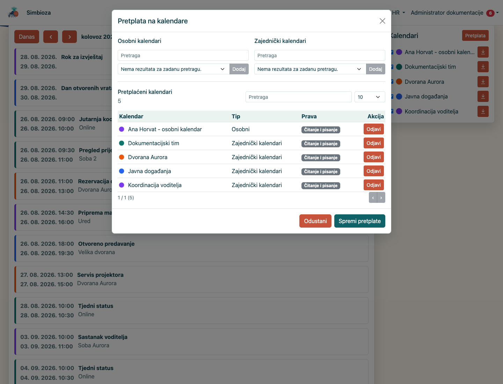
<figcaption>Pretplate su odvojene od ACL prava; prikaz pokazuje razinu prava za svaki kalendar.</figcaption>
</figure>

### 6.3. Prikaz samo jednog kalendara

Naziv svakog kalendara u bočnom popisu je poveznica. Odabirom se otvara samo taj kalendar, a **Svi kalendari** vraća preklopljeni prikaz.

<figure class="my-4">
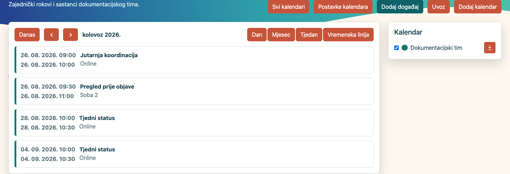
<figcaption>Timski kalendar Dokumentacijski tim otvoren je bez događaja iz ostalih kalendara.</figcaption>
</figure>

## 7. Mjesečni, tjedni, dnevni i vremenski prikaz

- **Mjesec** daje pregled cijelog mjeseca i najbolje prikazuje raspored više kalendara, cjelodnevne događaje i ponavljanja.
- **Tjedan** prikazuje sedam dana po satima i jasno otkriva preklapanja.
- **Dan** povećava jedan dan i prikladan je za detaljan raspored.
- **Vremenska linija** slaže događaje kronološki u preglednu listu.
- **Danas** vraća trenutačni datum, a strelice pomiču prethodno ili sljedeće razdoblje.

<figure class="my-4">
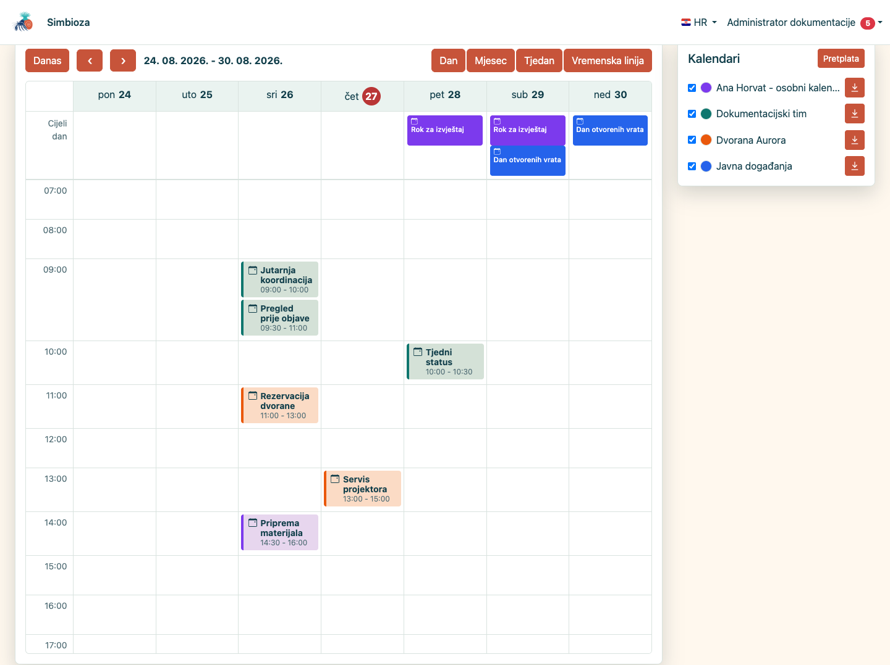
<figcaption>Tjedni prikaz pokazuje raspored po danima i satima.</figcaption>
</figure>

<figure class="my-4">
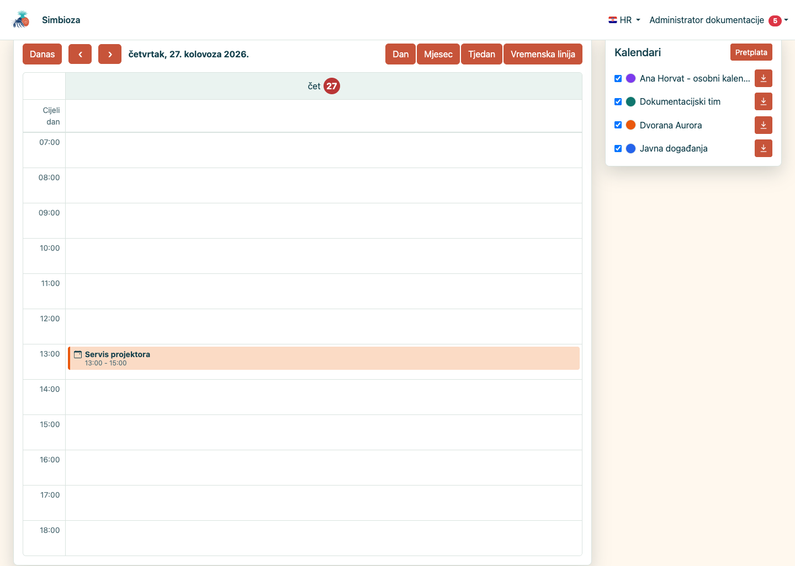
<figcaption>Dnevni prikaz naglašava preklopljene termine iz više kalendara.</figcaption>
</figure>

<figure class="my-4">
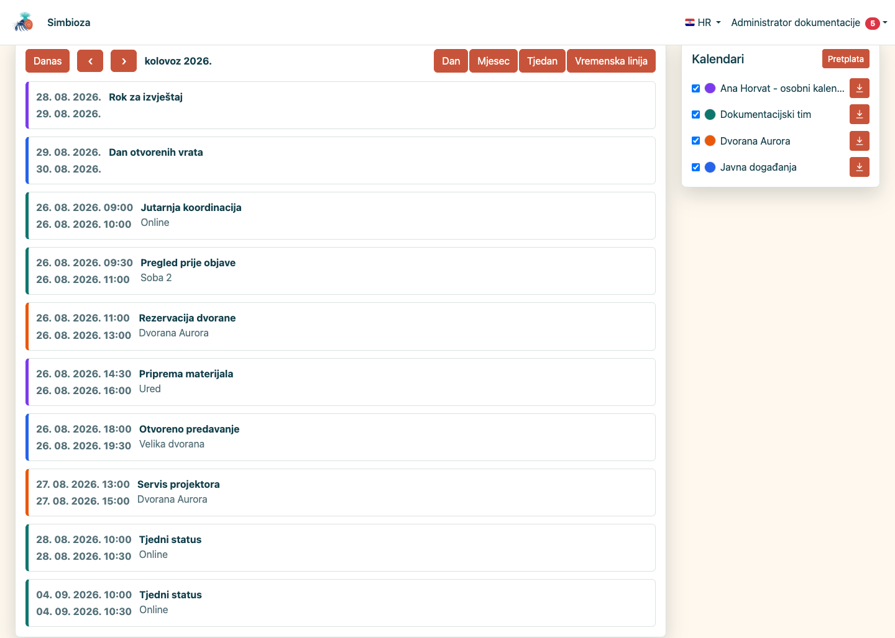
<figcaption>Kronološki prikaz događaja prikladan je za brzi pregled nadolazećih obveza.</figcaption>
</figure>

## 8. Dodavanje i uređivanje događaja

Odaberite **Dodaj događaj**. U padajućem popisu kalendara pojavljuju se samo kalendari u koje smijete pisati. Obični korisnik u primjeru može pisati u vlastiti osobni i timski kalendar, dok resursni i javni kalendar vidi samo za čitanje.

<figure class="my-4">
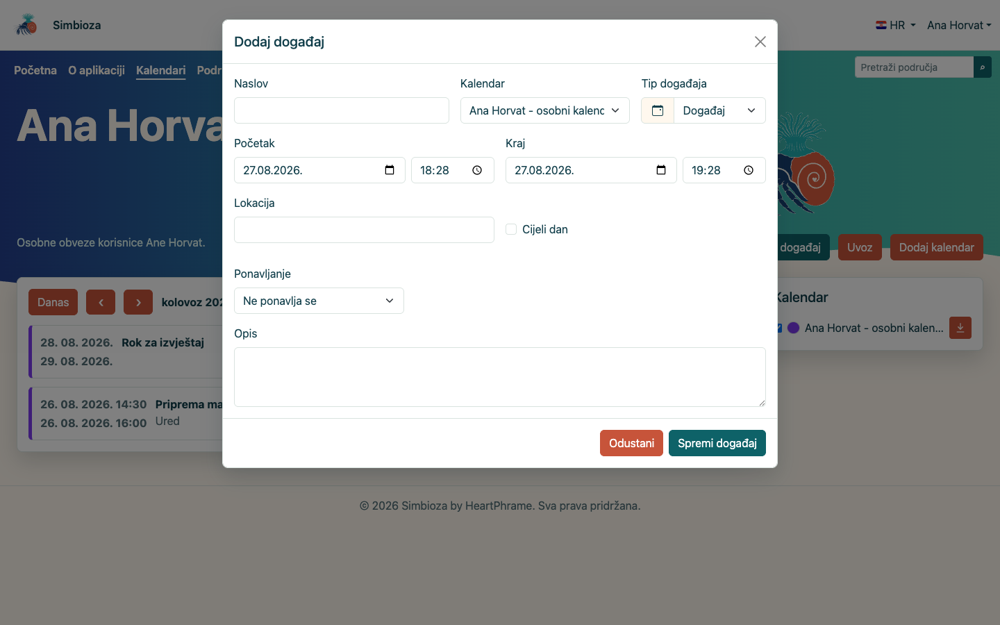
<figcaption>Prikaz korisnika bez administratorskog menija; obrazac nudi samo kalendare s pravom pisanja.</figcaption>
</figure>

### 8.1. Polja događaja

- **Naslov** je obavezan.
- **Kalendar** određuje prava, boju i publiku događaja.
- **Tip događaja** dodaje semantičku oznaku i ikonu. Dostupni su ugrađeni tipovi, a ovlašteni korisnik može dodati novi tip.
- **Početak i kraj** sadrže datum i vrijeme. Kraj ne smije biti prije početka.
- **Cijeli dan** skriva satnicu i prikazuje događaj kroz cijeli odabrani datum ili raspon.
- **Lokacija i opis** nisu obavezni, ali su vidljivi svima koji mogu čitati kalendar.

### 8.2. Ponavljanje

Događaj se može ponavljati dnevno, tjedno, mjesečno ili godišnje. Serija može biti bez kraja, završiti nakon zadanog broja pojavljivanja ili na određeni datum.

<figure class="my-4">
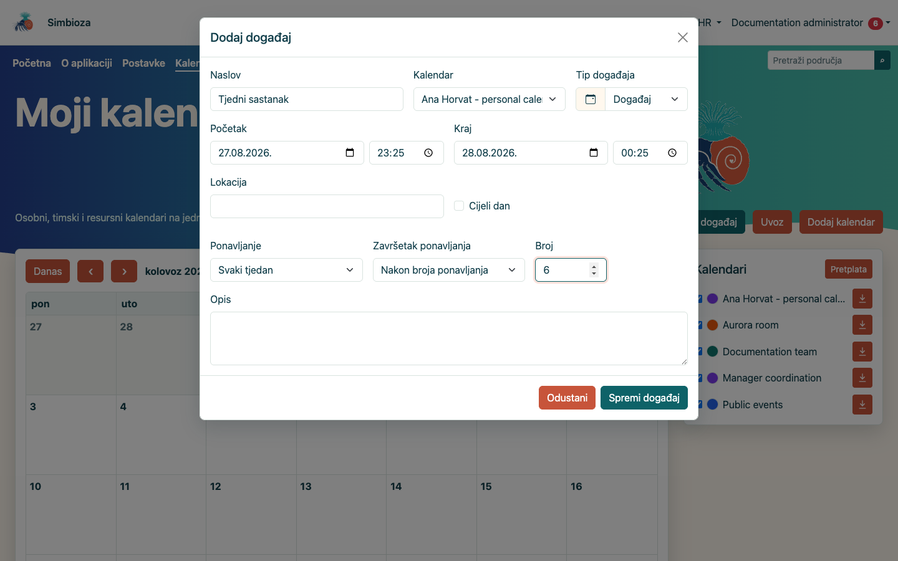
<figcaption>Primjer tjednog sastanka koji završava nakon šest pojavljivanja.</figcaption>
</figure>

### 8.3. Uređivanje i brisanje

Odaberite postojeći događaj. Ako je događaj dio serije, obrazac prikazuje kliknuto pojavljivanje i početak serije. Spremanje mijenja izvorni ponavljajući događaj i cijelu seriju; isto vrijedi za brisanje.

<figure class="my-4">
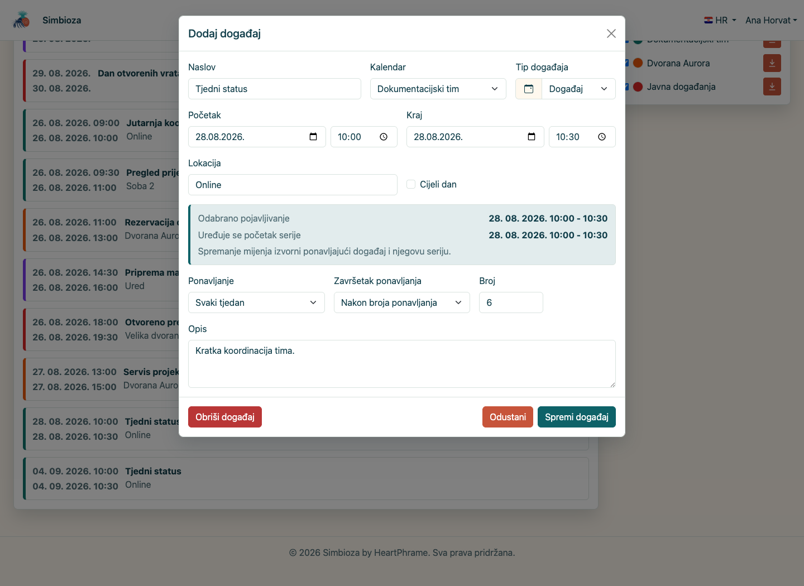
<figcaption>Jasno su odvojeni odabrano pojavljivanje, početak serije te akcije spremanja i brisanja.</figcaption>
</figure>

## 9. iCalendar uvoz i izvoz

Simbioza koristi standardni iCalendar format `.ics` za prijenos događaja između sustava.

- **Izvoz** je dostupan uz svaki čitljivi kalendar i u profilu osobnog kalendara.
- **Uvoz u postojeći kalendar** zahtijeva pravo pisanja.
- **Uvoz kao novi kalendar** administratoru stvara novi timski ili resursni kalendar, a korisniku novi osobni kalendar.
- Pri uvozu se događaji uspoređuju po stabilnom `UID`-u. **Preskoči postojeće** zadržava trenutačne zapise, a **Ažuriraj postojeće** ih zamjenjuje podacima iz datoteke.

Prije većeg uvoza izvezite odredišni kalendar. Provjerite vremensku zonu, cjelodnevne događaje i pravila ponavljanja u probnom kalendaru.

## 10. CalDAV

CalDAV omogućuje povezivanje kalendara s vanjskim klijentom koji podržava CalDAV. Adresa se nalazi u **Kalendari → Postavke kalendara → CalDAV**.

<figure class="my-4">
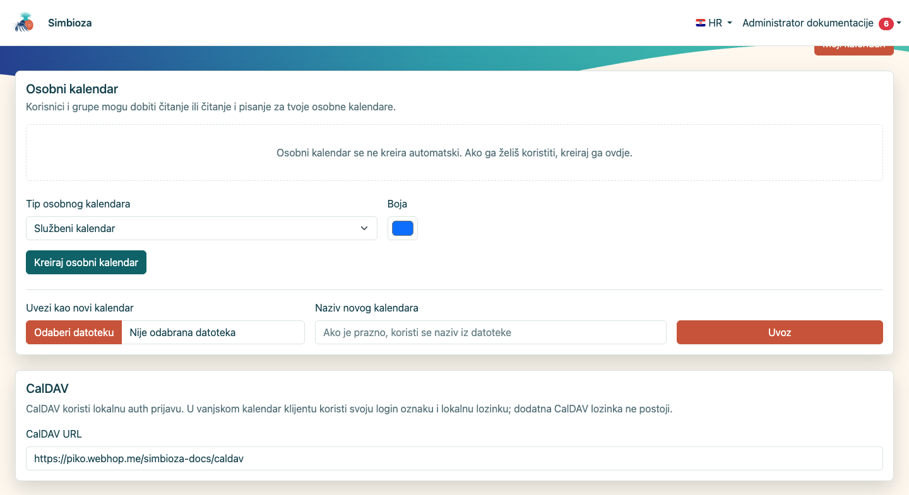
<figcaption>Profil prikazuje jedinu potrebnu CalDAV adresu i mogućnost stvaranja osobnog kalendara.</figcaption>
</figure>

### 10.1. Preduvjet: lokalne vjerodajnice

CalDAV koristi **lokalnu login oznaku i lokalnu lozinku** iz Simbioze. Ne postoji zasebna CalDAV lozinka. Korisniku koji koristi samo SSO administrator mora postaviti lokalnu vjerodajnicu prije povezivanja. Dopuštenje lokalne web-prijave zasebno je: CalDAV radi i kada je takva web-prijava isključena globalno ili za tog korisnika. Lozinku unesite samo u pouzdani kalendarski klijent preko HTTPS-a i ne prikazujte je u dokumentaciji ili snimkama zaslona.

### 10.2. Postavljanje klijenta

1.  Kopirajte prikazani CalDAV URL, primjerice `https://vas-host/aplikacija/caldav`.
2.  U vanjskom klijentu dodajte novi CalDAV račun.
3.  Kao korisničko ime upišite lokalnu login oznaku, a kao lozinku lokalnu lozinku.
4.  Prihvatite samo valjani HTTPS certifikat i provjerite prikazane kalendare.
5.  Napravite probni događaj u kalendaru s pravom pisanja i provjerite sinkronizaciju u oba smjera.

CalDAV implementacija pokriva osnovno otkrivanje, čitanje i pisanje kalendarskih zapisa potrebnih uobičajenim klijentima. Ponašanje naprednih svojstava može ovisiti o klijentu, zato ga provjerite prije organizacijskog uvođenja.

## 11. Mobilni prikaz

Na uskom zaslonu mjesečni raspored postaje kompaktan. Dodir datuma prikazuje kronološki popis događaja odabranog dana, a kalendari i njihove boje ostaju ispod rasporeda.

<figure class="my-4">
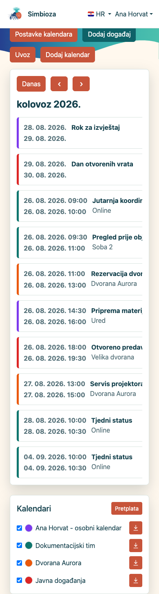
<figcaption>Mobilni prikaz mjeseca s popisom događaja odabranog dana i legendom kalendara.</figcaption>
</figure>

## 12. Administrator i obični korisnik

| Mogućnost | Administrator / grupa Kalendari | Obični korisnik |
|----|----|----|
| Administracija zajedničkih kalendara | Da | Ne |
| Kreiranje timskih i resursnih kalendara | Da | Ne |
| Kreiranje osobnog kalendara | Za bilo kojeg korisnika | Za sebe |
| Upravljanje ACL-om zajedničkog kalendara | Da | Ne |
| Upravljanje ACL-om vlastitog osobnog kalendara | Da | Da |
| Dodavanje događaja | U sve administrativno dostupne kalendare | Samo u kalendare s pravom pisanja |
| Čitanje, pretplata, boja i izvoz | Za čitljive kalendare | Za čitljive kalendare |
| CalDAV | Da, uz lokalne vjerodajnice | Da, uz lokalne vjerodajnice |

<figure class="my-4">
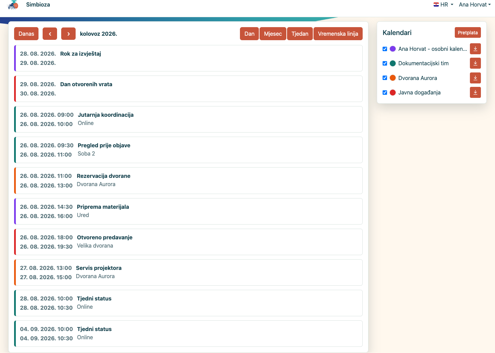
<figcaption>Obični korisnik vidi samo redovni gornji meni, ali može preklapati sve kalendare za koje ima pravo čitanja.</figcaption>
</figure>

### 12.1. Administrator — sigurnosna kopija sastanaka

Novi backup područja uključuje sudionike, odgovore, organizatore, rezervacije resursa i odobravatelje za njegove kalendare, zajedno s resursnim kalendarima potrebnim tim sastancima. Kopija područja može i dalje koristiti postojeći zajednički resursni kalendar; ne zamjenjuje njegove ostale sastanke.

Za potpuni povrat Kalendara, uključujući CalDAV korisničke zapise, izradite backup komponente **Kalendari** ili cijelog sitea u **Postavke → Backup i vraćanje**. Backup područja izostavlja privatne CalDAV vjerodajnice. ICS služi razmjeni događaja, ne čuva cijeli sustav sastanaka. Stariji arhiv područja sa sastancima odbit će se pri provjeri ako nedostaju njihovi obvezni zapisi; koristite potpuni backup komponente Kalendari/sitea ili izradite novi backup područja nadograđenim modulom. Stariji arhivi običnih događaja ostaju podržani. Prije zamjene podataka napravite sigurnosnu kopiju cilja i preflight provjeru; nakon povrata provjerite prava, jedan sastanak i njegov resurs.

## 13. Završna provjera i česte poteškoće

1.  Provjerite javni prikaz u privatnom prozoru preglednika, bez aktivne prijave.
2.  Provjerite barem jednog korisnika sa samo čitanjem i jednog s pisanjem.
3.  U prikazu više kalendara uključite sve boje i provjerite preklapanja.
4.  Otvorite naziv kalendara i vratite se poveznicom **Svi kalendari**.
5.  Napravite probni obični, cjelodnevni i ponavljajući događaj.
6.  Izvezite ICS, uvezite ga u probni kalendar i provjerite ponašanje postojećih UID-eva.
7.  Za CalDAV provjerite lokalnu prijavu, HTTPS i sinkronizaciju u oba smjera.
8.  Provjerite prikaz na mobilnom zaslonu.

### Ako kalendar ili događaj nedostaje

- Provjerite je li kalendar aktivan.
- Provjerite ima li korisnik izravno ili grupno pravo čitanja.
- Provjerite je li korisnik pretplaćen i je li kvačica vidljivosti uključena.
- Provjerite nalazite li se u pravom razdoblju i prikazu.
- Za unos provjerite pravo pisanja; pravo čitanja nije dovoljno.
- Za javni prikaz provjerite javno čitanje i zasebne postavke javnog indeksa/poveznice.

Kalendar je spreman za uporabu kada su provjereni javni i prijavljeni prikaz, ACL prava, barem jedan unos i izmjena događaja, ICS izvoz te — ako se koristi — CalDAV s lokalnim testnim računom.

