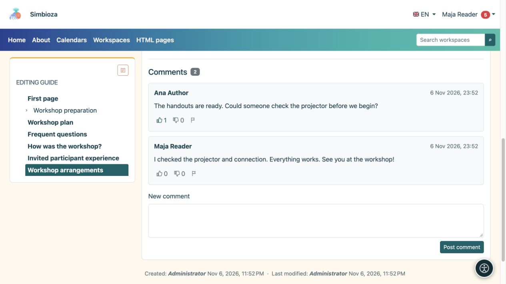

# Einen Kommentar lesen oder schreiben

> Die Bildschirmaufnahmen zeigen die englische Benutzeroberfläche.

[Zusammenarbeit](suradnja_de.md)

**Ziel:** Eine Seite besprechen, ohne den Haupttext zu bearbeiten. Kommentare werden unter einem veröffentlichten Dokument angezeigt, wenn das Modul verfügbar ist. Personen, die das Dokument lesen dürfen, können seine Kommentare lesen.

## Fügen Sie einen Kommentar hinzu

1. Öffnen Sie die Seite und scrollen Sie zu **Kommentare**.
2. Melden Sie sich an, wenn Sie Gast sind. Zum Posten ist eine Seitenleseberechtigung und die Aktivierung neuer Kommentare erforderlich.
3. Schreiben Sie unter **Neuer Kommentar** eine klare Frage oder Anmerkung.
4. Wählen Sie **Kommentar posten** und prüfen Sie, ob er in der Diskussion erscheint.

**Ergebnis:** Leser dieses Dokuments sehen den Kommentar. Es handelt sich nicht um eine private Nachricht an den Autor. Kommentare verwenden einfachen Text mit Zeilenumbrüchen; Durch das Einfügen von HTML werden sie nicht formatiert. Wenn sich die Diskussion über mehrere Seiten erstreckt, verwenden Sie die Seitenzahlen darunter.

<figure class="my-4">

<figcaption>Leser der Seite können Kommentare und Reaktionen sehen. Geben Sie Ihre Frage in „Neuer Kommentar“ ein und wählen Sie dann „Kommentar posten“.</figcaption>
</figure>

## Reagieren Sie oder melden Sie ein Problem

Angemeldete Leser können zwischen **Gefällt mir** und **Gefällt mir nicht** wählen. Durch erneutes Auswählen derselben Reaktion wird sie entfernt. Wenn Sie das andere auswählen, wird es geändert. Wählen Sie bei unangemessenen Inhalten **Unangemessenen Kommentar melden** und lesen Sie die Bestätigung. Durch die Meldung von Warnmeldungen werden die verantwortlichen Personen benachrichtigt; der Kommentar wird nicht sofort gelöscht.

**Kommentar löschen** erscheint nur mit der entsprechenden Moderationsberechtigung. Überprüfen Sie den ausgewählten Kommentar und bestätigen Sie. Gehen Sie nicht davon aus, dass jeder Leser oder jeder Kommentarautor Kommentare löschen kann.

## Als Autor können Sie neue Kommentare aktivieren oder schließen

1. Öffnen Sie [Seitenbearbeitung](uredivanje-stranica_de.md).
2. Stellen Sie **Kommentare aktiviert** ein.
3. Speichern Sie den Entwurf in einem Arbeitsbereich und veröffentlichen Sie die Änderung oder senden Sie sie an einen Herausgeber. Eigenständige HTML-Seiten verwenden ihr direktes Speicherverhalten.

**Ergebnis:** Die veröffentlichte Einstellung steuert neue Kommentare für dieses Dokument und diese Sprache. Durch das Deaktivieren neuer Kommentare wird die bestehende Diskussion nicht ausgeblendet.

Wenn das Formular fehlt, überprüfen Sie Ihre Anmeldung und die Nachricht neben den Kommentaren. Wenn der gesamte Abschnitt fehlt, bitten Sie den Autor oder Administrator, die Modul- und Dokumentverfügbarkeit zu überprüfen. [Der Seite folgen](pracenje-obavijesti_de.md) kann unterstützte Diskussionsänderungen bereitstellen, ohne sie wiederholt öffnen zu müssen.
