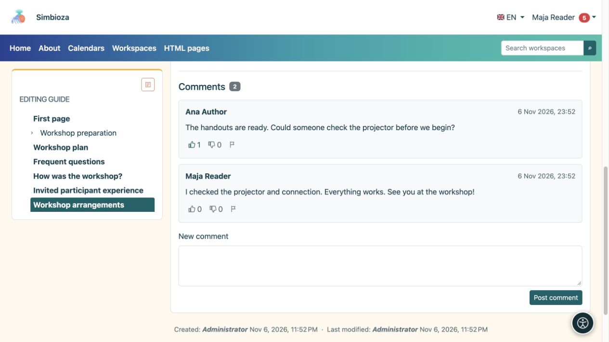

# Read or write a comment

[Collaboration](suradnja_en.md)

**Goal:** discuss a page without editing its main text. Comments appear below a published document when the module is available. People allowed to read that document can read its comments.

## Add a comment

1. Open the page and scroll to **Comments**.
2. Sign in if you are a guest. Posting requires page-read permission and new comments to be enabled.
3. Write a clear question or note under **New comment**.
4. Select **Post comment** and check that it appears in the discussion.

**Result:** readers of that document see the comment. It is not a private message to its author. Comments use plain text with line breaks; pasted HTML does not format them. If the discussion spans several pages, use the page numbers below it.

<figure class="my-4">

<figcaption>Readers of the page can see comments and reactions. Enter your question in New comment, then choose Post comment.</figcaption>
</figure>

## React or report a problem

Signed-in readers may choose **Like** or **Dislike**. Selecting the same reaction again removes it; selecting the other changes it. For inappropriate content, choose **Report inappropriate comment** and read the confirmation. Reporting alerts responsible people; it does not immediately delete the comment.

**Delete comment** appears only with the relevant moderation permission. Check the selected comment and confirm. Do not assume every reader or every comment author can delete comments.

## Enable or close new comments as an author

1. Open [page editing](uredivanje-stranica_en.md).
2. Set **Comments enabled**.
3. In a workspace, save the draft and publish the change or send it to a publisher. Standalone HTML pages use their direct save behaviour.

**Result:** the published setting controls new comments for that document and language. Disabling new comments does not hide the existing discussion.

If the form is missing, check your sign-in and the message beside comments. If the whole section is absent, ask the author or administrator to check the module and document availability. [Following the page](pracenje-obavijesti_en.md) can deliver supported discussion changes without repeatedly opening it.
