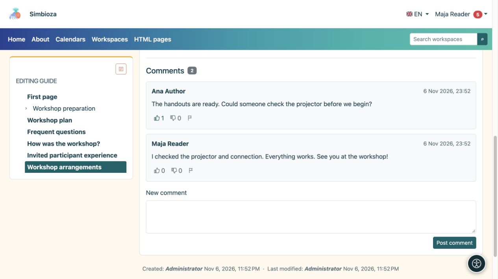

# Comentarios

> Las capturas de pantalla muestran la interfaz en inglés.

[Colaboración](suradnja_es.md)

**Objetivo:** discutir una página sin editar su texto principal. Los comentarios aparecen debajo de un documento publicado cuando el módulo está disponible. Las personas a las que se les permite leer ese documento pueden leer sus comentarios.

## Añadir un comentario

1. Abra la página y desplácese hasta **Comentarios**.
2. Inicia sesión si eres un invitado. La publicación requiere permiso de lectura de página y la habilitación de nuevos comentarios.
3. Escriba una pregunta o nota clara en **Nuevo comentario**.
4. Seleccione **Publicar comentario** y verifique que aparezca en la discusión.

**Resultado:** los lectores de ese documento ven el comentario. No es un mensaje privado para su autor. Los comentarios utilizan texto sin formato con saltos de línea; pegado HTML no los formatea. Si la discusión abarca varias páginas, utilice los números de página que aparecen debajo.

<figure class="my-4">

<figcaption>Los lectores de la página pueden ver comentarios y reacciones. Ingrese su pregunta en Nuevo comentario y luego elija Publicar comentario.</figcaption>
</figure>

## Reaccionar o informar un problema

Los lectores que hayan iniciado sesión pueden elegir **Me gusta** o **No me gusta**. Seleccionar nuevamente la misma reacción la elimina; seleccionar el otro lo cambia. Para contenido inapropiado, elija **Reportar comentario inapropiado** y lea la confirmación. Los informes alertan a las personas responsables; no elimina inmediatamente el comentario.

**Eliminar comentario** aparece solo con el permiso de moderación correspondiente. Verifique el comentario seleccionado y confirme. No asuma que todos los lectores o todos los autores de comentarios pueden eliminar comentarios.

## Habilitar o cerrar nuevos comentarios como autor

1. Abra [edición de página](uredivanje-stranica_es.md).
2. Establecer **Comentarios habilitados**.
3. En un espacio de trabajo, guarde el borrador y publique el cambio o envíelo a Una persona con permiso para publicar. Las páginas independientes HTML utilizan su comportamiento de guardado directo.

**Resultado:** la configuración publicada controla los nuevos comentarios para ese documento e idioma. Deshabilitar nuevos comentarios no oculta la discusión existente.

Si falta el formulario, verifique su inicio de sesión y el mensaje al lado de los comentarios. Si falta toda la sección, solicite al autor o administrador que verifique la disponibilidad del módulo y del documento. [Seguir la página](pracenje-obavijesti_es.md) puede ofrecer cambios de discusión admitidos sin tener que abrirla repetidamente.
