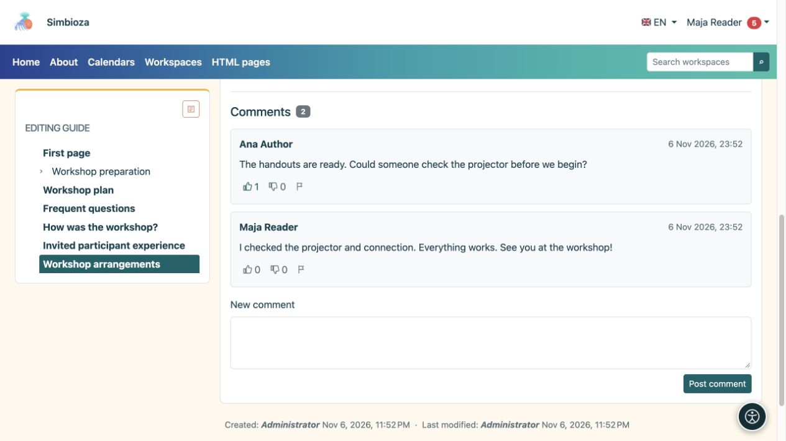

# Lire ou écrire un commentaire

> Les captures d’écran présentent l’interface en anglais.

[Collaboration](suradnja_fr.md)

**Objectif :** discuter d'une page sans modifier son texte principal. Les commentaires apparaissent sous un document publié lorsque le module est disponible. Les personnes autorisées à lire ce document peuvent lire ses commentaires.

## Ajouter un commentaire

1. Ouvrez la page et faites défiler jusqu'à **Commentaires**.
2. Connectez-vous si vous êtes un invité. La publication nécessite une autorisation de lecture de page et l'activation des nouveaux commentaires.
3. Écrivez une question ou une note claire sous **Nouveau commentaire**.
4. Sélectionnez **Publier un commentaire** et vérifiez qu'il apparaît dans la discussion.

**Résultat :** les lecteurs de ce document voient le commentaire. Il ne s'agit pas d'un message privé adressé à son auteur. Les commentaires utilisent du texte brut avec des sauts de ligne ; HTML collé ne les formate pas. Si la discussion s'étend sur plusieurs pages, utilisez les numéros de page en dessous.

<figure class="my-4">

<figcaption>Les lecteurs de la page peuvent voir les commentaires et les réactions. Saisissez votre question dans Nouveau commentaire, puis choisissez Publier un commentaire.</figcaption>
</figure>

## Réagir ou signaler un problème

Les lecteurs connectés peuvent choisir **J'aime** ou **Je n'aime pas**. Sélectionner à nouveau la même réaction la supprime ; sélectionner l’autre le change. Pour un contenu inapproprié, choisissez **Signaler un commentaire inapproprié** et lisez la confirmation. Le reporting alerte les personnes responsables ; cela ne supprime pas immédiatement le commentaire.

**Supprimer le commentaire** n'apparaît qu'avec l'autorisation de modération appropriée. Vérifiez le commentaire sélectionné et confirmez. Ne présumez pas que chaque lecteur ou chaque auteur de commentaires peut supprimer des commentaires.

## Activer ou fermer les nouveaux commentaires en tant qu'auteur

1. Ouvrez [édition de page](uredivanje-stranica_fr.md).
2. Définissez **Commentaires activés**.
3. Dans un espace de travail, enregistrez le brouillon et publiez la modification ou envoyez-la à un responsable de publication. Les pages HTML autonomes utilisent leur comportement de sauvegarde directe.

**Résultat :** le paramètre publié contrôle les nouveaux commentaires pour ce document et cette langue. La désactivation des nouveaux commentaires ne masque pas la discussion existante.

Si le formulaire est manquant, vérifiez votre connexion et le message à côté des commentaires. Si toute la section est absente, demandez à l'auteur ou à l'administrateur de vérifier la disponibilité du module et du document. [Suivre la page](pracenje-obavijesti_fr.md) peut fournir des modifications de discussion prises en charge sans l'ouvrir à plusieurs reprises.
