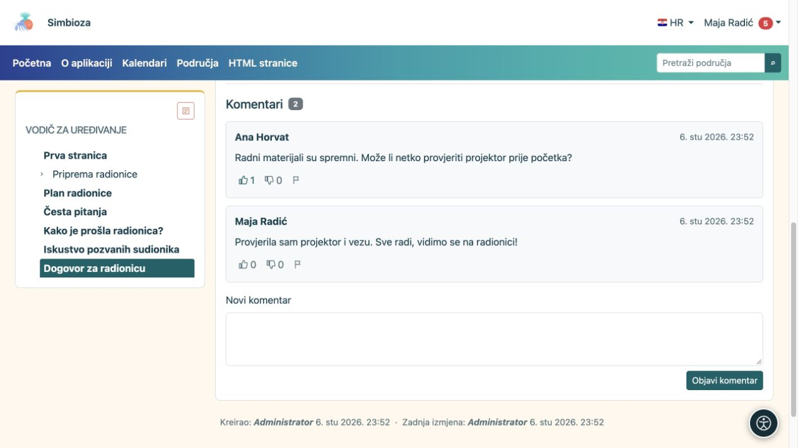

# Pročitajte ili napišite komentar

[Suradnja](suradnja_hr.md)

**Cilj:** raspraviti sadržaj stranice bez uređivanja njezina glavnog teksta. Komentari se prikazuju ispod objavljenog dokumenta kada je modul dostupan. Čitaju ih osobe koje smiju čitati taj dokument.

## Dodajte komentar

1. Otvorite stranicu i pomaknite se do **Komentari**.
2. Prijavite se ako ste gost. Za pisanje trebate pravo čitanja te stranice i omogućene nove komentare.
3. U **Novi komentar** upišite jasno pitanje ili napomenu.
4. Odaberite **Objavi komentar** i provjerite pojavljuje li se tekst u raspravi.

**Rezultat:** komentar vide čitatelji toga dokumenta. To nije privatna poruka autoru. Tekst se objavljuje kao običan tekst s prijelomima redaka; lijepljeni HTML nije način oblikovanja komentara. Ako komentara ima više stranica, upotrijebite brojeve ispod rasprave.

<figure class="my-4">

<figcaption>Komentar i reakcije vide čitatelji stranice. Pitanje upišite u Novi komentar pa odaberite Objavi komentar.</figcaption>
</figure>

## Reagirajte ili prijavite problem

Prijavljeni čitatelj može odabrati **Sviđa mi se** ili **Ne sviđa mi se**. Ponovni odabir iste reakcije uklanja je; odabir druge mijenja reakciju. Za neprimjeren sadržaj odaberite ikonu **Prijavi neprimjeren komentar** i pročitajte potvrdu. Prijava upozorava odgovorne osobe; ne znači da je komentar odmah obrisan.

**Obriši komentar** pojavljuje se samo kada imate odgovarajuću ovlast moderiranja. Provjerite koji komentar uklanjate i potvrdite radnju. Nemojte pretpostaviti da svaki čitatelj ili svaki autor komentara ima pravo brisanja.

## Autor želi uključiti ili zatvoriti nove komentare

1. Otvorite [uređivanje stranice](uredivanje-stranica_hr.md).
2. Podesite **Omogućeni komentari**.
3. U području spremite nacrt i objavite promjenu ili je pošaljite objavljivaču. Na samostalnoj HTML stranici vrijedi njezino izravno spremanje.

**Rezultat:** objavljena postavka određuje mogu li se dodavati novi komentari na tom dokumentu i jeziku. Isključivanje novih komentara ne skriva postojeću raspravu.

Ako ne vidite obrazac, provjerite prijavu i poruku uz komentare. Ako nedostaje cijeli dio, autor ili administrator treba provjeriti modul i dostupnost dokumenta. [Praćenjem stranice](pracenje-obavijesti_hr.md) možete primati podržane promjene rasprave, bez stalnog ručnog otvaranja stranice.
