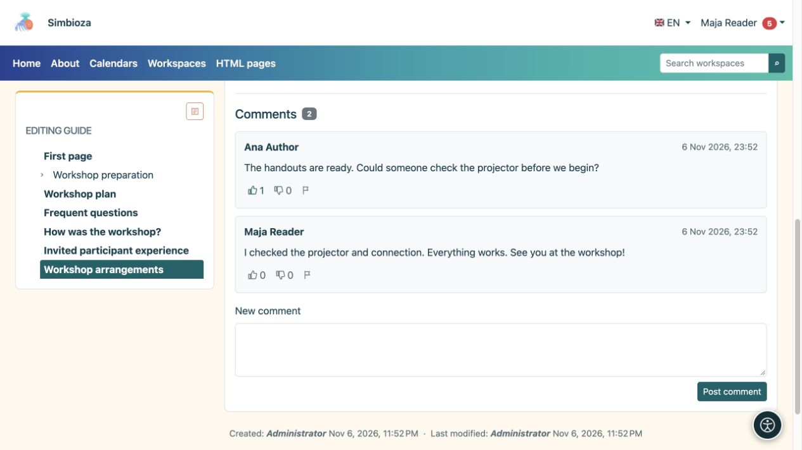

# Leggi o scrivi un commento

> Le schermate mostrano l’interfaccia in inglese.

[Collaborazione](suradnja_it.md)

**Obiettivo:** discutere una pagina senza modificarne il testo principale. I commenti vengono visualizzati sotto un documento pubblicato quando il modulo è disponibile. Le persone autorizzate a leggere quel documento possono leggerne i commenti.

## Aggiungi un commento

1. Apri la pagina e scorri fino a **Commenti**.
2. Accedi se sei ospite. La pubblicazione richiede l'autorizzazione di lettura della pagina e l'abilitazione di nuovi commenti.
3. Scrivi una domanda o una nota chiara sotto **Nuovo commento**.
4. Seleziona **Pubblica commento** e verifica che appaia nella discussione.

**Risultato:** i lettori di quel documento vedono il commento. Non è un messaggio privato al suo autore. I commenti utilizzano testo semplice con interruzioni di riga; incollato HTML non li formatta. Se la discussione si estende su più pagine, utilizzare i numeri di pagina sottostanti.

<figure class="my-4">

<figcaption>I lettori della pagina possono vedere commenti e reazioni. Inserisci la tua domanda in Nuovo commento, quindi scegli Pubblica commento.</figcaption>
</figure>

## Reagire o segnalare un problema

I lettori che hanno effettuato l'accesso possono scegliere **Mi piace** o **Non mi piace**. Selezionando nuovamente la stessa reazione la si rimuove; selezionando l'altro lo si cambia. Per contenuti inappropriati, seleziona **Segnala commento inappropriato** e leggi la conferma. La segnalazione avvisa i responsabili; non elimina immediatamente il commento.

**Elimina commento** viene visualizzato solo con l'autorizzazione di moderazione pertinente. Controlla il commento selezionato e conferma. Non dare per scontato che ogni lettore o ogni autore di commenti possa eliminare i commenti.

## Abilita o chiudi nuovi commenti come autore

1. Apri [modifica pagina](uredivanje-stranica_it.md).
2. Imposta **Commenti abilitati**.
3. In un'area di lavoro, salva la bozza e pubblica la modifica o inviala a un editore. Le pagine HTML autonome utilizzano il comportamento di salvataggio diretto.

**Risultato:** l'impostazione pubblicata controlla i nuovi commenti per quel documento e quella lingua. La disabilitazione dei nuovi commenti non nasconde la discussione esistente.

Se manca il modulo, controlla il tuo accesso e il messaggio accanto ai commenti. Se l'intera sezione è assente chiedere all'autore o all'amministratore di verificare la disponibilità del modulo e del documento. [Seguendo la pagina](pracenje-obavijesti_it.md) è possibile fornire le modifiche supportate alla discussione senza aprirla ripetutamente.
