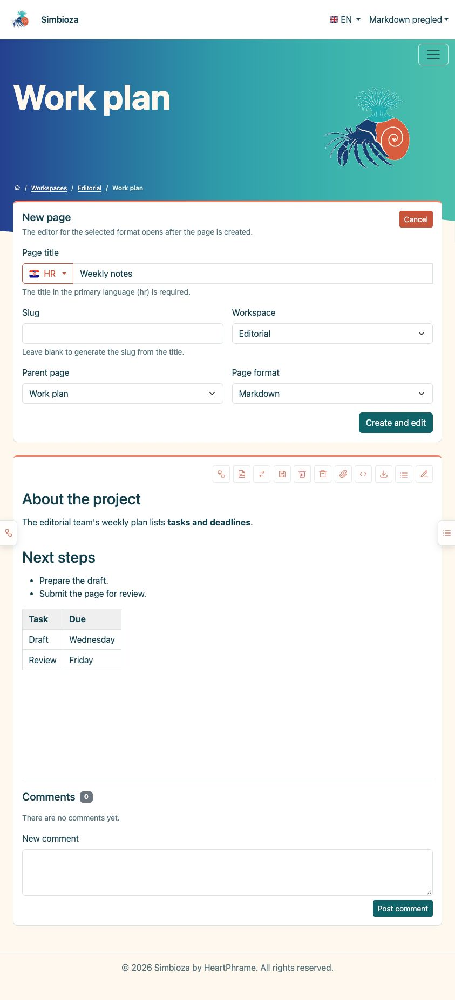
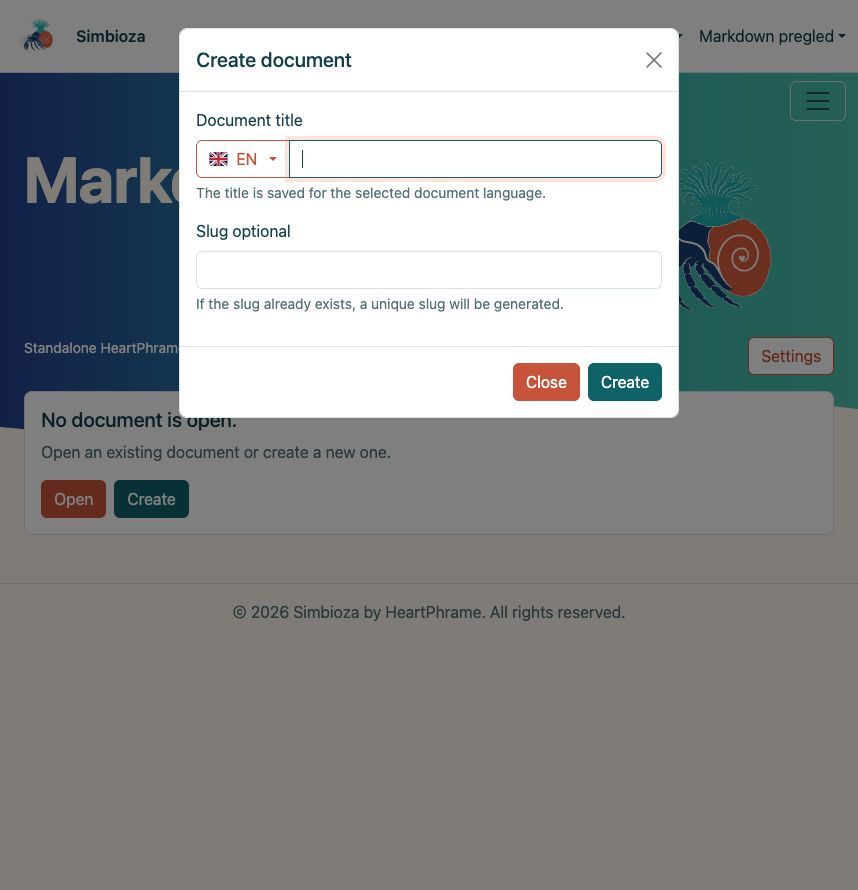
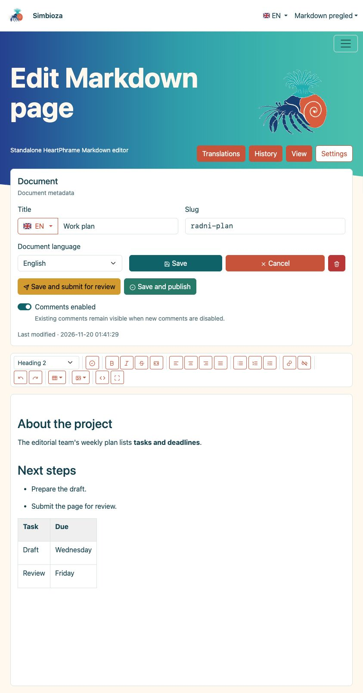
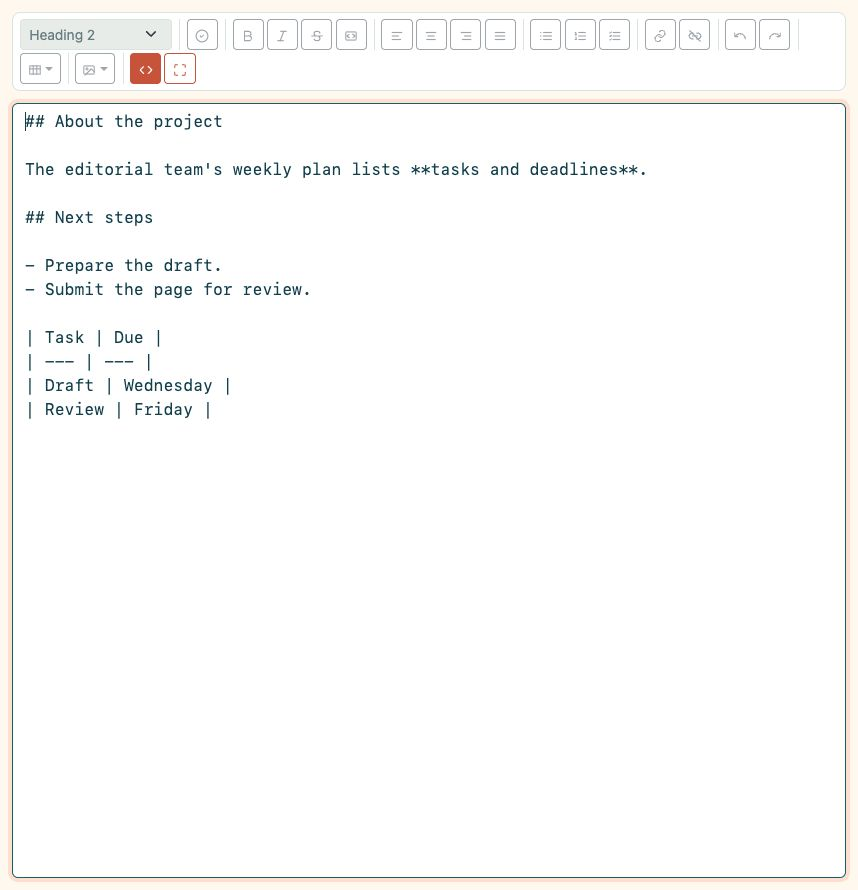
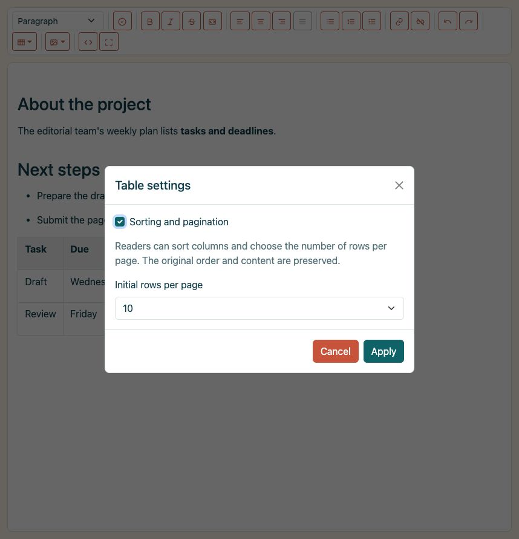
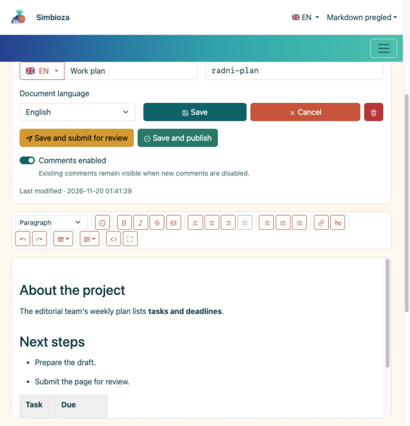

# MD Editor

Mit MD Editor können Sie Markdown-Seiten in Simbioza schreiben und bearbeiten. Dafür stehen der visuelle Modus und der Markdown-Quelltext zur Verfügung. Das Format wählen Sie, wenn Sie die Seite erstellen. Die Abbildungen zeigen die englische Oberfläche.

## 1. Dokument erstellen oder öffnen

Öffnen Sie den gewünschten **Arbeitsbereich** und wählen Sie **Neue Seite** neben dem Seitenbaum. Geben Sie den Seitentitel in der Hauptsprache ein und wählen Sie die übergeordnete Seite. Falls **Seitenformat** angezeigt wird, wählen Sie **Markdown**. Klicken Sie auf **Erstellen und bearbeiten**. Ist MD Editor der einzige verfügbare Editor, wählt Simbioza das Format automatisch. Eine vorhandene Seite öffnen Sie im Baum und bearbeiten sie über das Stiftsymbol.

Für ein eigenständiges Dokument wählen Sie in den Markdown-Editor-Einstellungen **Editor öffnen**, sofern Sie Zugriff darauf haben. Wählen Sie **Öffnen** oder **Erstellen**. Beim Erstellen wählen Sie die Sprache neben dem Dokumenttitel. Der **Slug**, der kurze Teil der Seitenadresse, ist optional.

## 2. Inhalt bearbeiten

Setzen Sie den Cursor in einen Absatz und wählen Sie unter **Format** einen Absatz, eine Überschrift, ein Zitat oder vorformatierten Text. Markieren Sie Wörter, um sie fett, kursiv oder durchgestrichen darzustellen. Die Werkzeugleiste bietet auch Ausrichtung, Listen, Checklisten, Links, Bilder und Tabellen. Wenn Sie den Mauszeiger auf ein Symbol setzen, erscheint der Name der Aktion.

Die **Dokumentprüfung** prüft Überschriften, Bildbeschreibungen und Linktexte. Im **Vollbild** bleibt die Werkzeugleiste über dem Inhalt. Lange Dokumente scrollen innerhalb des Editors. **Escape** stellt die vorherige Ansicht wieder her.

## 3. Markdown-Quelltext bearbeiten

Wählen Sie **Quelltext** (`<>`), um Markdown direkt zu bearbeiten, beispielsweise `## Überschrift`, `**fett**` oder `[Text](Adresse)`. Mit derselben Schaltfläche wechseln Sie zurück. Ihre Änderungen werden beim Wechsel übernommen. Klicken Sie auf **Speichern**, um sie im Dokument zu sichern.

## 4. Tabellen, Bilder und Videos hinzufügen

- Über **Tabelle** fügen Sie eine Tabelle ein, bearbeiten Zeilen und Spalten oder verbinden und teilen Zellen. Bei einer Kopfzeile ohne verbundene Zellen können Sie in den **Tabelleneinstellungen** **Sortierung und Seitennavigation** aktivieren. Wählen Sie die anfängliche Zeilenzahl und klicken Sie auf **Übernehmen**. Die Sortierung in der Leseansicht lässt die Reihenfolge im Quelltext bestehen.
- Wählen Sie unter **Anhänge** unterhalb des Editors eine Datei und klicken Sie auf **Hochladen**. Setzen Sie den Cursor in den Inhalt und wählen Sie neben der hochgeladenen Datei **In den Inhalt einfügen**. Bilder erscheinen als Bilder, unterstützte Videos als Player und andere Anhänge als Links.
- Wählen Sie ein Bild, um im Menü **Bild** Breite, Abstand, Ausrichtung oder Alternativtext zu bearbeiten. Rein schmückende Bilder können Sie als dekorativ markieren.
- Mit **Sichtbarkeit speichern** legen Sie unter **Anhänge** fest, ob die Liste in der Leseansicht erscheint. Eingefügte Medien bearbeiten Sie im Dokumentinhalt.

## 5. Speichern, prüfen und veröffentlichen

Prüfen Sie oben die **Dokumentsprache**. **Speichern** sichert den Inhalt für diese Sprache. Über **Übersetzungen**, **Verlauf** und **Vorschau** arbeiten Sie mit anderen Sprachfassungen, älteren Revisionen und der Seitenansicht. Speichern Sie vor einem Sprachwechsel.

In einem Arbeitsbereich kann das Speichern einen Entwurf hinterlassen. Falls verfügbar, wählen Sie **Speichern und zur Prüfung einreichen** oder **Speichern und veröffentlichen**, um die Änderungen für Leser sichtbar zu machen. Das **Inhaltsverzeichnis** der veröffentlichten Seite folgt ihren Überschriften. Über **Quelltext herunterladen** erhalten Sie die Markdown-Datei. Bei einer eigenständigen Seite verwalten Sie die Leseberechtigungen auf der Seite selbst.

[Seiten bearbeiten](uredivanje-stranica-pregled_de.md) · [HTML Editor](uredivanje-stranica_de.md)
