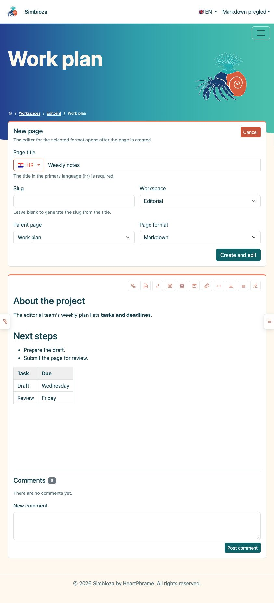
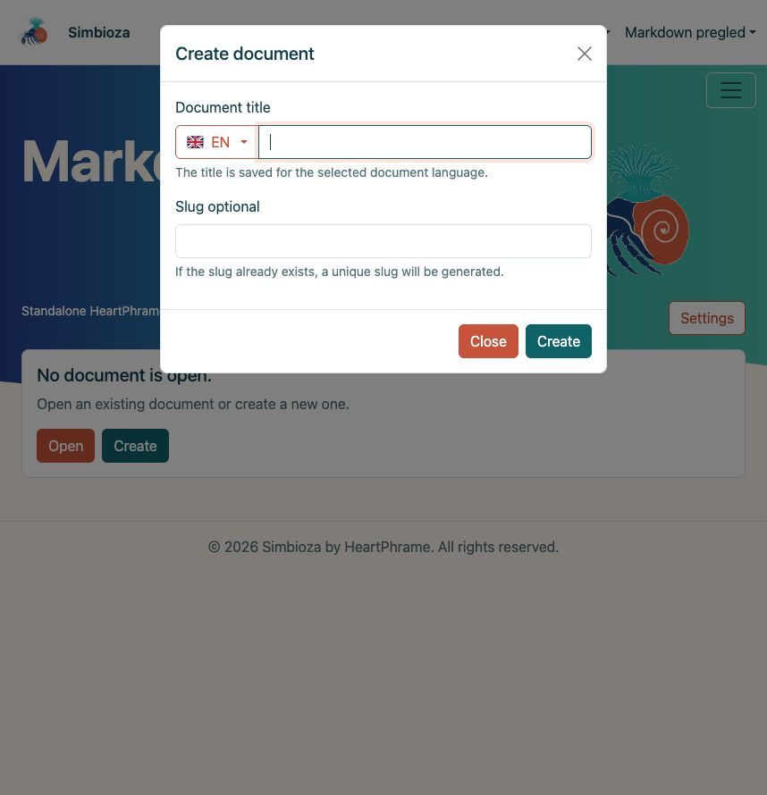
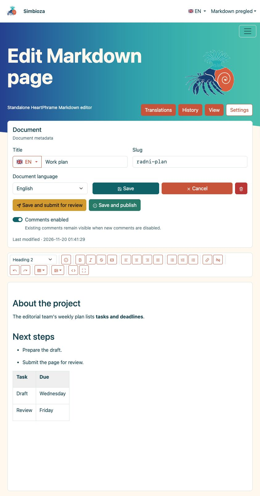
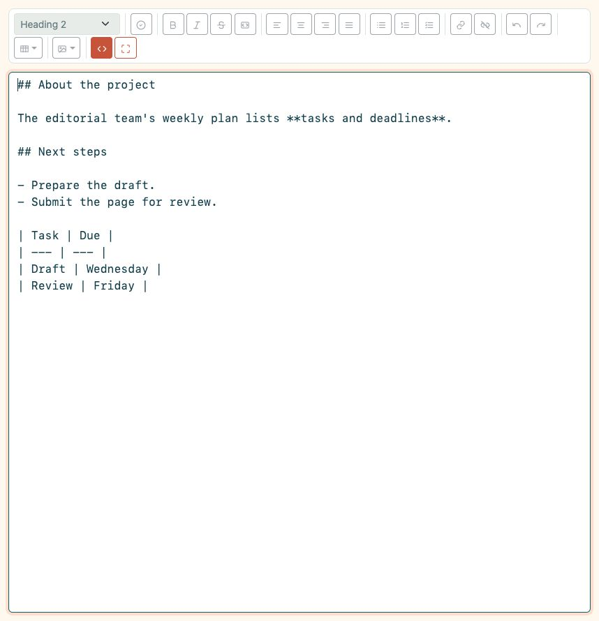
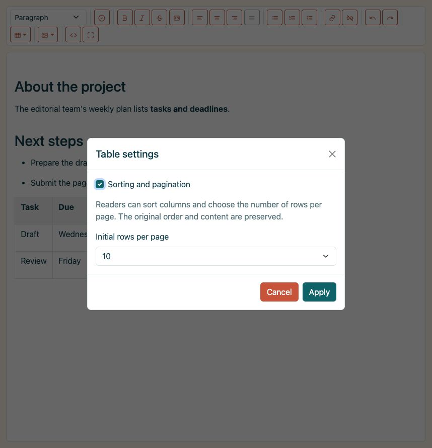
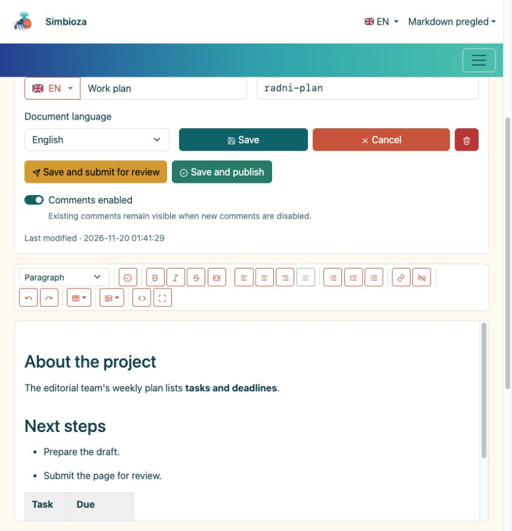

# MD Editor

Use MD Editor to write and edit Markdown pages in Simbioza. You can edit visually or work directly in the Markdown source. Choose the format when you create the page.

## 1. Create or open a document

Under **Workspaces**, open the workspace you want and choose **New page** beside the tree. Enter the **Page title** in the primary language, choose the parent page and, if **Page format** is available, select **Markdown**. Choose **Create and edit**. If MD Editor is the only available editor, Simbioza selects its format automatically. To edit an existing page, open it from the tree and choose the **Edit** pencil.

For a standalone document, select **Open editor** in Markdown Editor settings if you have access to those settings. Choose **Open** or **Create**. When creating a document, select the language next to **Document title**. You can leave the optional **Slug**, the short part of the page address, blank.

## 2. Edit the content

Put the caret in a paragraph and use **Format** to choose a paragraph, heading, quote or preformatted text. Select words to apply bold, italic or strikethrough. The toolbar also provides alignment, lists, checklists, links, images and tables. Hover over an icon to read its action name.

**Document check** checks headings, image descriptions and link text. **Fullscreen** keeps the toolbar above the content. Long documents scroll inside the editor, and **Escape** restores the previous view.

## 3. Edit the Markdown source

Select **Source code** (`<>`) to edit Markdown directly, for example `## Heading`, `**bold**` or `[label](address)`. Select it again to return to visual editing. Switching views carries your changes across. Choose **Save** to store them in the document.

## 4. Add tables, images and video

- Use **Table** to insert a table, edit rows and columns, or merge and split cells. With one header row and no merged cells, open **Table settings**. Enable **Sorting and pagination**, select the initial row count and choose **Apply**. Sorting in the reader's view preserves the source row order.
- In **Attachments** below the editor, choose a file and select **Upload**. Put the caret in the content, then choose **Insert into content** beside the uploaded file. Images appear as images, supported videos as players in the page view, and other attachments as links.
- Select an image, then use **Image** to set its width, spacing, alignment or **Edit image alternative text**. Mark an image as decorative when it adds no information.
- **Save visibility** in **Attachments** controls whether the attachment list is shown to readers. Edit inserted media in the document content.

## 5. Save, preview and publish

Check **Document language** at the top. **Save** stores the content for that language. Use **Translations**, **History** and **Preview** to work with other language versions, previous revisions and the page view. Save changes before switching to another language.

In a workspace, saving can leave changes in a draft. When available, choose **Save and submit for review** to request review or **Save and publish** to make changes visible to readers. The published page's **Table of contents** follows its headings, and **Download source** downloads the Markdown file. On a standalone page, manage reading permissions from the page itself.

[Editing pages](uredivanje-stranica-pregled_en.md) · [HTML Editor](uredivanje-stranica_en.md)
