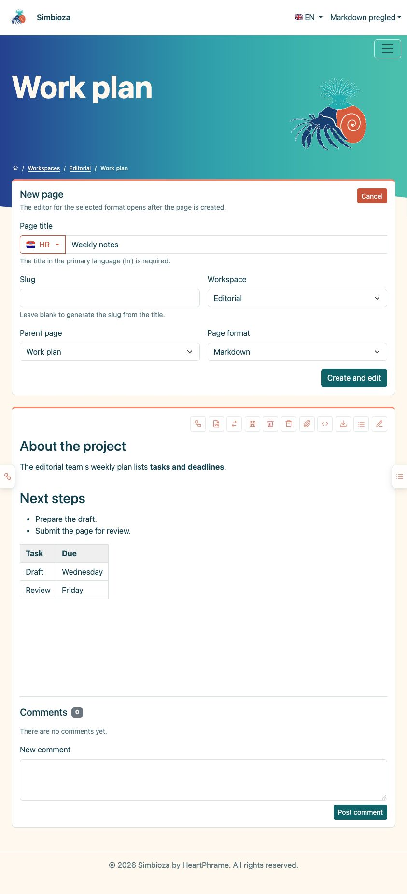
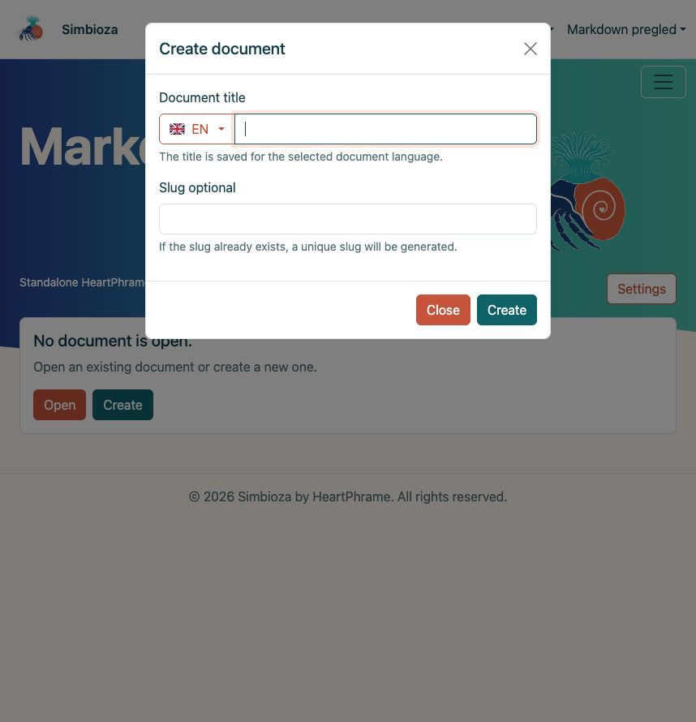
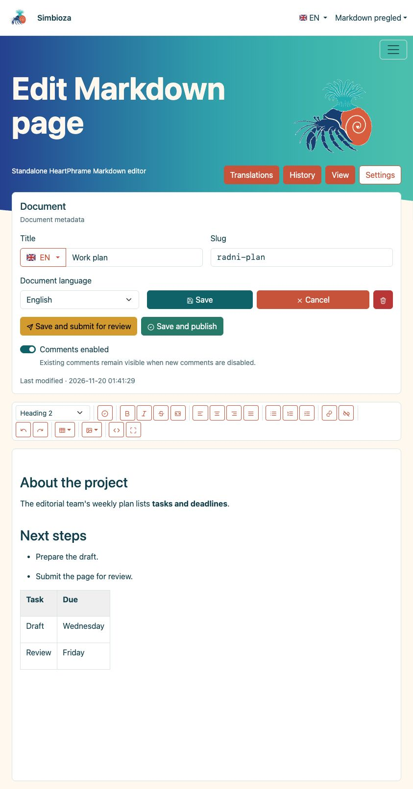
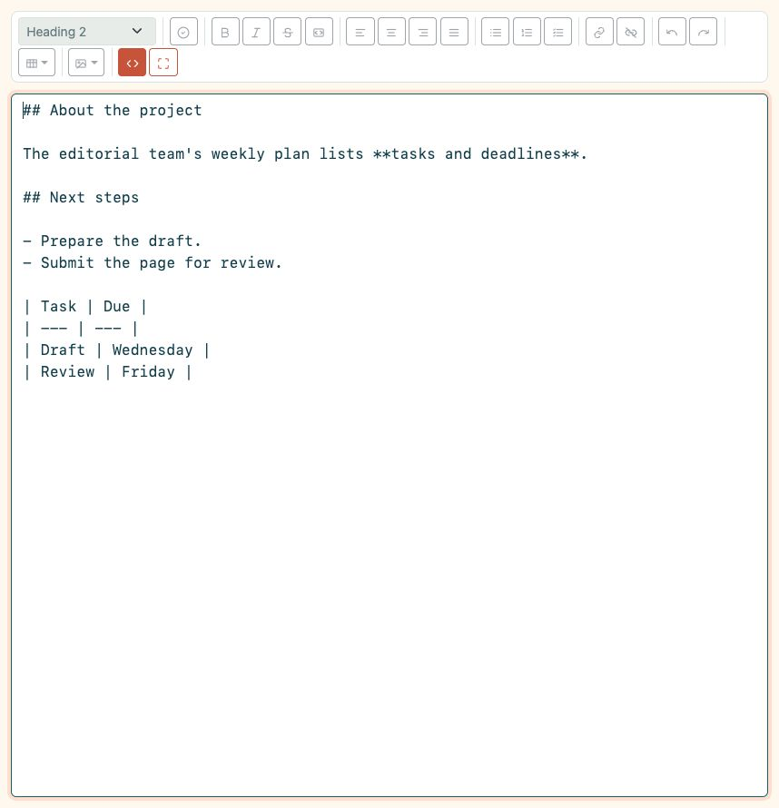
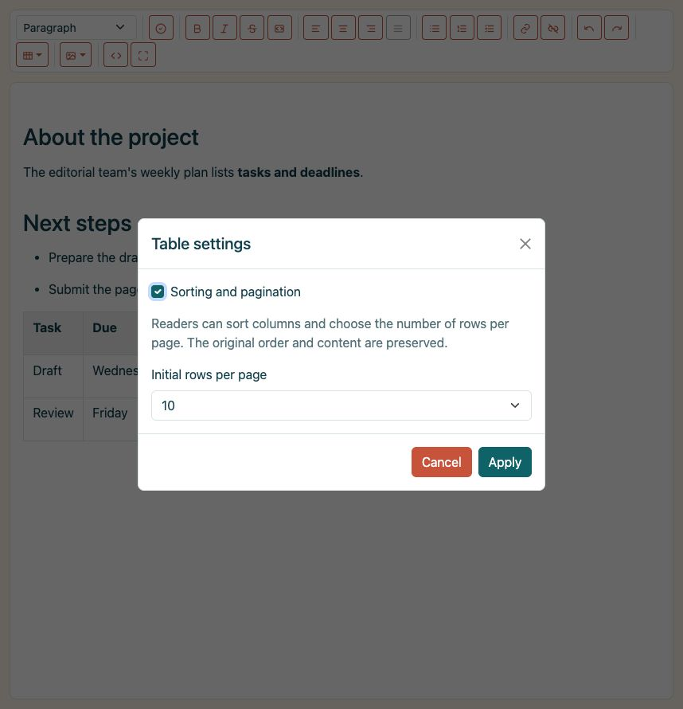
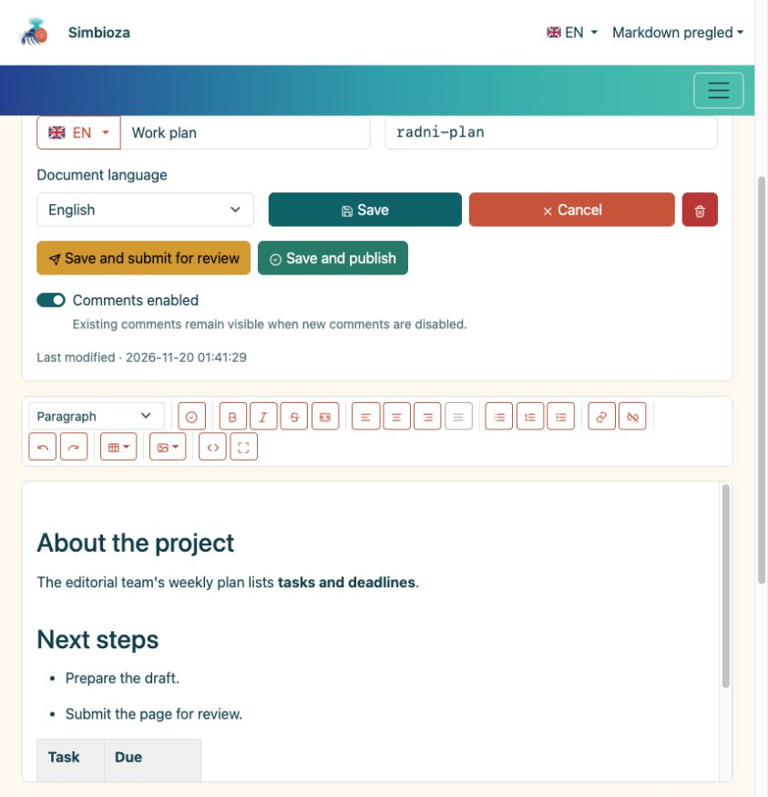

# MD Editor

Use MD Editor para escribir y editar páginas Markdown en Simbioza. Puede trabajar en modo visual o directamente con el código fuente Markdown. El formato se elige al crear la página. Las imágenes muestran la interfaz en inglés.

## 1. Crear o abrir un documento

Abra el **espacio de trabajo** deseado y seleccione **Nueva página** junto al árbol. Introduzca el título en el idioma principal y elija la página superior. Si aparece **Formato de página**, seleccione **Markdown**. Pulse **Crear y editar**. Si MD Editor es el único editor disponible, Simbioza selecciona su formato automáticamente. Para modificar una página existente, ábrala desde el árbol y pulse el lápiz **Editar**.

Para un documento independiente, seleccione **Abrir editor** en la configuración de Markdown Editor si tiene acceso. Pulse **Abrir** o **Crear**. Al crear un documento, elija el idioma junto al título. Puede dejar vacío el **slug**, la parte corta de la dirección de la página.

## 2. Editar el contenido

Coloque el cursor en un párrafo y use **Formato** para elegir párrafo, encabezado, cita o texto preformateado. Seleccione las palabras que quiera poner en negrita, cursiva o tachar. La barra también ofrece alineación, listas, listas de tareas, enlaces, imágenes y tablas. Sitúe el puntero sobre un icono para leer su nombre.

**Comprobar documento** revisa los encabezados, los textos alternativos de las imágenes y el texto de los enlaces. **Pantalla completa** mantiene la barra sobre el contenido. Los documentos largos se desplazan dentro del editor. Pulse **Escape** para volver a la vista anterior.

## 3. Editar el código fuente Markdown

Pulse **Código fuente** (`<>`) para editar Markdown directamente, por ejemplo `## Encabezado`, `**negrita**` o `[texto](dirección)`. Pulse el mismo botón para volver al modo visual. Los cambios se trasladan de una vista a otra. Pulse **Guardar** para conservarlos en el documento.

## 4. Añadir tablas, imágenes y vídeos

- Use **Tabla** para insertar una tabla, editar filas y columnas, o combinar y dividir celdas. Si hay una sola fila de encabezado y las celdas no están combinadas, abra **Configuración de tabla**. Active **Ordenación y paginación**, seleccione el número inicial de filas y pulse **Aplicar**. El orden en el código fuente se conserva al ordenar en la vista de lectura.
- En **Archivos adjuntos**, debajo del editor, elija un archivo y pulse **Subir**. Ponga el cursor en el contenido y seleccione **Insertar en el contenido** junto al archivo. Las imágenes se muestran como imágenes, los vídeos compatibles como reproductores y los demás archivos como enlaces.
- Seleccione una imagen y use **Imagen** para ajustar anchura, espaciado, alineación o texto alternativo. Puede marcarla como decorativa si no aporta información.
- **Guardar visibilidad**, en **Archivos adjuntos**, determina si los lectores ven la lista de archivos. Los elementos ya insertados se editan en el contenido del documento.

## 5. Guardar, revisar y publicar

Compruebe arriba el **idioma del documento**. **Guardar** conserva el contenido para ese idioma. Use **Traducciones**, **Historial** y **Vista previa** para trabajar con otras versiones de idioma, revisiones anteriores y la vista de la página. Guarde antes de cambiar de idioma.

En un espacio de trabajo, al guardar, los cambios pueden quedar en borrador. Si están disponibles, pulse **Guardar y enviar a revisión** o **Guardar y publicar** para hacerlos visibles a los lectores. El **Índice** de la página publicada sigue sus encabezados. **Descargar código fuente** obtiene el archivo Markdown. En una página independiente, gestione los permisos de lectura desde la propia página.

[Editar páginas](uredivanje-stranica-pregled_es.md) · [HTML Editor](uredivanje-stranica_es.md)
