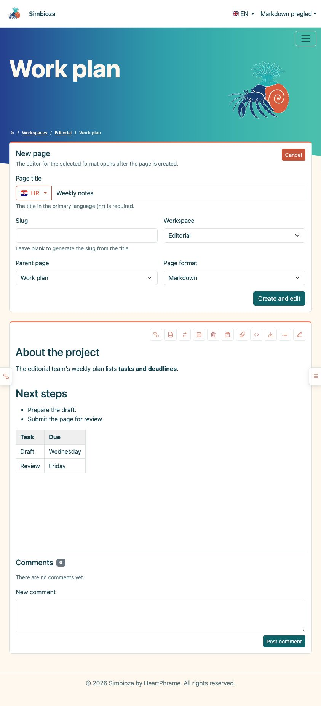
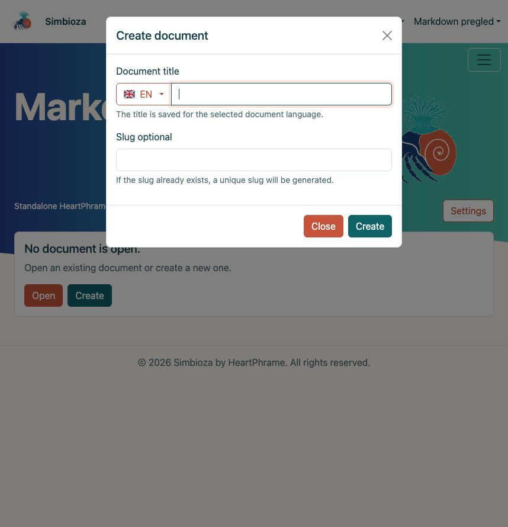
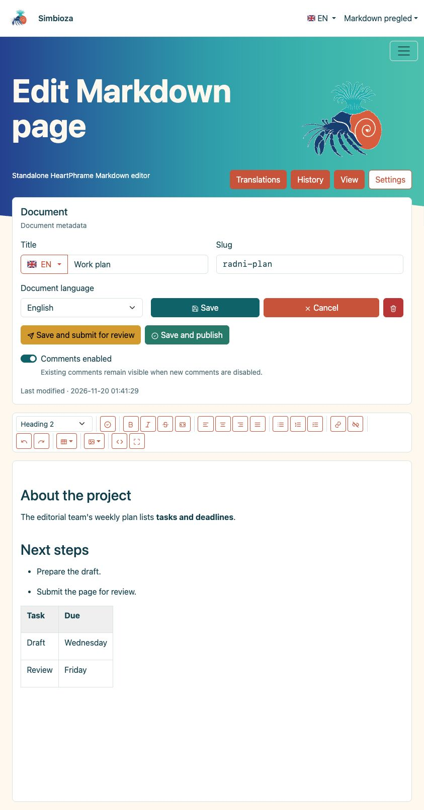
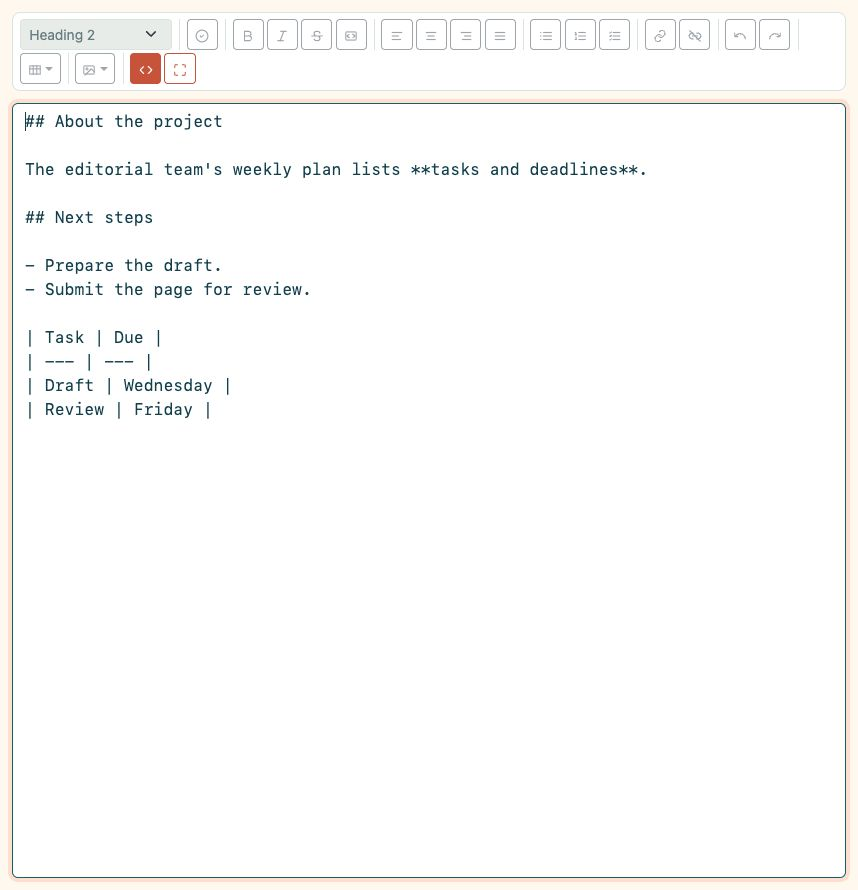
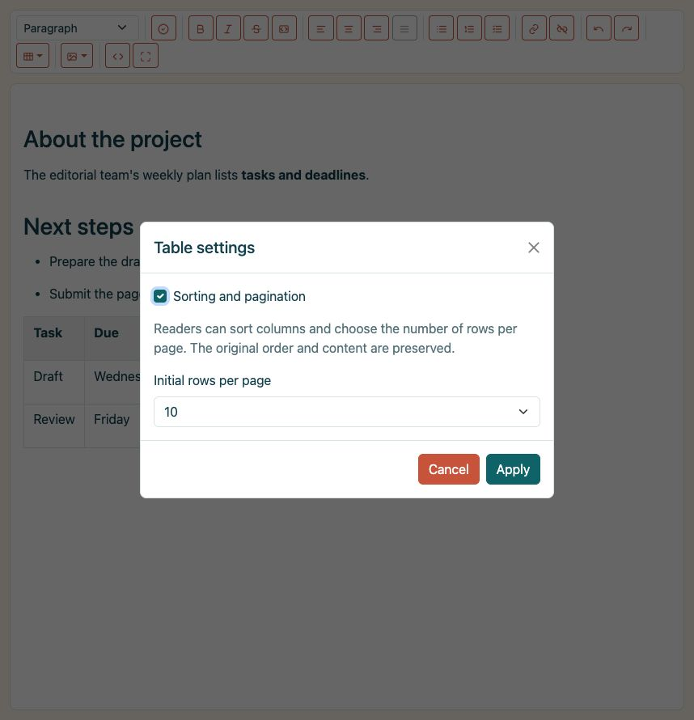
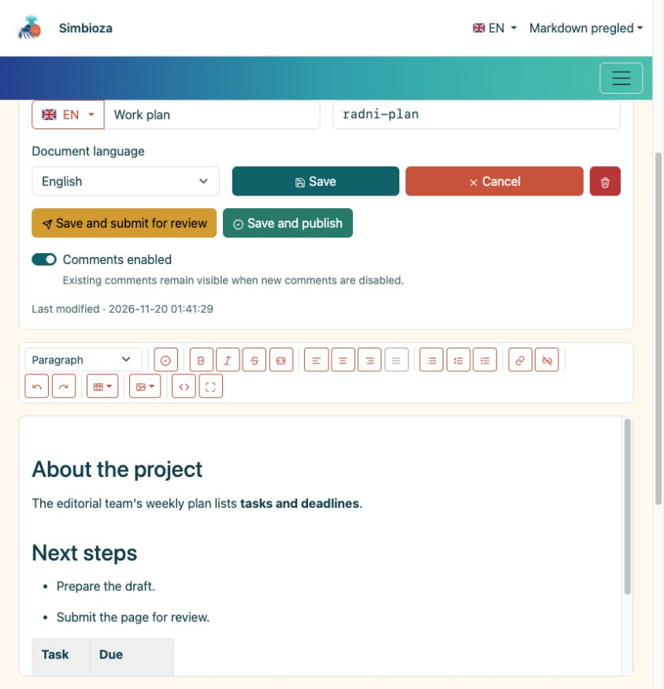

# MD Editor

MD Editor permet de rédiger et de modifier des pages Markdown dans Simbioza. Vous pouvez utiliser l’éditeur visuel ou travailler directement dans le code source Markdown. Le format se choisit lors de la création de la page. Les captures montrent l’interface en anglais.

## 1. Créer ou ouvrir un document

Dans **Espaces de travail**, ouvrez l’espace souhaité et choisissez **Nouvelle page** à côté de l’arborescence. Saisissez le titre dans la langue principale et choisissez la page parente. Si le champ **Format de la page** est disponible, sélectionnez **Markdown**. Cliquez sur **Créer et modifier**. Si MD Editor est le seul éditeur disponible, Simbioza sélectionne son format automatiquement. Pour une page existante, ouvrez-la depuis l’arborescence et cliquez sur le crayon **Modifier**.

Pour un document autonome, cliquez sur **Ouvrir l’éditeur** dans les paramètres de l’éditeur Markdown, si vous avez accès à ces paramètres. Choisissez **Ouvrir** ou **Créer**. Lors de la création, sélectionnez la langue à côté du titre. Le **slug**, la partie courte de l’adresse de la page, est facultatif.

## 2. Modifier le contenu

Placez le curseur dans un paragraphe et choisissez, dans **Format**, un paragraphe, un titre, une citation ou du texte préformaté. Sélectionnez des mots pour les mettre en gras, en italique ou les barrer. La barre propose aussi l’alignement, les listes, les listes de tâches, les liens, les images et les tableaux. Survolez une icône pour lire le nom de l’action.

**Vérifier le document** examine les titres, les descriptions d’images et le texte des liens. Le **Plein écran** garde la barre au-dessus du contenu. Les documents longs défilent à l’intérieur de l’éditeur. **Échap** rétablit la vue précédente.

## 3. Modifier le code source Markdown

Cliquez sur **Code source** (`<>`) pour modifier le Markdown directement, par exemple `## Titre`, `**gras**` ou `[libellé](adresse)`. Cliquez de nouveau pour revenir à l’éditeur visuel. Les modifications sont conservées d’un mode à l’autre. Cliquez sur **Enregistrer** pour les conserver dans le document.

## 4. Ajouter des tableaux, des images et des vidéos

- Utilisez **Tableau** pour insérer un tableau, modifier des lignes et des colonnes, ou fusionner et scinder des cellules. Pour un tableau à une seule ligne d’en-tête sans cellules fusionnées, ouvrez **Paramètres du tableau**. Activez **Tri et pagination**, sélectionnez le nombre initial de lignes et cliquez sur **Appliquer**. Le tri dans la vue de lecture conserve l’ordre des lignes dans le code source.
- Dans **Pièces jointes**, sous l’éditeur, choisissez un fichier et cliquez sur **Téléverser**. Placez le curseur dans le contenu, puis sélectionnez **Insérer dans le contenu** à côté du fichier. Les images s’affichent comme des images, les vidéos prises en charge s’affichent dans un lecteur et les autres fichiers sous forme de liens.
- Sélectionnez une image et utilisez **Image** pour régler sa largeur, son espacement, son alignement ou son texte alternatif. Vous pouvez la marquer comme décorative si elle n’apporte pas d’information.
- Dans **Pièces jointes**, **Enregistrer la visibilité** détermine si la liste s’affiche aux lecteurs. Modifiez les médias insérés dans le contenu du document.

## 5. Enregistrer, prévisualiser et publier

Vérifiez en haut la **langue du document**. **Enregistrer** conserve le contenu pour cette langue. Utilisez **Traductions**, **Historique** et **Aperçu** pour travailler avec les différentes versions linguistiques, les révisions précédentes et l’affichage de la page. Enregistrez avant de changer de langue.

Dans un espace de travail, les modifications enregistrées peuvent rester en brouillon. Si ces actions sont disponibles, choisissez **Enregistrer et soumettre à la relecture** ou **Enregistrer et publier** pour rendre la page visible aux lecteurs. La **Table des matières** de la page publiée suit ses titres. **Télécharger le code source** récupère le fichier Markdown. Pour une page autonome, gérez les droits de lecture depuis la page elle-même.

[Modifier les pages](uredivanje-stranica-pregled_fr.md) · [HTML Editor](uredivanje-stranica_fr.md)
