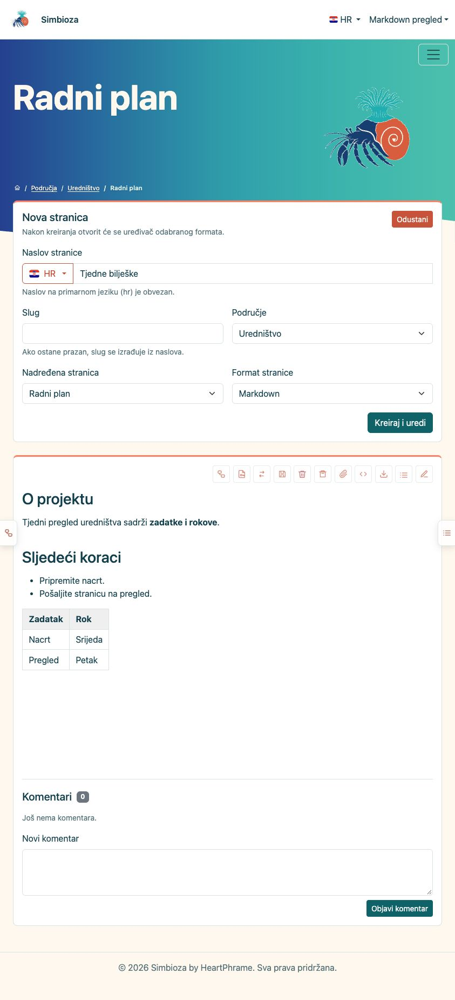
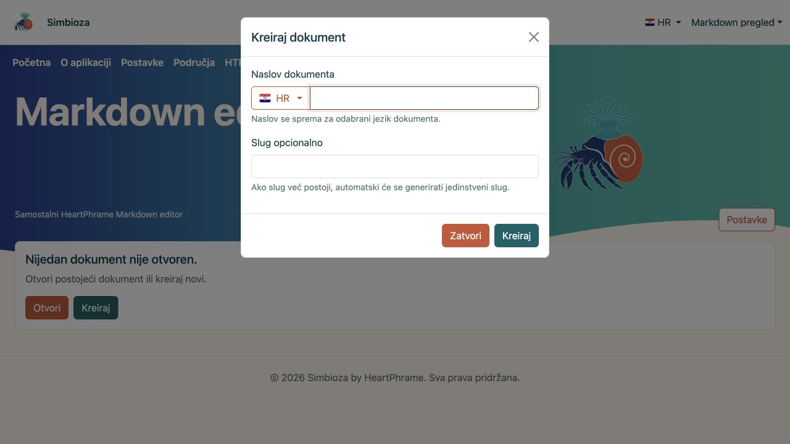
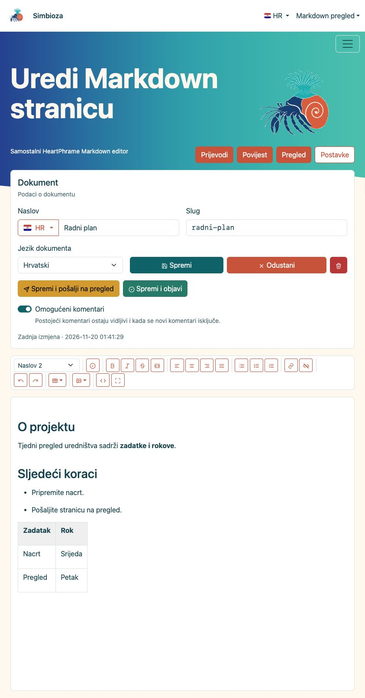
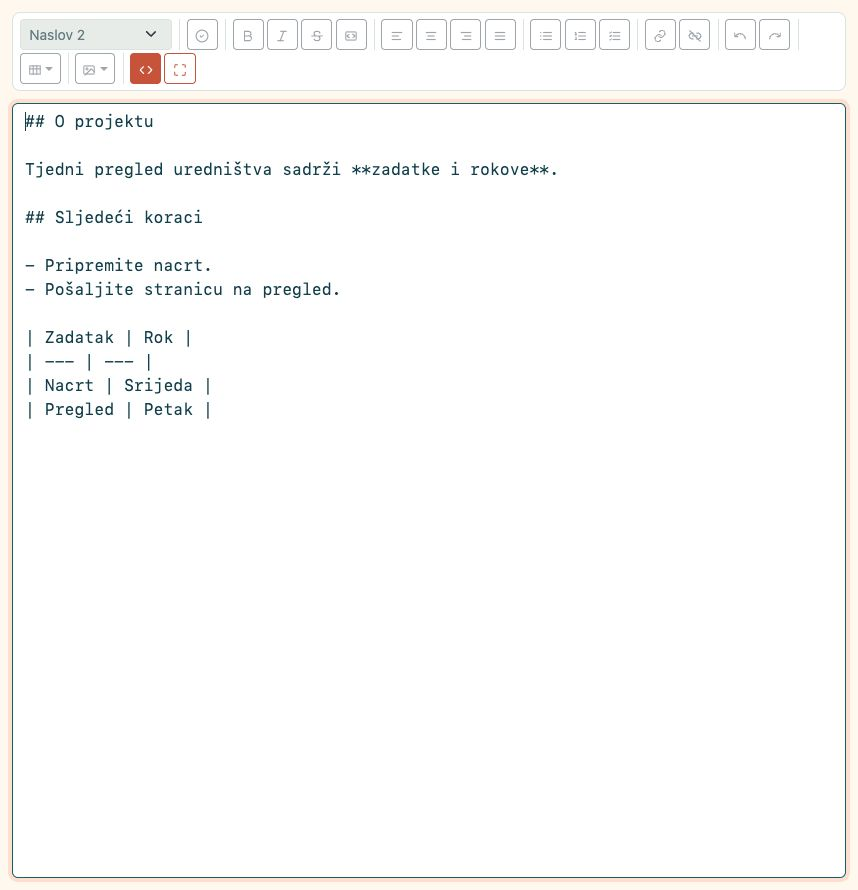
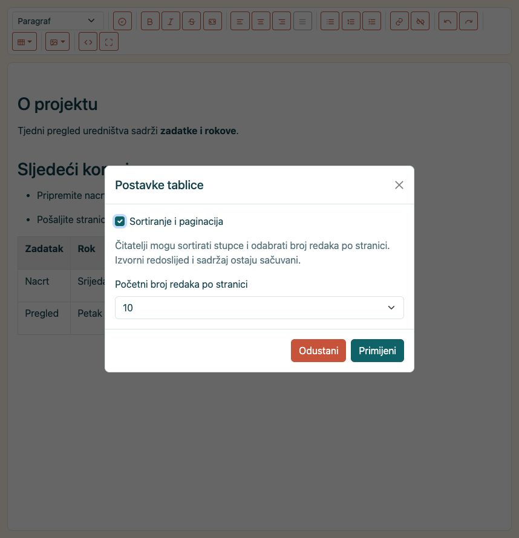
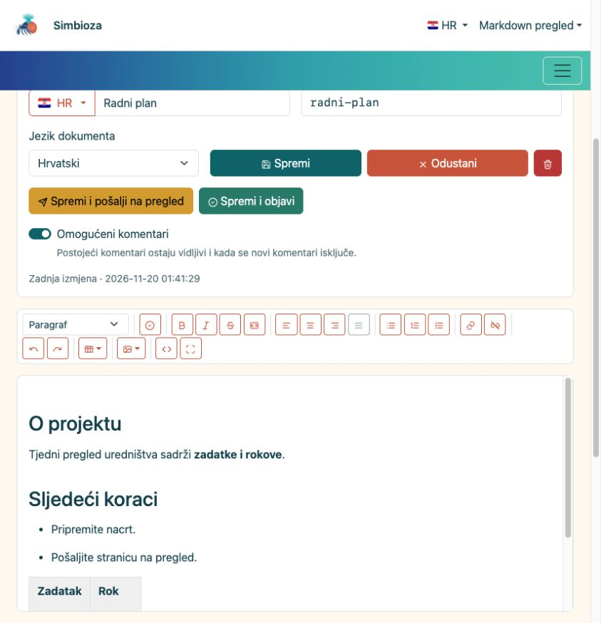

# MD Editor

MD Editor služi za pisanje i uređivanje Markdown stranica u Simbiozi. Tekst možete uređivati vizualno ili izravno u Markdown izvoru. Format se odabire pri stvaranju stranice.

## 1. Stvorite ili otvorite dokument

U **Područjima** otvorite željeno područje i uz stablo odaberite **Nova stranica**. Upišite **Naslov stranice** na primarnom jeziku, odaberite nadređenu stranicu i, ako je ponuđeno polje **Format stranice**, odaberite **Markdown**. Kliknite **Kreiraj i uredi**. Ako je MD Editor jedini dostupan editor, format se odabire automatski. Postojeću stranicu otvorite iz stabla i kliknite olovku **Uredi**.

Za samostalni dokument, u postavkama Markdown editora kliknite **Otvori editor** ako imate pristup postavkama. Odaberite **Otvori** ili **Kreiraj**. Pri stvaranju odaberite jezik uz **Naslov dokumenta**. **Slug** je dio adrese i možete ga ostaviti praznim.

## 2. Uredite sadržaj

Postavite pokazivač u odlomak i u izborniku **Format** odaberite paragraf, naslov, citat ili preformatirani tekst. Označite riječi za podebljanje, kurziv ili precrtavanje. Alatna traka nudi poravnanje, liste, kontrolne popise, poveznice, slike i tablice. Zadržite pokazivač na ikoni kako biste pročitali naziv radnje.

**Provjera dokumenta** provjerava naslove, alternativne opise slika i tekst poveznica. **Cijeli ekran** ostavlja alatnu traku iznad sadržaja. Dugi dokument pomiče se unutar uređivača, a **Escape** vraća prethodni prikaz.

## 3. Uredite Markdown izvor

Kliknite **Izvorni kod** (`<>`) za uređivanje Markdown zapisa, primjerice `## Naslov`, `**podebljano**` ili `[opis](adresa)`. Istim gumbom vratite se u vizualni editor. Promjena prikaza prenosi unesene izmjene između načina uređivanja. Za trajno čuvanje dokumenta kliknite **Spremi**.

## 4. Dodajte tablice, slike i video

- **Tablica** omogućuje umetanje tablice, rad s retcima i stupcima te spajanje i dijeljenje ćelija. U tablici s jednim retkom zaglavlja i bez spojenih ćelija otvorite **Postavke tablice**. Uključite **Sortiranje i paginacija**, odaberite početni broj redaka i kliknite **Primijeni**. Sortiranje u prikazu zadržava izvorni redoslijed redaka dokumenta.
- U kartici **Privitci** ispod uređivača odaberite datoteku i kliknite **Učitaj**. Postavite pokazivač u sadržaj pa uz učitanu datoteku kliknite **Umetni u tekst**. Slika se umeće kao slika, podržani video kao reproduktor u prikazu stranice, a ostali privitci kao poveznice.
- Kliknite sliku pa u izborniku **Slika** odaberite širinu, razmak, poravnanje ili **Uredi alternativni tekst slike**. Sliku koja služi samo kao ukras označite kao ukrasnu.
- **Spremi vidljivost** u kartici **Privitci** određuje prikaz popisa privitaka pri čitanju. Umetnuti mediji uređuju se u sadržaju dokumenta.

## 5. Spremite, pregledajte i objavite

U vrhu editora provjerite **Jezik dokumenta**. **Spremi** sprema sadržaj tog jezika. **Prijevodi**, **Povijest** i **Pregled** služe za rad s drugim jezičnim inačicama, prethodnim revizijama i prikazom stranice. Spremite izmjene prije prebacivanja na drugi jezik.

U Području spremanje može ostaviti izmjene u nacrtu. Ako su dostupne, odaberite **Spremi i pošalji na pregled** za provjeru ili **Spremi i objavi** za objavu čitateljima. Na objavljenoj stranici **Sadržaj** slijedi naslove dokumenta, a **Preuzmi izvor** preuzima Markdown zapis. U samostalnom prikazu ovlasti čitanja uređuju se na samoj stranici.

[Uređivanje stranica](uredivanje-stranica-pregled_hr.md) · [HTML Editor](uredivanje-stranica_hr.md)
