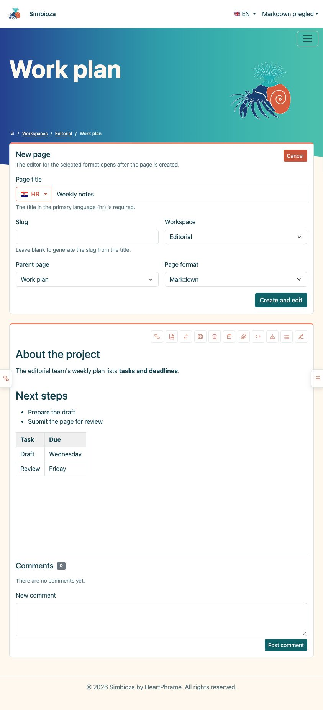
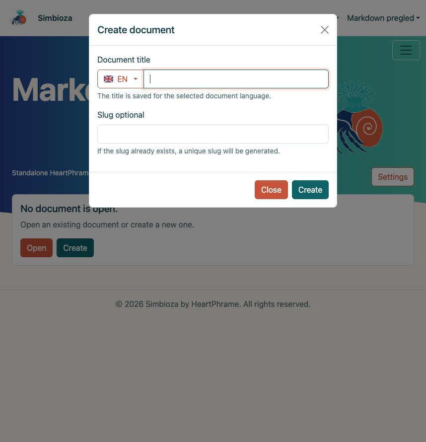
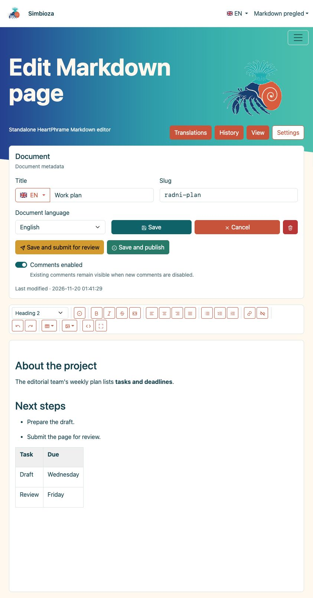
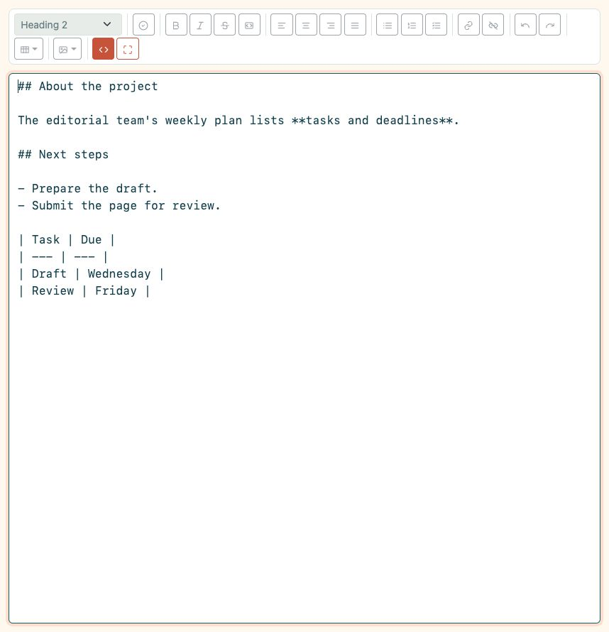
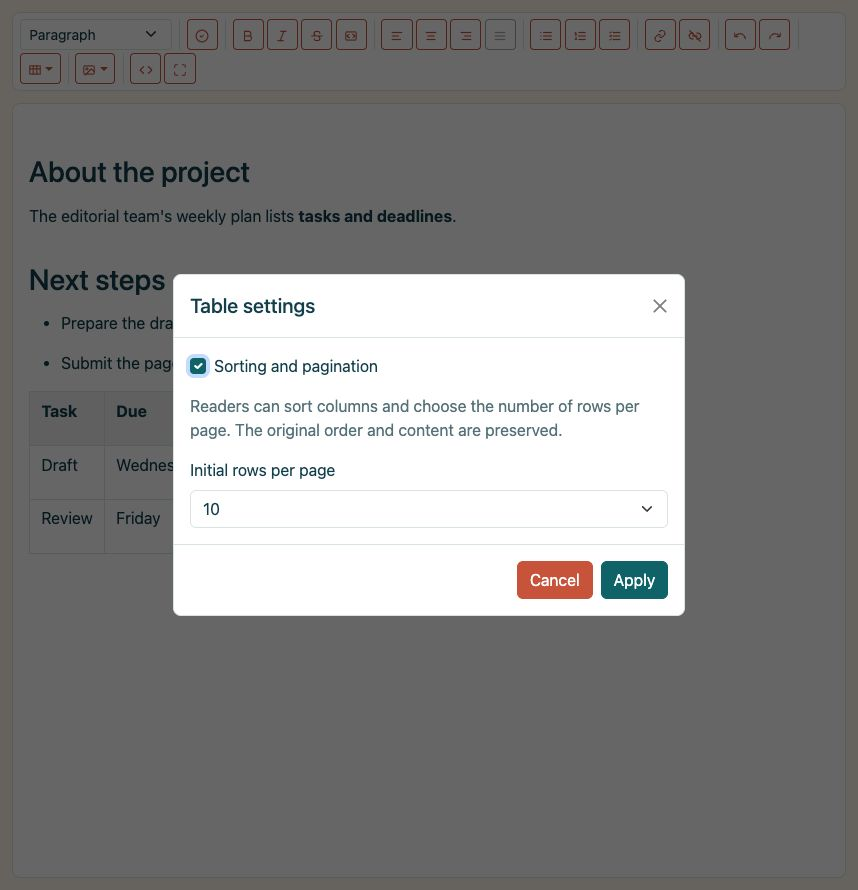
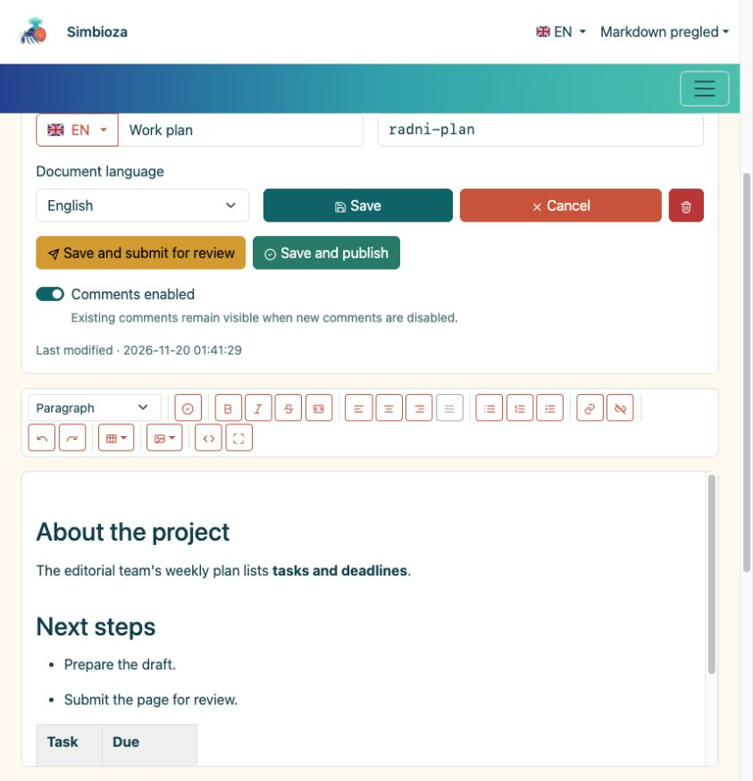

# MD Editor

Usa MD Editor per scrivere e modificare pagine Markdown in Simbioza. Puoi lavorare in modalità visuale o direttamente nel sorgente Markdown. Scegli il formato quando crei la pagina. Le immagini mostrano l’interfaccia in inglese.

## 1. Creare o aprire un documento

In **Aree di lavoro**, apri l’area desiderata e seleziona **Nuova pagina** accanto all’albero. Inserisci il titolo nella lingua principale e scegli la pagina superiore. Se è disponibile il campo **Formato della pagina**, seleziona **Markdown**. Seleziona **Crea e modifica**. Se MD Editor è l’unico editor disponibile, Simbioza seleziona automaticamente il suo formato. Per modificare una pagina esistente, aprila dall’albero e seleziona la matita **Modifica**.

Per un documento autonomo, seleziona **Apri editor** nelle impostazioni dell’editor Markdown, se puoi accedervi. Scegli **Apri** o **Crea**. Durante la creazione scegli la lingua accanto al titolo. Lo **slug**, la parte breve dell’indirizzo della pagina, è facoltativo.

## 2. Modificare il contenuto

Metti il cursore in un paragrafo e usa **Formato** per scegliere un paragrafo, un titolo, una citazione o testo preformattato. Seleziona le parole da mettere in grassetto, in corsivo o da barrare. La barra offre anche allineamento, elenchi, elenchi di controllo, collegamenti, immagini e tabelle. Passa il puntatore su un’icona per leggere il nome dell’azione.

**Verifica documento** controlla titoli, descrizioni delle immagini e testo dei collegamenti. **Schermo intero** mantiene la barra sopra il contenuto. I documenti lunghi scorrono all’interno dell’editor. Premi **Esc** per tornare alla vista precedente.

## 3. Modificare il sorgente Markdown

Seleziona **Codice sorgente** (`<>`) per modificare il Markdown direttamente, per esempio `## Titolo`, `**grassetto**` o `[testo](indirizzo)`. Usa lo stesso pulsante per tornare alla modalità visuale. Le modifiche passano da una modalità all’altra. Seleziona **Salva** per conservarle nel documento.

## 4. Aggiungere tabelle, immagini e video

- Usa **Tabella** per inserire una tabella, modificare righe e colonne, unire o dividere celle. Per una tabella con una sola riga di intestazione e senza celle unite, apri **Impostazioni tabella**. Attiva **Ordinamento e paginazione**, seleziona il numero iniziale di righe e scegli **Applica**. L’ordinamento nella vista di lettura conserva l’ordine delle righe nel sorgente.
- Nel riquadro **Allegati**, sotto l’editor, scegli un file e seleziona **Carica**. Posiziona il cursore nel contenuto e scegli **Inserisci nel contenuto** accanto al file. Le immagini vengono mostrate come immagini, i video supportati in un lettore e gli altri allegati come collegamenti.
- Seleziona un’immagine e usa **Immagine** per impostare larghezza, spaziatura, allineamento o testo alternativo. Contrassegna come decorativa un’immagine che non aggiunge informazioni.
- **Salva visibilità**, nel riquadro **Allegati**, stabilisce se i lettori vedono l’elenco. I media già inseriti si modificano nel contenuto del documento.

## 5. Salvare, visualizzare l’anteprima e pubblicare

Controlla in alto la **lingua del documento**. **Salva** conserva il contenuto per quella lingua. Usa **Traduzioni**, **Cronologia** e **Anteprima** per consultare le versioni in altre lingue, le revisioni precedenti e l’aspetto della pagina. Salva le modifiche prima di cambiare lingua.

In un’area di lavoro il salvataggio può lasciare le modifiche in bozza. Se disponibili, seleziona **Salva e invia per la revisione** o **Salva e pubblica** per renderle visibili ai lettori. L’**Indice** della pagina pubblicata segue i titoli. **Scarica sorgente** scarica il file Markdown. Per una pagina autonoma, gestisci i permessi di lettura dalla pagina stessa.

[Modifica delle pagine](uredivanje-stranica-pregled_it.md) · [HTML Editor](uredivanje-stranica_it.md)
