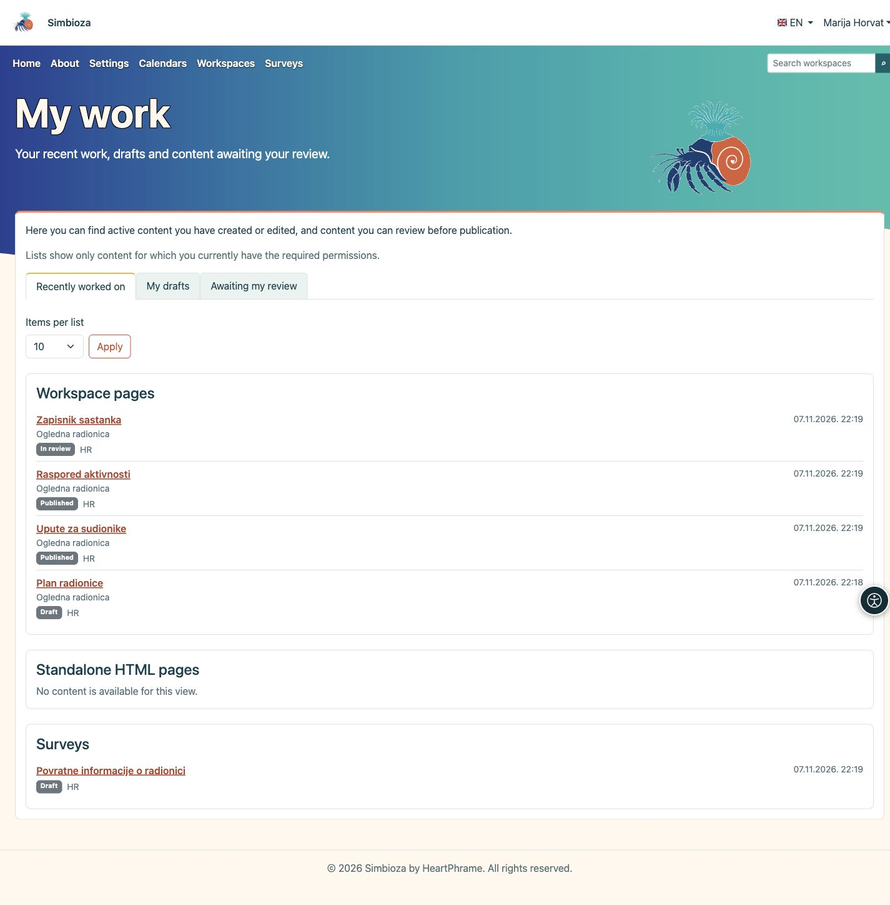

# Meine Arbeit

> Die Bildschirmaufnahmen zeigen die englische Benutzeroberfläche.

**Ziel:** Schnell zu bearbeiteten Inhalten zurückkehren, einen Entwurf fortsetzen oder Inhalte finden, die Sie vor der Veröffentlichung prüfen müssen.

## Ihre Übersicht öffnen

1. Melden Sie sich mit Ihrem eigenen Benutzerkonto bei Simbioza an.
2. Öffnen Sie das Kontomenü neben Ihrem Namen und wählen Sie **Meine Arbeit**.
3. Wählen Sie eine der drei nachfolgend beschriebenen Ansichten.

**Ergebnis:** Sie sehen Ihre persönlichen Arbeitslisten. Das Öffnen dieser Übersicht ändert weder die Startseite noch die Einstellungen anderer Personen.

<figure class="my-4">

<figcaption>Meine Arbeit: Wählen Sie den fortzusetzenden Arbeitsbereich und öffnen Sie einen Inhalt über seinen Titel.</figcaption>
</figure>

## Auswählen, was Sie fortsetzen möchten

| Ansicht | Inhalt |
| --- | --- |
| **Zuletzt bearbeitet** | Aktive Seiten und Umfragen, die Sie erstellt oder bearbeitet haben. Ihr letzter Beitrag bleibt erfasst, auch wenn anschließend jemand anderes dieselben Inhalte bearbeitet. |
| **Meine Entwürfe** | Unveröffentlichte Inhalte, zu denen Sie beigetragen haben. Dazu können bereits zur Prüfung eingereichte Seiten und Umfragen gehören. Die Kennzeichnung neben dem Titel zeigt den aktuellen Status. |
| **Wartet auf meine Prüfung** | Zur Prüfung eingereichte Seiten und Umfragen, die Sie aufgrund Ihrer Berechtigungen veröffentlichen dürfen. Es müssen nicht Ihre eigenen Inhalte sein. |

Dies ist eine Übersicht Ihrer Arbeit an Inhalten, kein Verlauf gelesener Seiten und keine Liste ausgefüllter Umfragen.

## Inhalte öffnen

Die Inhalte sind in eigene Karten aufgeteilt: **Seiten in Arbeitsbereichen**, **Eigenständige HTML-Seiten** und **Umfragen**, je nach installierten und aktivierten Funktionen. Eigenständige HTML-Seiten haben keine eigene Warteschlange zur Prüfung und erscheinen deshalb nicht unter **Wartet auf meine Prüfung**.

Jeder Eintrag zeigt Status, Sprache und Datum. Bei Seiten in Arbeitsbereichen sehen Sie außerdem den Namen des Arbeitsbereichs. Klicken Sie auf einen **Titel**, um den Inhalt zu öffnen. Danach können Sie ihn weiter bearbeiten oder die angebotenen Prüf- und Veröffentlichungsaktionen verwenden. Das Öffnen von **Meine Arbeit** veröffentlicht nichts.

## Länge der Listen anpassen

1. Wählen Sie unter **Einträge pro Liste** **10**, **25** oder **50**.
2. Klicken Sie auf **Anwenden**.
3. Weitere Einträge erreichen Sie mit **Nächste Seite** in der jeweiligen Karte. **Zum Listenanfang** führt diese Karte zurück zum Anfang.

Jede Karte hat eine eigene Seitennavigation. Eine andere Anzahl oder Ansicht setzt die Listen auf den Anfang zurück.

## Wenn etwas fehlt

Sie sehen nur Inhalte, für die Sie aktuell die erforderlichen Berechtigungen besitzen. Früheres Autorentum stellt entzogene Rechte nicht wieder her. Gelöschte, archivierte und deaktivierte Inhalte sind ausgeschlossen; eine veröffentlichte Version ist selbst kein Entwurf. Neue unveröffentlichte Änderungen einer veröffentlichten Seite oder Umfrage erscheinen wieder bei den Entwürfen.

Eine leere Liste kann normal sein: Vielleicht haben Sie noch nichts bearbeitet oder es wartet nichts auf Ihre Prüfung. Falls Sie einen bestimmten Eintrag erwarten, prüfen Sie Ihr Konto und bitten Sie die Verwaltung des Arbeitsbereichs oder die Administration um die passende Berechtigung.

Weitere Schritte erklären [Seiten bearbeiten](uredivanje-stranica_de.md) und [Umfragen erstellen](ankete-autori_de.md). Ihre Kontodaten verwalten Sie unter [Mein Profil](osobni-profil_de.md).

Bei älteren Umfragen werden vorhandene Autorenangaben verwendet. Änderungen von Mitwirkenden und Prüfungen erhalten seit Einführung dieser Übersicht eigene Zeitangaben; unbekannte ältere Zeiten werden nicht erfunden. Kann eine Liste nicht vollständig geladen werden, erscheint eine Meldung anstelle einer unvollständigen oder scheinbar leeren Liste. Versuchen Sie es später erneut oder verwenden Sie die Suche.
