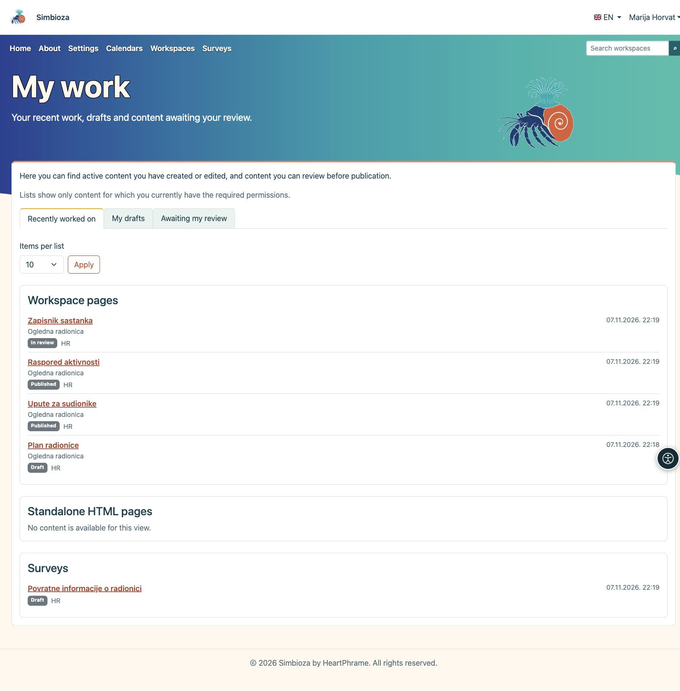

# My work

**Goal:** quickly return to content you have edited, continue a draft, or find content you need to review before publication.

## Open your overview

1. Sign in to Simbioza with your own user account.
2. Open the account menu beside your name and select **My work**.
3. Choose one of the three views described below.

**Result:** you see your personal work lists. Opening this overview does not change the homepage or anyone else’s settings.

<figure class="my-4">

<figcaption>My work: choose what to continue, then open the content title.</figcaption>
</figure>

## Choose what to continue

| View | What you will find |
| --- | --- |
| **Recently worked on** | Active pages and surveys you have created or edited. Your last contribution remains recorded even if someone else later edits the same content. |
| **My drafts** | Unpublished content you have contributed to. This can include pages or surveys you have already submitted for review. The badge beside the title shows the current status. |
| **Awaiting my review** | Pages and surveys submitted for review that your permissions allow you to publish. They do not have to be your own work. |

This is an overview of work on content, not a history of pages you have read or a list of surveys you have completed.

## Open the content

Content appears in separate cards: **Workspace pages**, **Standalone HTML pages** and **Surveys**, depending on the features installed and enabled. Standalone HTML pages have no separate review queue, so they do not appear under **Awaiting my review**.

Each entry shows its status, language and date. Workspace pages also show their workspace name. Click a **title** to open the content, then continue editing or use the available review and publication actions. Simply opening **My work** does not publish anything.

## Adjust the list length

1. Under **Items per list**, select **10**, **25** or **50**.
2. Click **Apply**.
3. To see more items, click **Next page** in the relevant card. **Back to the start** returns that card to its first items.

Each card has its own paging controls. Changing the number of items or the view returns the lists to the start.

## If something is missing

Only content for which you currently have the required permissions is shown. Previous authorship does not restore a removed permission. Deleted, archived or disabled content is excluded; a published version itself is not a draft. New unpublished changes to a published page or survey appear among drafts again.

An empty list can be normal: you may not have edited any content yet, or there may be nothing for you to review. If you expect a particular item, check your account and ask the workspace manager or administrator for the appropriate permission.

For the next step, see [Editing pages](uredivanje-stranica_en.md) or [Creating surveys](ankete-autori_en.md). Manage your account details in [My profile](osobni-profil_en.md).

For older surveys, the overview uses existing authorship records. Collaborator edits and reviews receive their own timestamps from the introduction of this overview; unknown older timestamps are not invented. If a list cannot be completed, a message replaces an incomplete or apparently empty list. Try later or use search.
