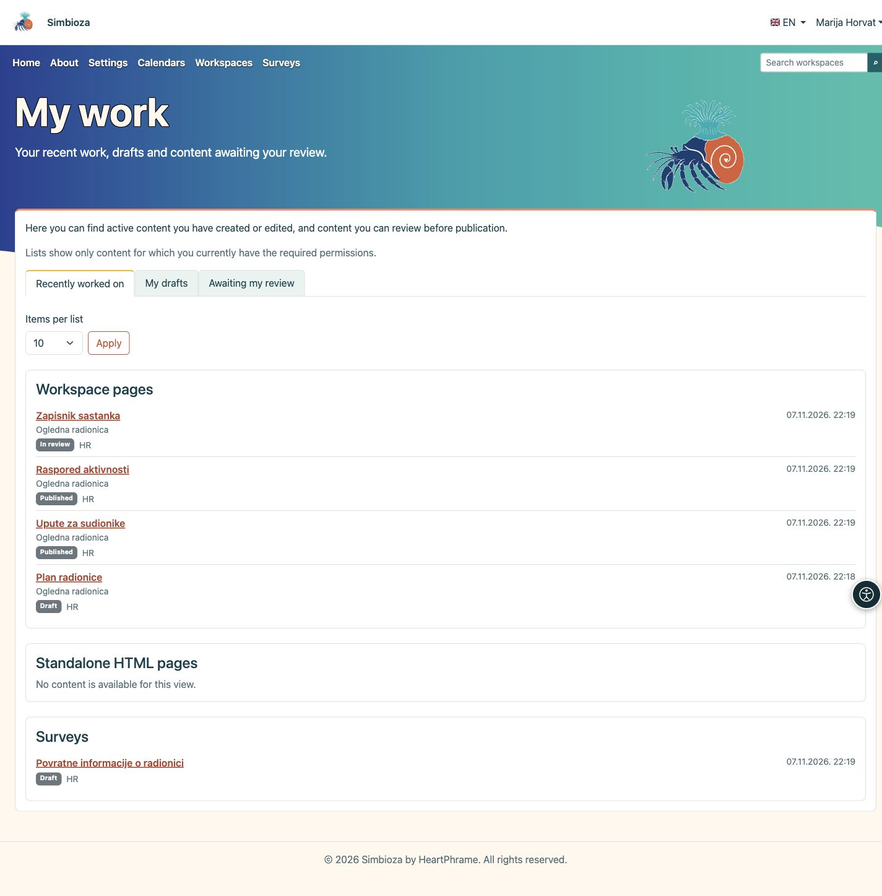

# Mi trabajo

> Las capturas de pantalla muestran la interfaz en inglés.

**Objetivo:** volver rápidamente al contenido que ha editado, continuar un borrador o encontrar contenido que debe revisar antes de su publicación.

## Abra su resumen

1. Inicie sesión en Simbioza con su propia cuenta de usuario.
2. Abra el menú de la cuenta junto a su nombre y seleccione **Mi trabajo**.
3. Elija una de las tres vistas que se describen a continuación.

**Resultado:** verá sus listas personales de trabajo. Abrir este resumen no cambia la página de inicio ni la configuración de otras personas.

<figure class="my-4">

<figcaption>Mi trabajo: elija qué desea continuar y abra el título del contenido.</figcaption>
</figure>

## Elija qué desea continuar

| Vista | Qué encontrará |
| --- | --- |
| **Trabajo reciente** | Páginas y encuestas activas que ha creado o editado. Su última contribución sigue registrada aunque otra persona edite después el mismo contenido. |
| **Mis borradores** | Contenido sin publicar en el que ha colaborado. Puede incluir páginas o encuestas que ya ha enviado a revisión. La etiqueta junto al título muestra el estado actual. |
| **Pendiente de mi revisión** | Páginas y encuestas enviadas a revisión que sus permisos le permiten publicar. No tienen que ser de su autoría. |

Este es un resumen del trabajo realizado en el contenido, no un historial de páginas leídas ni una lista de encuestas completadas.

## Abra el contenido

El contenido se organiza en tarjetas separadas: **Páginas de los espacios de trabajo**, **Páginas HTML independientes** y **Encuestas**, según las funciones instaladas y activadas. Las páginas HTML independientes no tienen una cola de revisión separada, por lo que no aparecen en **Pendiente de mi revisión**.

Cada entrada muestra su estado, idioma y fecha. Las páginas de los espacios de trabajo también muestran el nombre del espacio. Haga clic en un **título** para abrir el contenido. Después, continúe editando o utilice las acciones disponibles de revisión y publicación. Abrir **Mi trabajo** no publica nada.

## Ajuste la longitud de las listas

1. En **Elementos por lista**, seleccione **10**, **25** o **50**.
2. Haga clic en **Aplicar**.
3. Para ver más elementos, pulse **Página siguiente** en la tarjeta correspondiente. **Volver al inicio de la lista** devuelve esa tarjeta al principio.

Cada tarjeta tiene su propia paginación. Cambiar el número de elementos o la vista devuelve las listas al principio.

## Si falta algo

Solo se muestra el contenido para el que actualmente tiene los permisos necesarios. Haber creado contenido no restablece un permiso retirado. Se excluye el contenido eliminado, archivado o desactivado; una versión publicada no es en sí un borrador. Las nuevas modificaciones sin publicar de una página o encuesta publicada vuelven a aparecer entre los borradores.

Una lista vacía puede ser normal: quizá aún no haya editado contenido o no tenga nada que revisar. Si esperaba una entrada concreta, compruebe su cuenta y solicite el permiso adecuado a quien administra el espacio de trabajo o Simbioza.

Para continuar, consulte [Editar páginas](uredivanje-stranica_es.md) o [Crear encuestas](ankete-autori_es.md). Gestione los datos de su cuenta en [Mi perfil](osobni-profil_es.md).

Para las encuestas antiguas se utilizan los datos de autoría existentes. Desde la incorporación de este resumen, las ediciones de colaboradores y las revisiones registran su propia fecha; no se inventan fechas antiguas desconocidas. Si no se puede completar una lista, aparece un mensaje en lugar de una lista incompleta o aparentemente vacía. Inténtelo más tarde o utilice la búsqueda.
