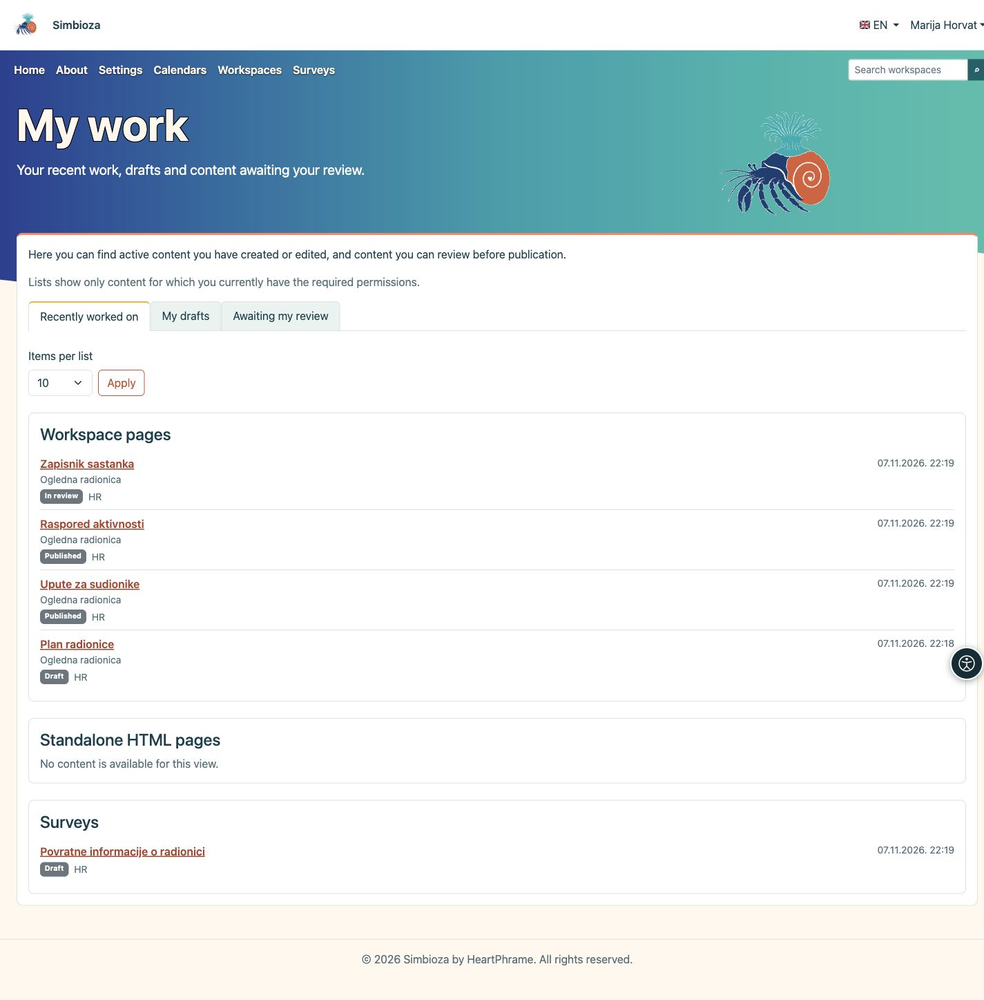

# Mon travail

> Les captures d’écran présentent l’interface en anglais.

**Objectif :** retrouver rapidement un contenu que vous avez modifié, reprendre un brouillon ou trouver un contenu à réviser avant sa publication.

## Ouvrir votre vue d’ensemble

1. Connectez-vous à Simbioza avec votre propre compte.
2. Ouvrez le menu du compte à côté de votre nom et sélectionnez **Mon travail**.
3. Choisissez l’une des trois vues décrites ci-dessous.

**Résultat :** vous accédez à vos listes de travail personnelles. L’ouverture de cette vue ne modifie ni la page d’accueil ni les paramètres des autres personnes.

<figure class="my-4">

<figcaption>Mon travail : choisissez le travail à reprendre, puis ouvrez le titre du contenu.</figcaption>
</figure>

## Choisir le travail à reprendre

| Vue | Contenu proposé |
| --- | --- |
| **Travail récent** | Les pages et enquêtes actives que vous avez créées ou modifiées. Votre dernière contribution reste enregistrée même si une autre personne modifie ensuite le même contenu. |
| **Mes brouillons** | Les contenus non publiés auxquels vous avez contribué. Ils peuvent inclure des pages ou enquêtes déjà envoyées en révision. L’étiquette à côté du titre indique leur état actuel. |
| **À réviser** | Les pages et enquêtes envoyées en révision que vos autorisations vous permettent de publier. Vous n’avez pas besoin d’en être l’auteur. |

Il s’agit d’un aperçu de votre travail sur les contenus, et non d’un historique des pages lues ou des enquêtes auxquelles vous avez répondu.

## Ouvrir un contenu

Les contenus sont répartis dans des cartes distinctes : **Pages des espaces de travail**, **Pages HTML autonomes** et **Enquêtes**, selon les fonctionnalités installées et activées. Les pages HTML autonomes ne disposent pas d’une file de révision distincte et n’apparaissent donc pas dans **À réviser**.

Chaque entrée indique son état, sa langue et sa date. Les pages des espaces de travail affichent également le nom de leur espace. Cliquez sur un **titre** pour ouvrir le contenu, puis poursuivez sa modification ou utilisez les actions de révision et de publication proposées. Ouvrir **Mon travail** ne publie rien.

## Ajuster la longueur des listes

1. Dans **Éléments par liste**, choisissez **10**, **25** ou **50**.
2. Cliquez sur **Appliquer**.
3. Pour afficher d’autres éléments, cliquez sur **Page suivante** dans la carte concernée. **Retour au début de la liste** ramène cette carte au début.

Chaque carte possède sa propre pagination. Changer le nombre d’éléments ou la vue ramène les listes au début.

## Si un élément manque

Seuls les contenus pour lesquels vous disposez actuellement des autorisations nécessaires sont affichés. Une contribution passée ne rétablit pas une autorisation retirée. Les contenus supprimés, archivés ou désactivés sont exclus ; une version publiée ne constitue pas un brouillon. Les nouvelles modifications non publiées d’une page ou enquête publiée figurent à nouveau parmi les brouillons.

Une liste vide peut être normale : vous n’avez peut-être encore rien modifié, ou aucun contenu n’attend votre révision. Si vous recherchez une entrée précise, vérifiez votre compte et demandez l’autorisation adaptée au responsable de l’espace de travail ou à l’administration.

Pour poursuivre, consultez [Modifier des pages](uredivanje-stranica_fr.md) ou [Créer des enquêtes](ankete-autori_fr.md). Gérez les informations de votre compte dans [Mon profil](osobni-profil_fr.md).

Pour les anciennes enquêtes, les données d’auteur existantes sont utilisées. Depuis l’ajout de cette vue, les modifications des collaborateurs et les validations reçoivent leur propre date ; les anciennes dates inconnues ne sont pas inventées. Si une liste ne peut pas être chargée entièrement, un message remplace une liste incomplète ou apparemment vide. Réessayez plus tard ou utilisez la recherche.
