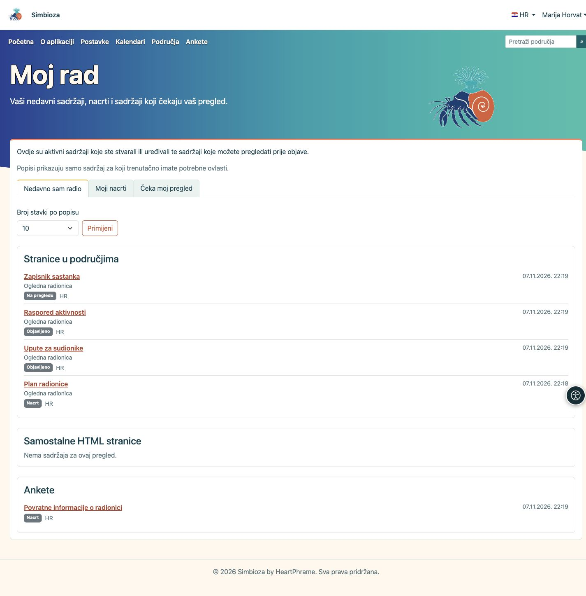

# Moj rad

**Cilj:** brzo se vratiti sadržaju koji ste uređivali, nastaviti nacrt ili pronaći sadržaj koji trebate pregledati prije objave.

## Otvorite svoj pregled

1. Prijavite se u Simbiozu svojim korisničkim računom.
2. Otvorite korisnički izbornik uz svoje ime i odaberite **Moj rad**.
3. Odaberite jedan od tri pregleda opisana u nastavku.

**Rezultat:** dobivate vlastite radne popise. Otvaranje ovog pregleda ne mijenja naslovnicu ni postavke drugim korisnicima.

<figure class="my-4">

<figcaption>Pregled Moj rad: odaberite što želite nastaviti, zatim otvorite naslov sadržaja.</figcaption>
</figure>

## Odaberite što želite nastaviti

| Pregled | Što ćete pronaći |
| --- | --- |
| **Nedavno sam radio** | Aktivne stranice i ankete koje ste stvarali ili uređivali. Posljednji vlastiti doprinos ostaje zabilježen i ako netko drugi poslije uredi isti sadržaj. |
| **Moji nacrti** | Neobjavljeni sadržaj kojem ste doprinosili. Ovdje mogu biti i stranice ili ankete koje ste već poslali na pregled. Oznaka uz naslov pokazuje trenutačni status. |
| **Čeka moj pregled** | Stranice i ankete poslane na pregled koje prema svojim ovlastima smijete objaviti. Ne moraju biti vaš vlastiti rad. |

To je pregled rada na sadržaju, a ne povijest pročitanih stranica ni popis anketa koje ste ispunili.

## Otvorite sadržaj

Sadržaj je raspoređen u zasebne kartice: **Stranice u područjima**, **Samostalne HTML stranice** i **Ankete**, ovisno o instaliranim i uključenim mogućnostima. Samostalne HTML stranice nemaju zaseban red za pregled pa se ne pojavljuju u pregledu **Čeka moj pregled**.

Uz naslov vidite status, jezik i datum. Za stranicu u području prikazuje se i naziv područja. Kliknite **naslov** da otvorite sadržaj, zatim nastavite uređivanje ili upotrijebite ponuđene radnje za pregled i objavu. Sam dolazak na **Moj rad** ništa ne objavljuje.

## Prilagodite duljinu popisa

1. U **Broj stavki po popisu** odaberite **10**, **25** ili **50**.
2. Kliknite **Primijeni**.
3. Za dodatne stavke kliknite **Sljedeća stranica** u željenoj kartici. **Na početak popisa** vraća tu karticu na početak.

Svaka kartica ima vlastito listanje. Promjena broja stavki ili vrste pregleda vraća popise na početak.

## Ako nešto nedostaje

Prikazuje se samo sadržaj za koji trenutačno imate potrebne ovlasti. Prethodno autorstvo ne vraća uklonjeno pravo pristupa. Obrisani, arhivirani ili isključeni sadržaji nisu na ovim popisima; objavljena verzija sama nije nacrt. Nove neobjavljene izmjene objavljene stranice ili ankete ponovno se pojavljuju među nacrtima.

Prazan popis može biti sasvim u redu: možda još niste uređivali sadržaj ili nemate ništa za pregled. Ako očekujete određenu stavku, provjerite svoj račun i zatražite odgovarajuće pravo od upravitelja područja ili administratora.

Za sljedeći korak pogledajte [Uređivanje stranica](uredivanje-stranica_hr.md) ili [Sastavljanje anketa](ankete-autori_hr.md). Podatke računa uređujete u [Mojem profilu](osobni-profil_hr.md).

Za starije ankete koriste se postojeći podatci o autorstvu. Izmjene suradnika i pregledi bilježe se s vlastitim vremenom od uvođenja ovog pregleda; nepoznata starija vremena ne izmišljaju se. Ako se popis ne može dovršiti, prikazuje se poruka umjesto nepotpunog ili prividno praznog popisa. Pokušajte kasnije ili koristite pretraživanje.
