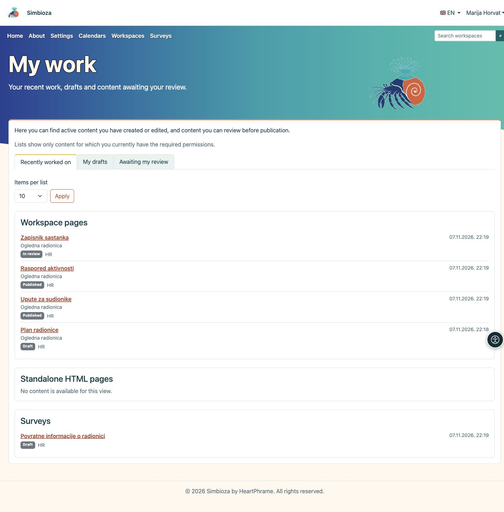

# Il mio lavoro

> Le schermate mostrano l’interfaccia in inglese.

**Obiettivo:** ritrovare rapidamente i contenuti che hai modificato, continuare una bozza o trovare contenuti da revisionare prima della pubblicazione.

## Apri la tua panoramica

1. Accedi a Simbioza con il tuo account utente.
2. Apri il menu dell’account accanto al tuo nome e seleziona **Il mio lavoro**.
3. Scegli una delle tre viste descritte di seguito.

**Risultato:** vengono mostrati i tuoi elenchi di lavoro personali. Aprire questa panoramica non cambia la pagina iniziale né le impostazioni degli altri utenti.

<figure class="my-4">

<figcaption>Il mio lavoro: scegli il lavoro da continuare, quindi apri il titolo del contenuto.</figcaption>
</figure>

## Scegli il lavoro da continuare

| Vista | Contenuti disponibili |
| --- | --- |
| **Lavoro recente** | Le pagine e i sondaggi attivi che hai creato o modificato. Il tuo ultimo contributo resta registrato anche se un’altra persona modifica in seguito lo stesso contenuto. |
| **Le mie bozze** | I contenuti non pubblicati a cui hai contribuito. Possono includere pagine o sondaggi già inviati in revisione. L’etichetta accanto al titolo mostra lo stato attuale. |
| **Da revisionare** | Le pagine e i sondaggi inviati in revisione che le tue autorizzazioni ti consentono di pubblicare. Non devono necessariamente essere contenuti creati da te. |

Questa è una panoramica del lavoro sui contenuti, non una cronologia delle pagine lette o un elenco dei sondaggi compilati.

## Apri un contenuto

I contenuti sono organizzati in schede separate: **Pagine degli spazi di lavoro**, **Pagine HTML autonome** e **Sondaggi**, in base alle funzionalità installate e attive. Le pagine HTML autonome non hanno una coda di revisione separata e quindi non compaiono in **Da revisionare**.

Ogni voce mostra stato, lingua e data. Per le pagine degli spazi di lavoro compare anche il nome dello spazio. Fai clic su un **titolo** per aprire il contenuto, quindi continua a modificarlo oppure usa le azioni disponibili per revisionarlo e pubblicarlo. Aprire **Il mio lavoro** non pubblica nulla.

## Regola la lunghezza degli elenchi

1. In **Elementi per elenco**, scegli **10**, **25** o **50**.
2. Fai clic su **Applica**.
3. Per vedere altre voci, fai clic su **Pagina successiva** nella scheda desiderata. **Torna all’inizio dell’elenco** riporta quella scheda alle prime voci.

Ogni scheda ha la propria paginazione. Cambiare il numero di elementi o la vista riporta gli elenchi all’inizio.

## Se manca qualcosa

Vengono mostrati solo i contenuti per i quali hai attualmente le autorizzazioni necessarie. Aver creato un contenuto non ripristina un’autorizzazione revocata. I contenuti eliminati, archiviati o disattivati sono esclusi; una versione pubblicata non è di per sé una bozza. Le nuove modifiche non pubblicate di una pagina o di un sondaggio già pubblicato ricompaiono tra le bozze.

Un elenco vuoto può essere normale: potresti non aver ancora modificato contenuti o non avere nulla da revisionare. Se ti aspetti una voce specifica, controlla il tuo account e chiedi l’autorizzazione appropriata a chi gestisce lo spazio di lavoro o a un amministratore.

Per continuare, consulta [Modificare le pagine](uredivanje-stranica_it.md) o [Creare i sondaggi](ankete-autori_it.md). Gestisci i dati del tuo account in [Il mio profilo](osobni-profil_it.md).

Per i sondaggi precedenti vengono usati i dati di paternità esistenti. Dall’introduzione di questo riepilogo le modifiche dei collaboratori e le revisioni registrano la propria data; non vengono inventate date precedenti sconosciute. Se non è possibile completare un elenco, compare un messaggio invece di un elenco incompleto o apparentemente vuoto. Riprova più tardi o usa la ricerca.
