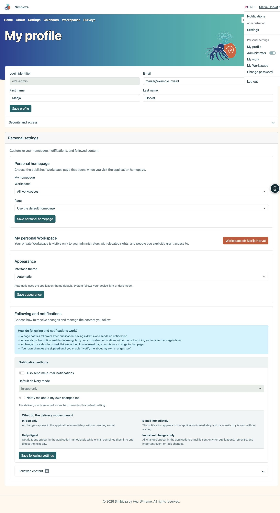
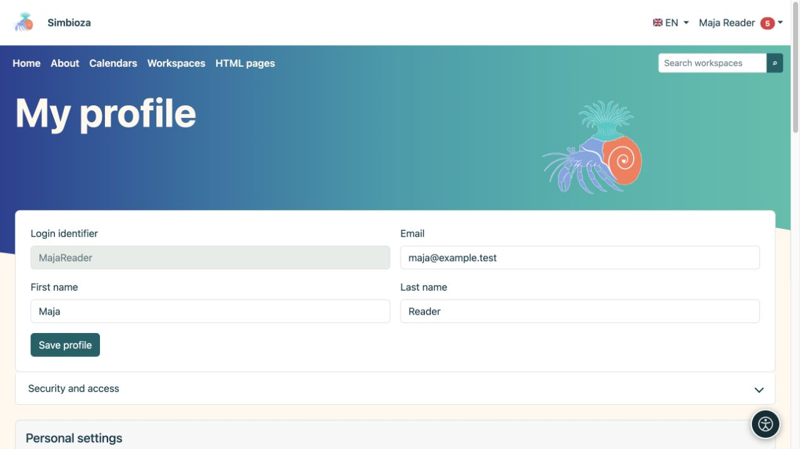

# Anmeldung und mein Profil

> Die Bildschirmaufnahmen zeigen die englische Benutzeroberfläche.

**Ziel:** Verwenden Sie Ihr eigenes Konto und passen Sie persönliche Daten an, ohne die gesamte Installation zu ändern.

## Möglichkeiten im Kontomenü

Klicken Sie nach der Anmeldung auf **Ihren Namen** in der Kopfzeile. Das Menü zeigt nur Einträge an, die Ihrem Konto in dieser Installation zur Verfügung stehen.

| Eintrag | Zweck |
| --- | --- |
| **Benachrichtigungen** | Öffnet Ihre Benachrichtigungen. Die Zahl am Eintrag zeigt ungelesene Benachrichtigungen an. |
| **Mein Profil** | Erlaubte persönliche Daten bearbeiten sowie Sicherheits- und persönliche Einstellungen öffnen. |
| **Meine Arbeit** | [Zuletzt bearbeitete Inhalte, Ihre Entwürfe und Inhalte zur Prüfung](moj-rad_de.md), entsprechend Ihren aktuellen Berechtigungen. |
| **Mein Arbeitsbereich** | Öffnet Ihren bestehenden persönlichen Arbeitsbereich, sofern verfügbar. |
| **Passwort ändern** | Ihr lokales Simbioza-Passwort ändern oder festlegen. |
| **Abmelden** | Beendet Ihre Anmeldung bei Simbioza. |

Der Abschnitt **Verwaltung** mit dem Link **Einstellungen** und der Schalter **Administrator** sind für Personen mit entsprechenden Administrationsrechten bestimmt. Sie gewähren gewöhnlichen Benutzern keine solchen Rechte. Wenn der Schalter angeboten wird, können berechtigte Personen damit vorübergehende Administrationsrechte über den angezeigten Ablauf aktivieren oder deaktivieren.

<figure class="my-4">

<figcaption>Die Einträge im Kontomenü hängen von Ihren Berechtigungen und den aktivierten Funktionen ab.</figcaption>
</figure>

## An- und abmelden

1. Wählen Sie im Kontomenü **Anmelden** oder folgen Sie der Anmeldeaktion auf einer geschützten Seite.
2. Geben Sie für ein lokales Konto Ihre **Anmeldekennung** und Ihr Passwort ein. Bei der Kennung handelt es sich nicht unbedingt um eine E-Mail-Adresse; Verwenden Sie den Ihnen zugewiesenen Wert.
3. Wählen Sie für ein externes Konto den angebotenen Anbieter aus und schließen Sie die Anmeldung ab. Wenden Sie sich an den Administrator, wenn der erwartete Anbieter nicht verfügbar ist.
4. Überprüfen Sie bei Ihrer Rückkehr den angezeigten Namen. Beenden Sie den Vorgang mit **Abmelden** auf einem gemeinsam genutzten Computer.

Wenn **Registrieren eines neuen lokalen Benutzerkontos** angeboten wird, können Sie die Registrierung abschließen. Der Administrator kontrolliert die Verfügbarkeit und Felder. Durch die Eingabe einer E-Mail-Adresse wird nicht automatisch der Besitz dieser Adresse bestätigt.

Die Anmeldung nur für eine [externe Umfrage](ankete-ispunjavanje_de.md) kann unabhängig von einem Simbioza-Konto erfolgen. Der Name eines Befragten stellt nicht automatisch ein Benutzerprofil oder eine Berechtigung zum Bearbeiten von Seiten dar.

## Bearbeiten Sie Ihre Daten

1. Öffnen Sie das Kontomenü → **Mein Profil**.
2. Ändern Sie die bearbeitbaren angezeigten Felder.
3. Wählen Sie **Profil speichern** und lesen Sie die Bestätigung.

**Ergebnis:** Erlaubte persönliche Änderungen werden gespeichert. Der Administrator verwaltet Gruppen, Kontostatus und Zugriffsrechte. Ein fehlendes oder gesperrtes Feld ist kein Grund, ein neues Konto zu erstellen.

<figure class="my-4">

<figcaption>Bearbeiten Sie Ihre verfügbaren Details im Profil. Das Speichern dieser Felder gewährt keinen Zugriff auf private Inhalte.</figcaption>
</figure>

## Sicherheit und Zugang

Öffnen Sie **Sicherheit und Zugriff** für Ihre Gruppen, Ihr lokales Passwort und verknüpfte externe Identitäten. Bei Passwortänderungen werden die verfügbaren Felder „Aktuelles Passwort“, „Neues Passwort“ und „Bestätigung“ verwendet. Ändern Sie ein temporäres lokales Passwort, wenn der Bildschirm dies erfordert.

Durch das Festlegen eines lokalen Passworts wird die lokale Webanmeldung nicht automatisch aktiviert. Es kann auch [CalDAV](kalendari-povezivanje_de.md#caldav) dienen. Geben Sie nicht das Passwort eines externen Anbieters als aktuelles lokales Passwort ein. Verknüpfen oder entkoppeln Sie Identitäten nur durch die angebotenen Aktionen und nach Lesebestätigung.

## Persönliche Homepage, Aussehen und Follower

Die verfügbaren Abschnitte hängen von den aktivierten Modulen ab:

- Ein persönlicher Homepage-Selektor bietet veröffentlichte Seiten an, auf die Sie zugreifen können, wobei der Administrator eine persönliche Auswahl ermöglicht.
- **Aussehen** kann „Automatisch“, „Hell“, „Dunkel“ und „System“ bieten. Eine global erzwungene Licht- oder Dunkelpolitik hat Vorrang, sodass eine persönliche Auswahl unter Umständen fehlt.
- **Mein persönlicher Arbeitsbereich** öffnet Ihren eigenen Bereich; Wenn die Selbsterstellung aktiviert ist, verwenden Sie die angebotene Erstellungsaktion.
- **Folgen und Benachrichtigungen** steuern, [was Sie verfolgen und wie Änderungen Sie erreichen](pracenje-obavijesti_de.md).

Der persönliche Auftritt überschreibt nicht jedermanns Design. Größeren Text und andere persönliche Hilfe finden Sie unter [Barrierefreiheit](pristupacnost_de.md).

## Sie können keine Inhalte öffnen

Überprüfen Sie das Konto und den genauen Link. Ein fehlendes Element kann auf eine nicht verfügbare Berechtigung, unveröffentlichten Inhalt oder eine Funktion hinweisen, die von dieser Installation nicht verwendet wird. Eine direkte URL gewährt keinen Zugriff und eine alte Benachrichtigung kann verlorene Berechtigungen nicht wiederherstellen. Senden Sie dem Arbeitsbereichs-Manager den Link und die erforderliche Aktion ohne Ihr Passwort.

Um eine andere Anwendung zu verbinden, fordern Sie über den genehmigten Prozess den entsprechenden [API-Zugriff](api-koristenje_de.md) an; für die normale Browsernutzung ist kein Schlüssel API erforderlich.
