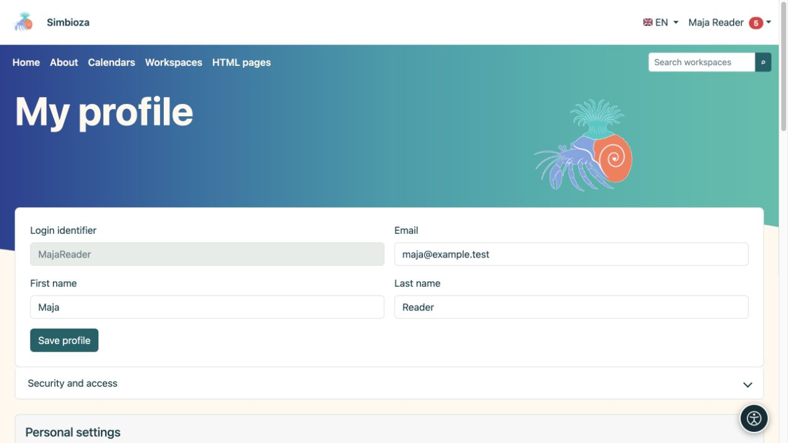

# Sign-in and my profile

**Goal:** use your own account and adjust personal details without changing the whole installation.

## Sign in and out

1. Choose **Sign in** in the account menu or follow the sign-in action on a protected page.
2. For a local account, enter your **Login identifier** and password. The identifier is not necessarily an email address; use the value assigned to you.
3. For an external account, select the offered provider and complete its sign-in. Contact the administrator if the expected provider is absent.
4. On return, check the displayed name. Finish with **Sign out** on a shared computer.

If **Register a new local user account** is offered, you may complete registration. The administrator controls its availability and fields. Entering an email address does not itself verify ownership of that address.

Signing in only for an [external survey](ankete-ispunjavanje_en.md) may be separate from a Simbioza account. A respondent's name does not automatically provide a user profile or permission to edit pages.

## Edit your details

1. Open the account menu → **My profile**.
2. Change the editable displayed fields.
3. Select **Save profile** and read the confirmation.

**Result:** permitted personal changes are saved. The administrator manages groups, account status and access rights. A missing or locked field is not a reason to create another account.

<figure class="my-4">

<figcaption>Edit your available details in the profile. Saving these fields does not grant access to private content.</figcaption>
</figure>

## Security and access

Open **Security and access** for your groups, local password and linked external identities. Password changes use the available current-password, new-password and confirmation fields. Change a temporary local password when the screen requires it.

Setting a local password does not itself enable local web sign-in. It may also serve [CalDAV](kalendari-povezivanje_en.md#caldav). Do not enter an external provider's password as the current local password. Link or unlink identities only through the offered actions and after reading confirmation.

## Personal home page, appearance and following

Available sections depend on enabled modules:

- A personal home-page selector offers published pages you may access, where the administrator allows personal selection.
- **Appearance** may offer Automatic, Light, Dark and System. A globally forced light or dark policy takes precedence, so personal selection may be absent.
- **My personal Workspace** opens your own space; if self-creation is enabled, use its offered creation action.
- **Following and notifications** controls [what you follow and how changes reach you](pracenje-obavijesti_en.md).

Personal appearance does not overwrite everyone's theme. For larger text and other personal assistance, see [Accessibility](pristupacnost_en.md).

## You cannot open content

Check the account and exact link. A missing item may mean unavailable permission, unpublished content or a feature not used by this installation. A direct URL grants no access, and an old notification cannot restore lost permission. Send the workspace manager the link and needed action without your password.

To connect another application, request the appropriate [API access](api-koristenje_en.md) through the approved process; ordinary browser use needs no API key.
